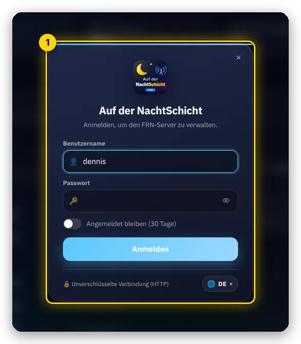
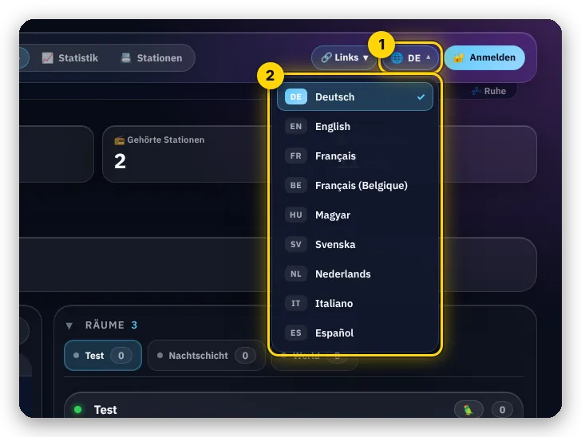
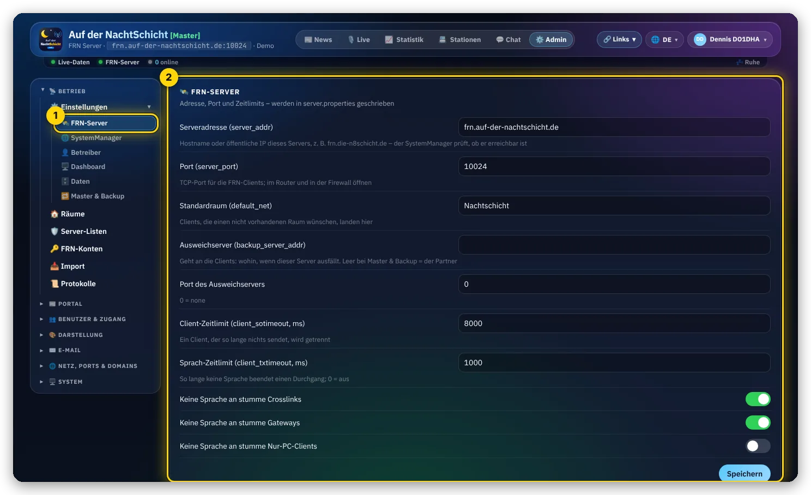
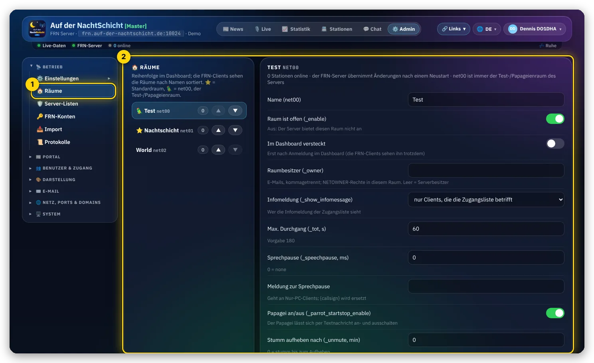
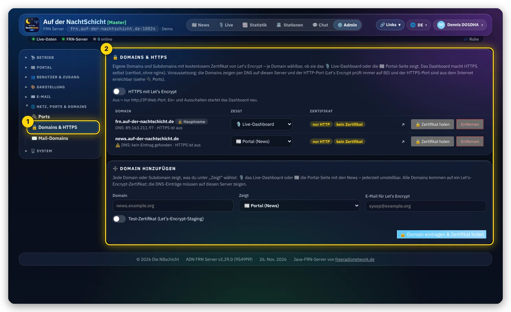
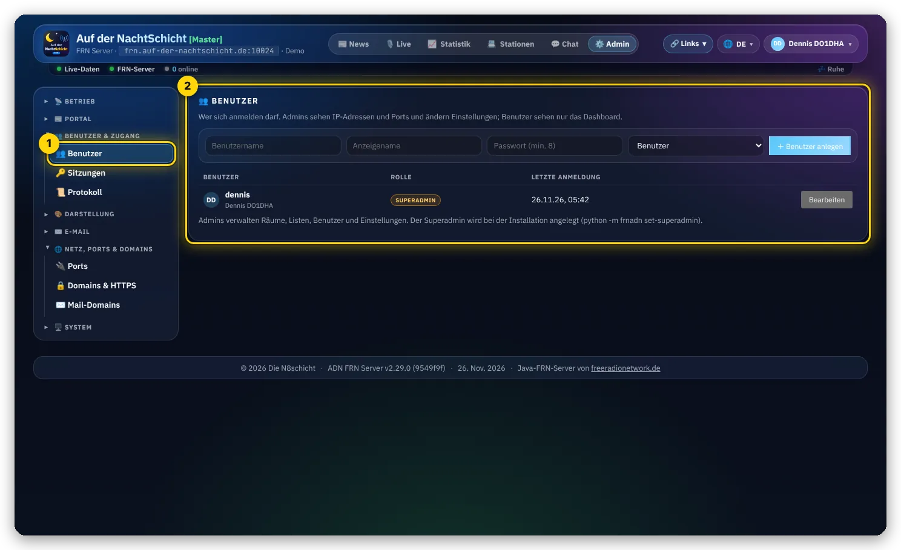
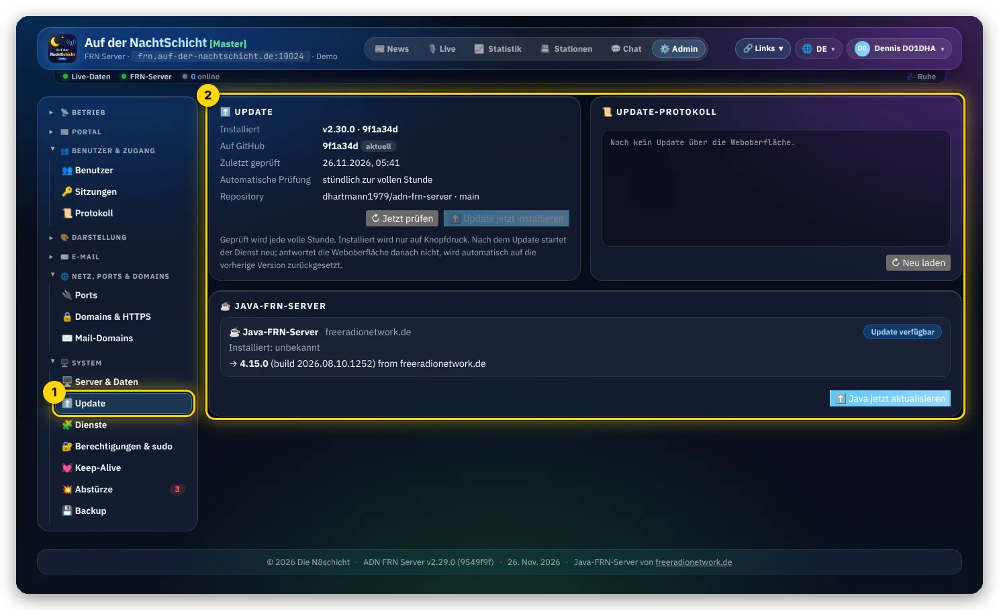
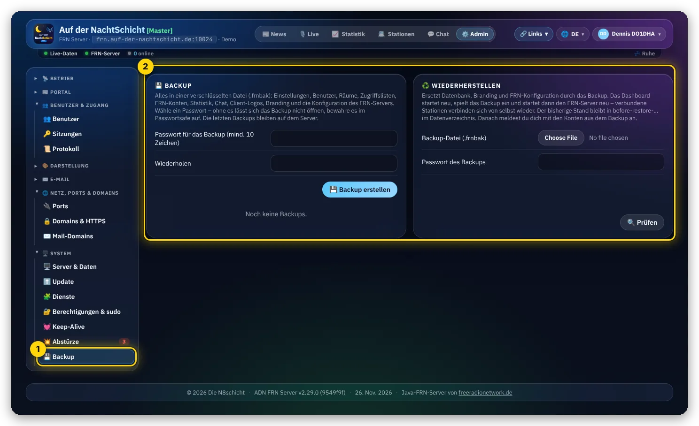

# 📘 ADN-FRN-Server – Schritt für Schritt

<sub>Sprache: **🇩🇪 Deutsch** · [🇬🇧 English](../en/README.md) · [🇫🇷 Français](../fr/README.md) · [🇧🇪 Français (Belgique)](../fr-BE/README.md) · [🇭🇺 Magyar](../hu/README.md) · [🇸🇪 Svenska](../sv/README.md) · [🇳🇱 Nederlands](../nl/README.md) · [🇮🇹 Italiano](../it/README.md) · [🇪🇸 Español](../es/README.md)</sub>

Der ADN-FRN-Server ist ein FreeRadioNetwork-Server mit Dashboard, Adminbereich, News-Portal und Mailserver. Diese Anleitung führt durch die ersten Schritte.

> 💡 Die gelben Ziffern im Bild gehören zu den Ziffern im Text.

## Inhalt

1. [Installieren](#1-installieren)
2. [Anmelden](#2-anmelden)
3. [Sprache wählen](#3-sprache-wählen)
4. [FRN-Server einrichten](#4-frn-server-einrichten)
5. [Räume anlegen](#5-räume-anlegen)
6. [Eigene Domain mit HTTPS](#6-eigene-domain-mit-https)
7. [Benutzer anlegen](#7-benutzer-anlegen)
8. [Aktualisieren](#8-aktualisieren)
9. [Sichern](#9-sichern)

## 1. Installieren

Auf einem Debian- oder Ubuntu-Server als Benutzer mit sudo-Rechten:

```bash
git clone https://github.com/dhartmann1979/adn-frn-server
cd adn-frn-server
sudo ./scripts/install.sh
```

Der Installer richtet Java, den FRN-Server, das Dashboard, die Dienste und die Rechte ein und fragt nach dem Superadmin. Danach ist das Dashboard unter `http://<server>:8080` erreichbar.

## 2. Anmelden

<p align="center"></p>

Oben rechts auf **🔐 Anmelden** klicken. Im Anmeldefenster ① Benutzername und Passwort eingeben; 👁 zeigt das Passwort, „Angemeldet bleiben“ spart die Anmeldung beim nächsten Mal. Nach fünf falschen Versuchen ist der Name für 15 Minuten gesperrt. Angemeldet erscheinen Avatar und Name ▾ mit Konto, Adminbereich und Abmelden.

## 3. Sprache wählen

<p align="center"></p>

Oben rechts öffnet **🌐 DE ▾** ① das Sprachmenü ② mit neun Sprachen. Die Wahl gilt sofort und für alle N8-Oberflächen auf diesem Server. Beim ersten Besuch gilt die Sprache des Browsers.

## 4. FRN-Server einrichten

<p align="center"></p>

Im Adminbereich unter **📡 Betrieb → ⚙️ Einstellungen → 🛰️ FRN-Server** ① stehen Adresse, Port und Zeitgrenzen des FRN-Servers ②. Unter **🌐 SystemManager** wählst du, ob der Server beim SystemManager angemeldet ist oder eigenständig läuft. Nach dem Speichern den FRN-Server neu starten.

## 5. Räume anlegen

<p align="center"></p>

Unter **🏠 Räume** ① legst du die Räume (Nets) an ②: Name, Emoji, Besitzer, wer senden darf und den Papagei-Echotest. Die Reihenfolge im Dashboard bestimmst du mit ▲ ▼. Der FRN-Server übernimmt Änderungen nach einem Neustart.

## 6. Eigene Domain mit HTTPS

<p align="center"></p>

Unter **🌐 Netz, Ports & Domains → 🔒 Domains & HTTPS** ① trägst du eine Domain ein, die per DNS auf den Server zeigt, dazu eine E-Mail-Adresse für Let’s Encrypt ②. Das Zertifikat wird geholt und automatisch erneuert. Ports 80 und 443 müssen aus dem Internet erreichbar sein.

## 7. Benutzer anlegen

<p align="center"></p>

Unter **👥 Benutzer & Zugang → Benutzer** ① legst du weitere Konten an und vergibst die Rolle ②. Admins sehen IP-Adressen und ändern Einstellungen, Benutzer sehen nur das Dashboard. Unter **Sitzungen** beendest du Anmeldungen, das **Protokoll** zeigt jede Änderung.

## 8. Aktualisieren

<p align="center"></p>

Unter **🖥️ System → ⬆️ Update** ① siehst du die installierte Version und ob GitHub eine neuere hat ②. **⬆️ Update jetzt installieren** lädt sie, prüft danach die Weboberfläche und stellt bei einem Fehler automatisch die vorherige Version wieder her. Ein Passwort ist dafür nicht nötig.

## 9. Sichern

<p align="center"></p>

Unter **🖥️ System → 💾 Backup** ① erstellst du eine verschlüsselte Sicherung aller Daten ② und spielst sie bei Bedarf wieder ein – auch auf einem neuen Server. Bewahre das Passwort der Sicherung gut auf: ohne es lässt sie sich nicht öffnen.

---

📖 Ausführliche Beschreibung (Deutsch): [docs/de/installation.md](../../../docs/de/installation.md)
