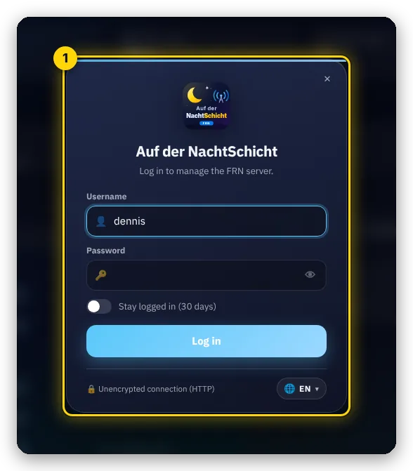
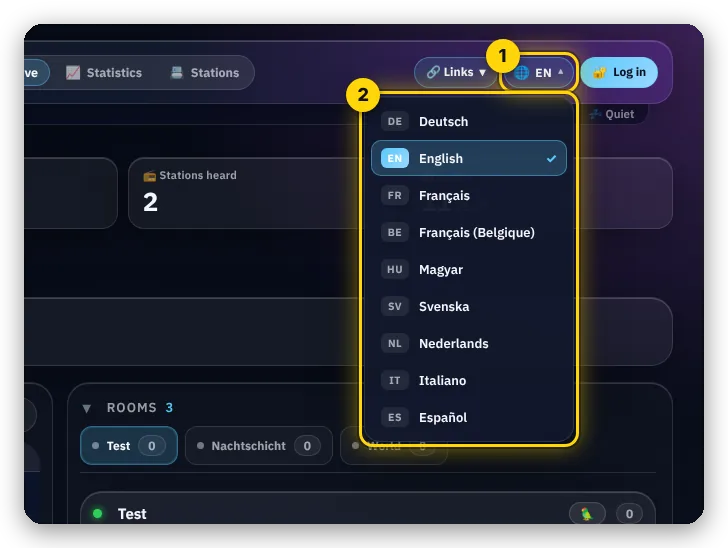
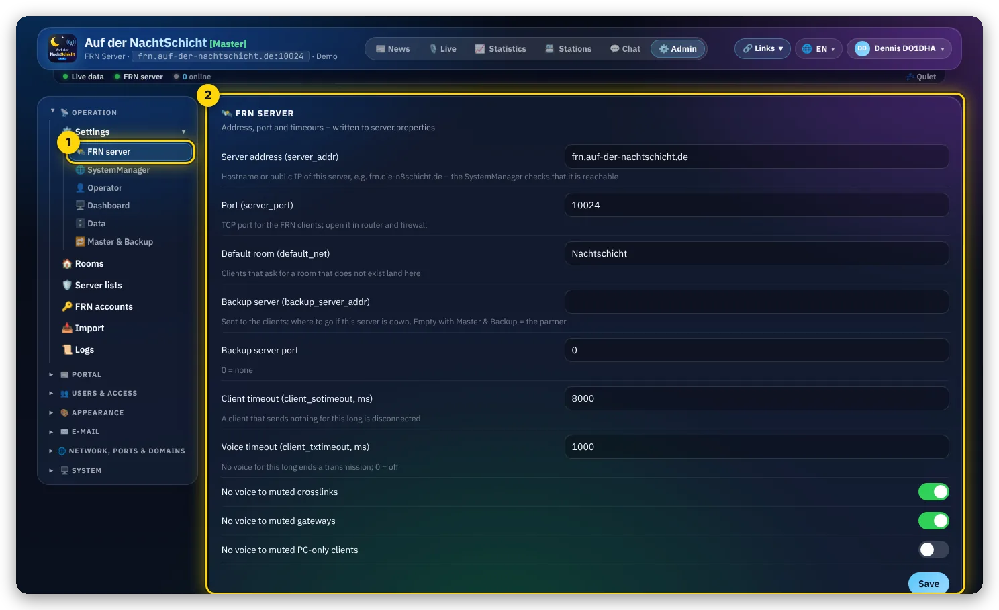
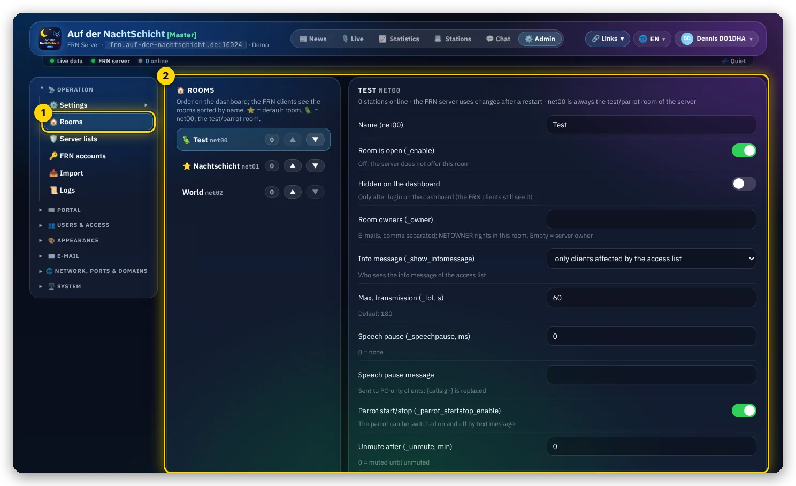
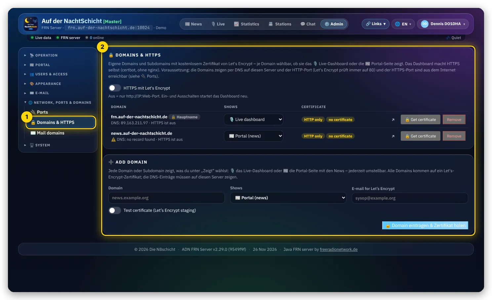
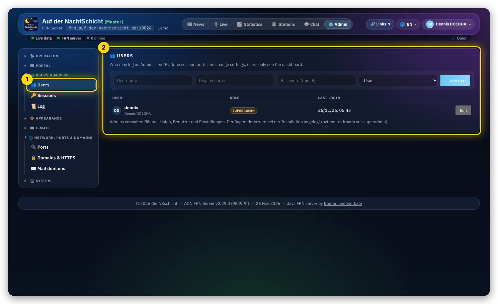
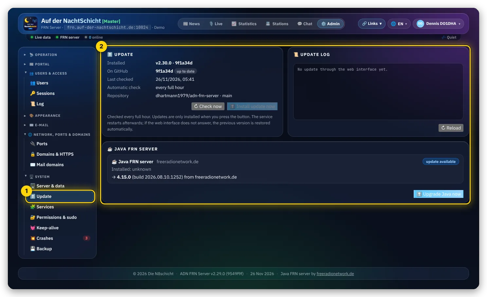
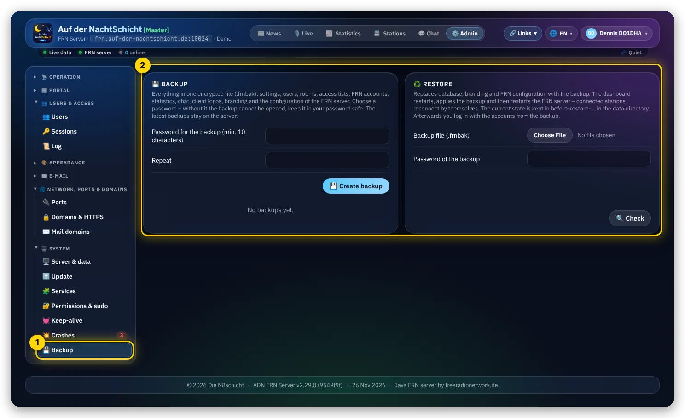

# 📘 ADN FRN Server – Step by step

<sub>Language: [🇩🇪 Deutsch](../de/README.md) · **🇬🇧 English** · [🇫🇷 Français](../fr/README.md) · [🇧🇪 Français (Belgique)](../fr-BE/README.md) · [🇭🇺 Magyar](../hu/README.md) · [🇸🇪 Svenska](../sv/README.md) · [🇳🇱 Nederlands](../nl/README.md) · [🇮🇹 Italiano](../it/README.md) · [🇪🇸 Español](../es/README.md)</sub>

The ADN FRN Server is a FreeRadioNetwork server with dashboard, admin area, news portal and mail server. This guide takes you through the first steps.

> 💡 The yellow numbers in the pictures belong to the numbers in the text.

## Contents

1. [Install](#1-install)
2. [Log in](#2-log-in)
3. [Choose the language](#3-choose-the-language)
4. [Set up the FRN server](#4-set-up-the-frn-server)
5. [Create rooms](#5-create-rooms)
6. [Own domain with HTTPS](#6-own-domain-with-https)
7. [Add users](#7-add-users)
8. [Update](#8-update)
9. [Back up](#9-back-up)

## 1. Install

On a Debian or Ubuntu server as a user with sudo rights:

```bash
git clone https://github.com/dhartmann1979/adn-frn-server
cd adn-frn-server
sudo ./scripts/install.sh
```

The installer sets up Java, the FRN server, the dashboard, the services and the permissions and asks for the superadmin. Afterwards the dashboard is at `http://<server>:8080`.

## 2. Log in

<p align="center"></p>

Click **🔐 Log in** at the top right. In the login window ① enter username and password; 👁 shows the password, “Stay logged in” saves the login next time. After five wrong attempts the name is locked for 15 minutes. Once logged in, avatar and name ▾ appear with account, admin area and log out.

## 3. Choose the language

<p align="center"></p>

At the top right, **🌐 EN ▾** ① opens the language menu ② with nine languages. The choice applies at once and to all N8 interfaces on this server. On the first visit the language of the browser is used.

## 4. Set up the FRN server

<p align="center"></p>

In the admin area under **📡 Operation → ⚙️ Settings → 🛰️ FRN server** ① you find address, port and time limits of the FRN server ②. Under **🌐 SystemManager** choose whether the server is registered at the SystemManager or runs stand-alone. Restart the FRN server after saving.

## 5. Create rooms

<p align="center"></p>

Under **🏠 Rooms** ① create the rooms (nets) ②: name, emoji, owners, who may transmit and the parrot echo test. Set the order on the dashboard with ▲ ▼. The FRN server takes over changes after a restart.

## 6. Own domain with HTTPS

<p align="center"></p>

Under **🌐 Network, ports & domains → 🔒 Domains & HTTPS** ① enter a domain that points to the server by DNS, plus an e-mail address for Let’s Encrypt ②. The certificate is fetched and renewed automatically. Ports 80 and 443 must be reachable from the internet.

## 7. Add users

<p align="center"></p>

Under **👥 Users & access → Users** ① add further accounts and give them a role ②. Admins see IP addresses and change settings, users only see the dashboard. Under **Sessions** you end logins, the **Log** shows every change.

## 8. Update

<p align="center"></p>

Under **🖥️ System → ⬆️ Update** ① you see the installed version and whether GitHub has a newer one ②. **⬆️ Install update now** downloads it, then checks the web interface and restores the previous version automatically if something goes wrong. No password is needed for this.

## 9. Back up

<p align="center"></p>

Under **🖥️ System → 💾 Backup** ① create an encrypted backup of all data ② and restore it when needed – also on a new server. Keep the backup password safe: without it the backup cannot be opened.

---

📖 Detailed description (German): [docs/de/installation.md](../../../docs/de/installation.md)
