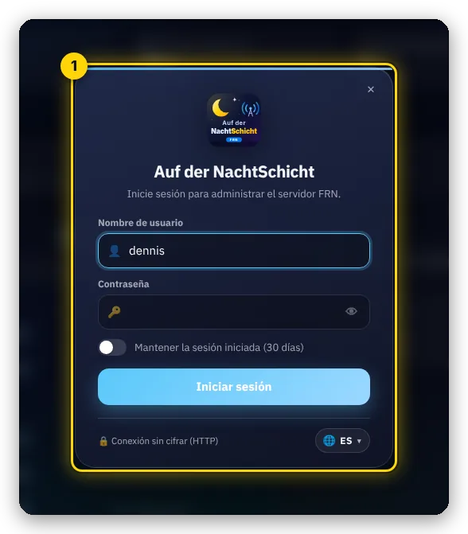
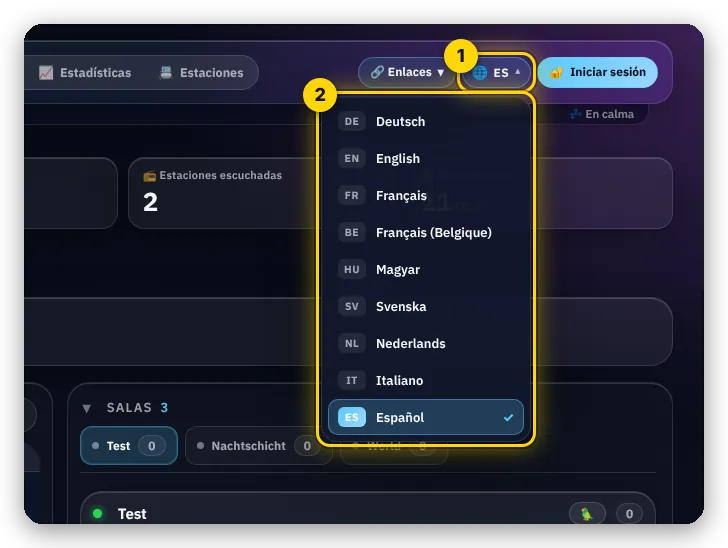
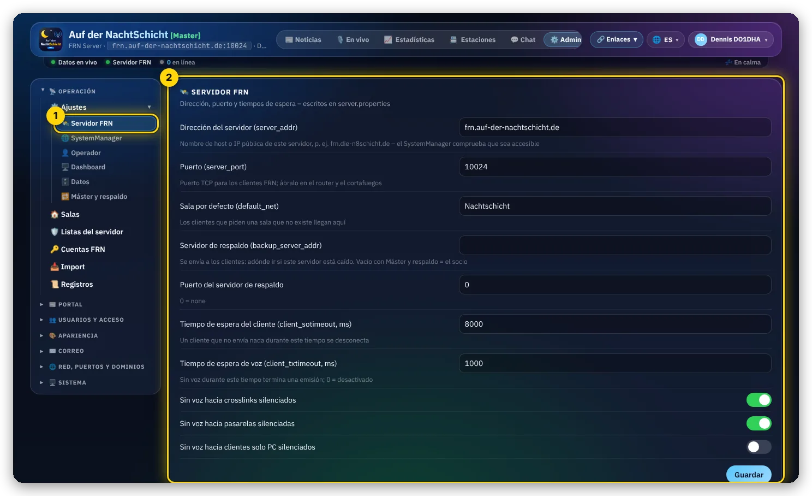
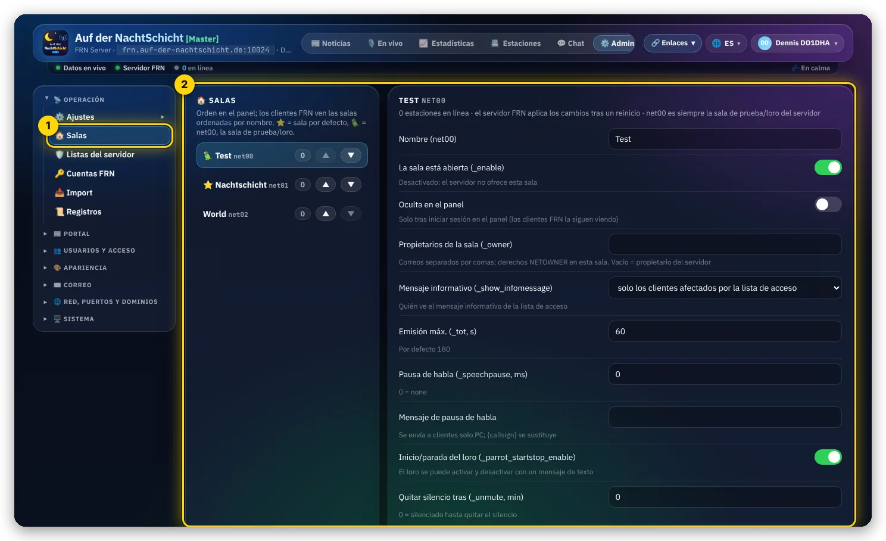
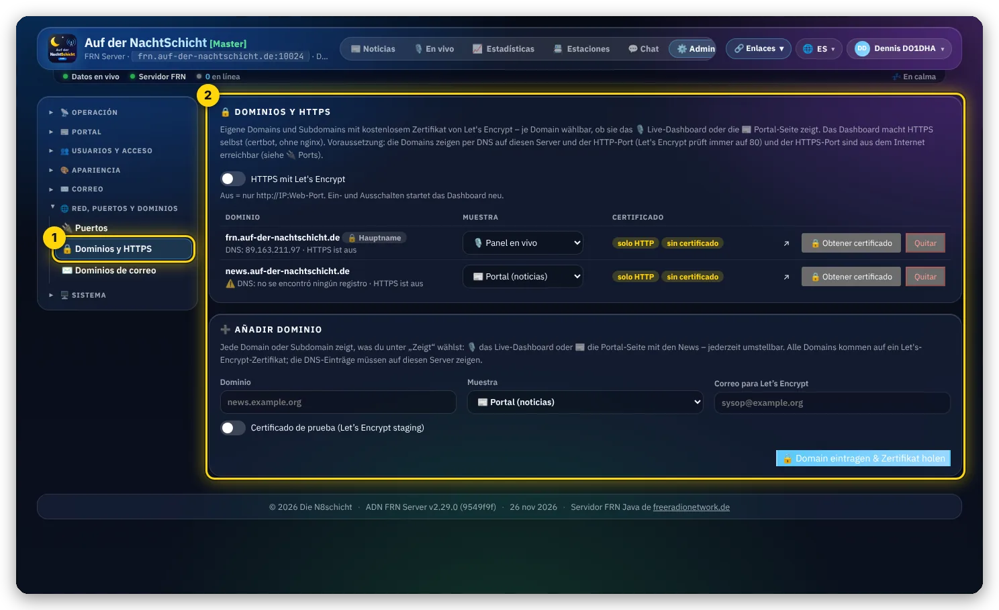
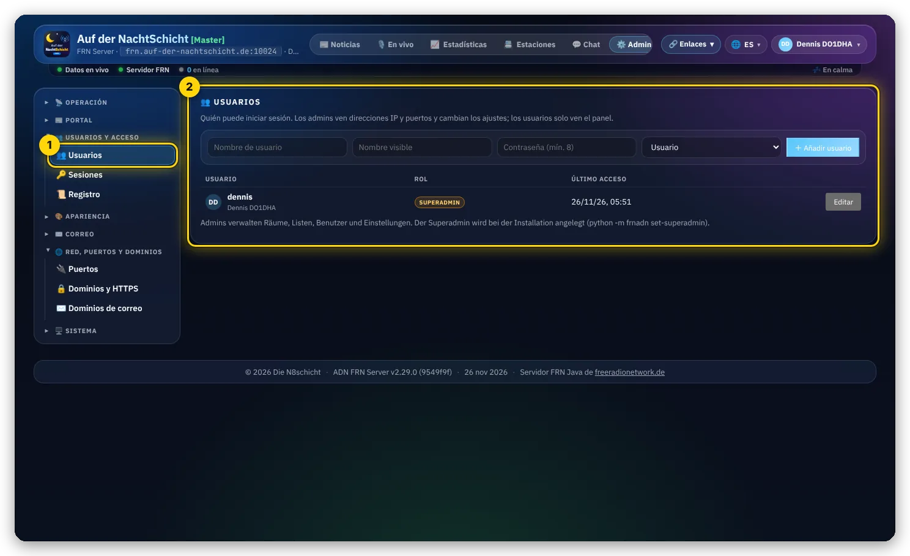
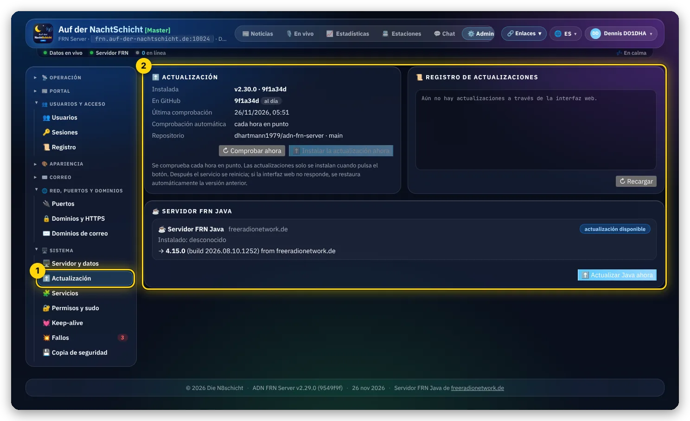
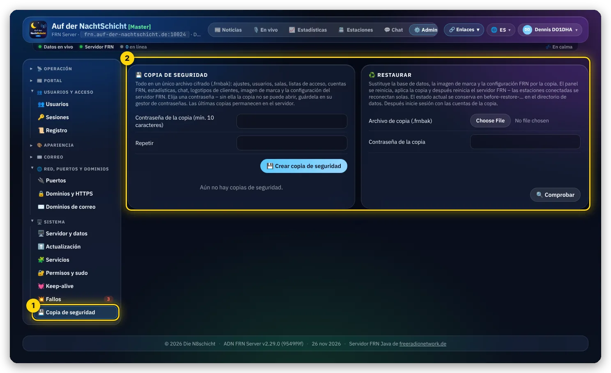

# 📘 ADN FRN Server – Paso a paso

<sub>Idioma: [🇩🇪 Deutsch](../de/README.md) · [🇬🇧 English](../en/README.md) · [🇫🇷 Français](../fr/README.md) · [🇧🇪 Français (Belgique)](../fr-BE/README.md) · [🇭🇺 Magyar](../hu/README.md) · [🇸🇪 Svenska](../sv/README.md) · [🇳🇱 Nederlands](../nl/README.md) · [🇮🇹 Italiano](../it/README.md) · **🇪🇸 Español**</sub>

ADN FRN Server es un servidor FreeRadioNetwork con panel, área de administración, portal de noticias y servidor de correo. Esta guía le acompaña en los primeros pasos.

> 💡 Los números amarillos de las imágenes corresponden a los números del texto.

## Contenido

1. [Instalar](#1-instalar)
2. [Iniciar sesión](#2-iniciar-sesión)
3. [Elegir el idioma](#3-elegir-el-idioma)
4. [Configurar el servidor FRN](#4-configurar-el-servidor-frn)
5. [Crear salas](#5-crear-salas)
6. [Dominio propio con HTTPS](#6-dominio-propio-con-https)
7. [Añadir usuarios](#7-añadir-usuarios)
8. [Actualizar](#8-actualizar)
9. [Hacer una copia de seguridad](#9-hacer-una-copia-de-seguridad)

## 1. Instalar

En un servidor Debian o Ubuntu como usuario con derechos sudo:

```bash
git clone https://github.com/dhartmann1979/adn-frn-server
cd adn-frn-server
sudo ./scripts/install.sh
```

El instalador configura Java, el servidor FRN, el panel, los servicios y los permisos y pide el superadmin. Después el panel está en `http://<servidor>:8080`.

## 2. Iniciar sesión

<p align="center"></p>

Haga clic en **🔐 Iniciar sesión** arriba a la derecha. En la ventana de inicio de sesión ① introduzca nombre de usuario y contraseña; 👁 muestra la contraseña, «Mantener la sesión iniciada» evita iniciar sesión la próxima vez. Tras cinco intentos fallidos el nombre se bloquea 15 minutos. Con la sesión iniciada aparecen avatar y nombre ▾ con cuenta, área de administración y cerrar sesión.

## 3. Elegir el idioma

<p align="center"></p>

Arriba a la derecha, **🌐 ES ▾** ① abre el menú de idiomas ② con nueve idiomas. La elección se aplica al instante y a todas las interfaces N8 de este servidor. En la primera visita se usa el idioma del navegador.

## 4. Configurar el servidor FRN

<p align="center"></p>

En el área de administración, en **📡 Operación → ⚙️ Ajustes → 🛰️ Servidor FRN** ①, están la dirección, el puerto y los tiempos de espera del servidor FRN ②. En **🌐 SystemManager** elija si el servidor está registrado en el SystemManager o funciona de forma autónoma. Tras guardar, reinicie el servidor FRN.

## 5. Crear salas

<p align="center"></p>

En **🏠 Salas** ① cree las salas (nets) ②: nombre, emoji, propietarios, quién puede emitir y la prueba de eco del loro. El orden en el panel se ajusta con ▲ ▼. El servidor FRN aplica los cambios tras un reinicio.

## 6. Dominio propio con HTTPS

<p align="center"></p>

En **🌐 Red, puertos y dominios → 🔒 Dominios y HTTPS** ① introduzca un dominio que apunte al servidor por DNS y una dirección de correo para Let’s Encrypt ②. El certificado se obtiene y se renueva automáticamente. Los puertos 80 y 443 deben ser accesibles desde Internet.

## 7. Añadir usuarios

<p align="center"></p>

En **👥 Usuarios y acceso → Usuarios** ① añada más cuentas y asígneles un rol ②. Los admins ven las direcciones IP y cambian los ajustes, los usuarios solo ven el panel. En **Sesiones** termina accesos, el **Registro** muestra cada cambio.

## 8. Actualizar

<p align="center"></p>

En **🖥️ Sistema → ⬆️ Actualización** ① ve la versión instalada y si GitHub tiene una más reciente ②. **⬆️ Instalar la actualización ahora** la descarga, comprueba después la interfaz web y, si algo falla, restaura automáticamente la versión anterior. No hace falta contraseña.

## 9. Hacer una copia de seguridad

<p align="center"></p>

En **🖥️ Sistema → 💾 Copia de seguridad** ① cree una copia cifrada de todos los datos ② y restáurela cuando haga falta – también en un servidor nuevo. Guarde bien la contraseña de la copia: sin ella no se puede abrir.

---

📖 Descripción detallada (alemán): [docs/de/installation.md](../../../docs/de/installation.md)
