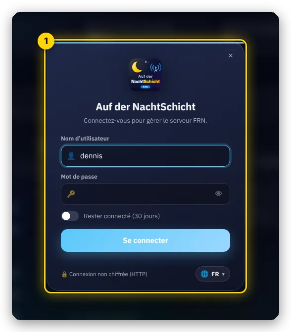
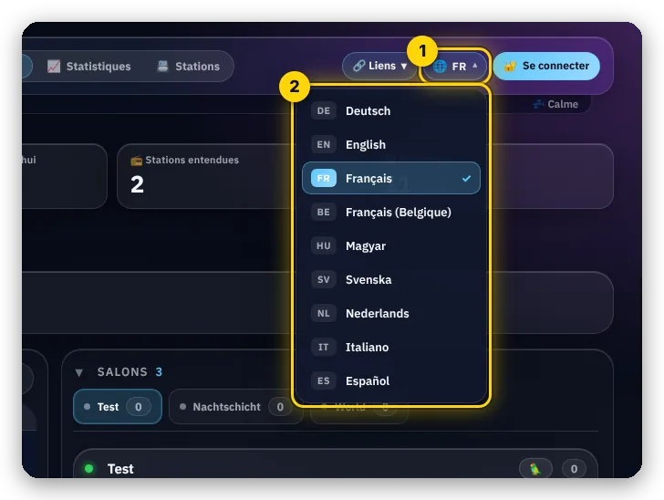
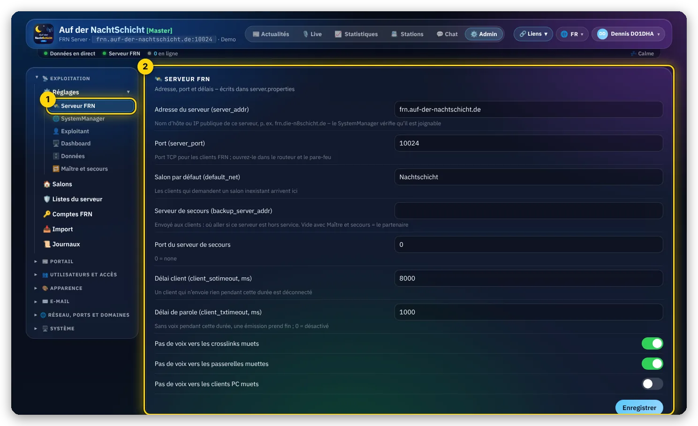
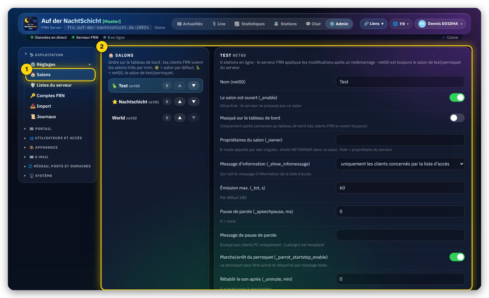
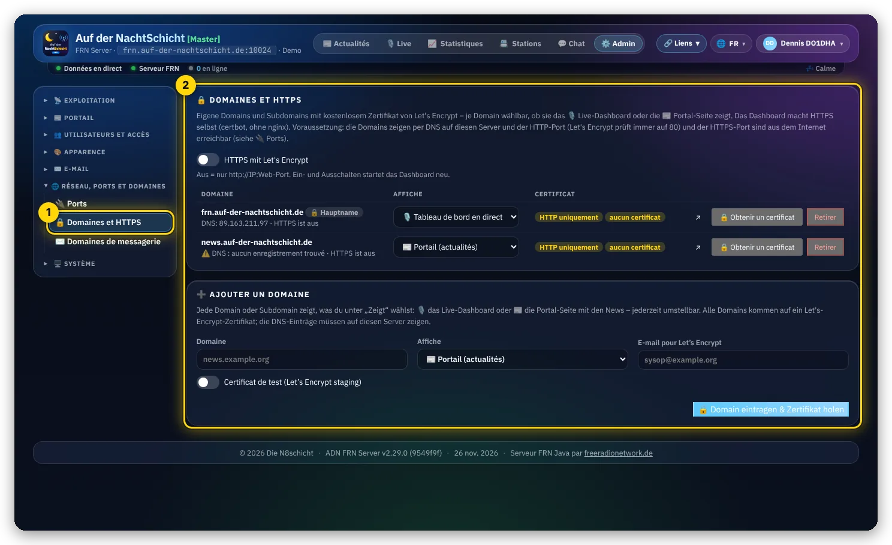
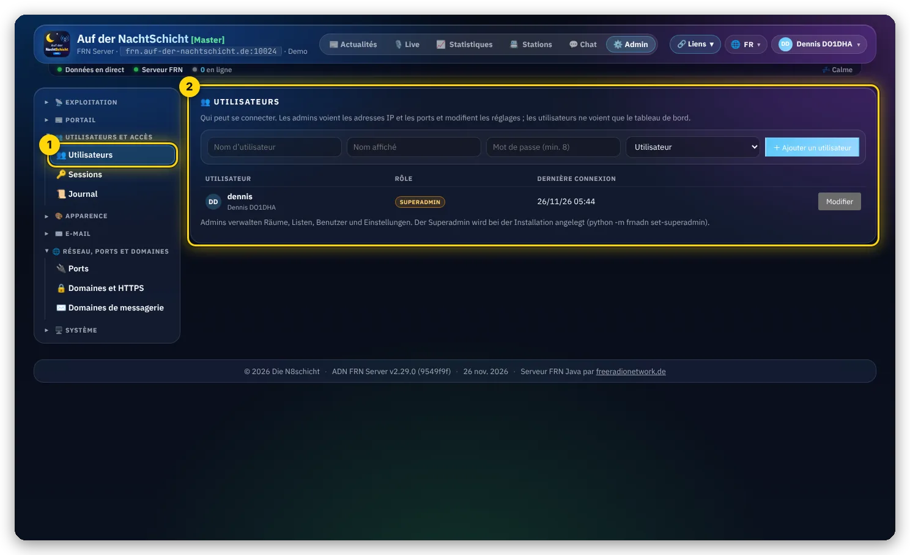
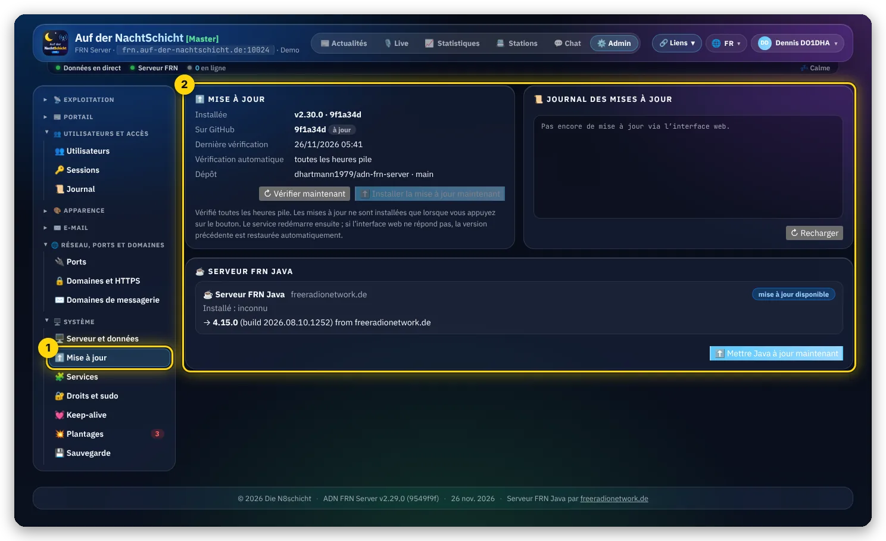
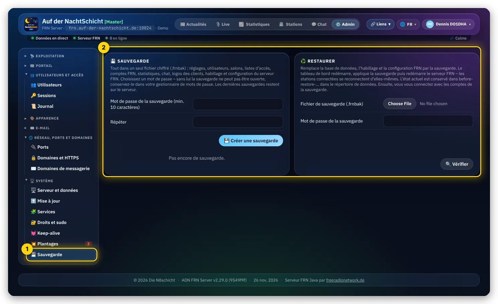

# 📘 ADN FRN Server – Pas à pas

<sub>Langue: [🇩🇪 Deutsch](../de/README.md) · [🇬🇧 English](../en/README.md) · **🇫🇷 Français** · [🇧🇪 Français (Belgique)](../fr-BE/README.md) · [🇭🇺 Magyar](../hu/README.md) · [🇸🇪 Svenska](../sv/README.md) · [🇳🇱 Nederlands](../nl/README.md) · [🇮🇹 Italiano](../it/README.md) · [🇪🇸 Español](../es/README.md)</sub>

L’ADN FRN Server est un serveur FreeRadioNetwork avec tableau de bord, espace admin, portail d’actualités et serveur de messagerie. Ce guide vous accompagne dans les premières étapes.

> 💡 Les chiffres jaunes des images correspondent aux chiffres du texte.

## Sommaire

1. [Installer](#1-installer)
2. [Se connecter](#2-se-connecter)
3. [Choisir la langue](#3-choisir-la-langue)
4. [Configurer le serveur FRN](#4-configurer-le-serveur-frn)
5. [Créer des salons](#5-créer-des-salons)
6. [Domaine propre avec HTTPS](#6-domaine-propre-avec-https)
7. [Ajouter des utilisateurs](#7-ajouter-des-utilisateurs)
8. [Mettre à jour](#8-mettre-à-jour)
9. [Sauvegarder](#9-sauvegarder)

## 1. Installer

Sur un serveur Debian ou Ubuntu, en tant qu’utilisateur disposant des droits sudo :

```bash
git clone https://github.com/dhartmann1979/adn-frn-server
cd adn-frn-server
sudo ./scripts/install.sh
```

L’installateur configure Java, le serveur FRN, le tableau de bord, les services et les droits, puis demande le superadmin. Ensuite, le tableau de bord est accessible sous `http://<serveur>:8080`.

## 2. Se connecter

<p align="center"></p>

Cliquez sur **🔐 Se connecter** en haut à droite. Dans la fenêtre de connexion ①, saisissez le nom d’utilisateur et le mot de passe ; 👁 affiche le mot de passe, « Rester connecté » évite de se reconnecter la prochaine fois. Après cinq tentatives erronées, le nom est bloqué pendant 15 minutes. Une fois connecté, l’avatar et le nom ▾ apparaissent avec le compte, l’espace admin et la déconnexion.

## 3. Choisir la langue

<p align="center"></p>

En haut à droite, **🌐 FR ▾** ① ouvre le menu des langues ② avec neuf langues. Le choix s’applique immédiatement et à toutes les interfaces N8 de ce serveur. Lors de la première visite, la langue du navigateur est utilisée.

## 4. Configurer le serveur FRN

<p align="center"></p>

Dans l’espace admin, sous **📡 Exploitation → ⚙️ Réglages → 🛰️ Serveur FRN** ①, se trouvent l’adresse, le port et les délais du serveur FRN ②. Sous **🌐 SystemManager**, choisissez si le serveur est enregistré auprès du SystemManager ou fonctionne de manière autonome. Redémarrez le serveur FRN après l’enregistrement.

## 5. Créer des salons

<p align="center"></p>

Sous **🏠 Salons** ①, créez les salons (nets) ② : nom, emoji, propriétaires, qui peut émettre et le test d’écho perroquet. L’ordre sur le tableau de bord se règle avec ▲ ▼. Le serveur FRN applique les modifications après un redémarrage.

## 6. Domaine propre avec HTTPS

<p align="center"></p>

Sous **🌐 Réseau, ports et domaines → 🔒 Domaines et HTTPS** ①, saisissez un domaine qui pointe vers le serveur par DNS, ainsi qu’une adresse e-mail pour Let’s Encrypt ②. Le certificat est obtenu et renouvelé automatiquement. Les ports 80 et 443 doivent être joignables depuis Internet.

## 7. Ajouter des utilisateurs

<p align="center"></p>

Sous **👥 Utilisateurs et accès → Utilisateurs** ①, ajoutez d’autres comptes et attribuez-leur un rôle ②. Les admins voient les adresses IP et modifient les réglages, les utilisateurs ne voient que le tableau de bord. Sous **Sessions**, vous terminez des connexions ; le **Journal** affiche chaque modification.

## 8. Mettre à jour

<p align="center"></p>

Sous **🖥️ Système → ⬆️ Mise à jour** ①, vous voyez la version installée et si GitHub en propose une plus récente ②. **⬆️ Installer la mise à jour maintenant** la télécharge, vérifie ensuite l’interface web et restaure automatiquement la version précédente en cas de problème. Aucun mot de passe n’est nécessaire.

## 9. Sauvegarder

<p align="center"></p>

Sous **🖥️ Système → 💾 Sauvegarde** ①, créez une sauvegarde chiffrée de toutes les données ② et restaurez-la au besoin – y compris sur un nouveau serveur. Conservez bien le mot de passe de la sauvegarde : sans lui, elle ne peut pas être ouverte.

---

📖 Description détaillée (allemand): [docs/de/installation.md](../../../docs/de/installation.md)
