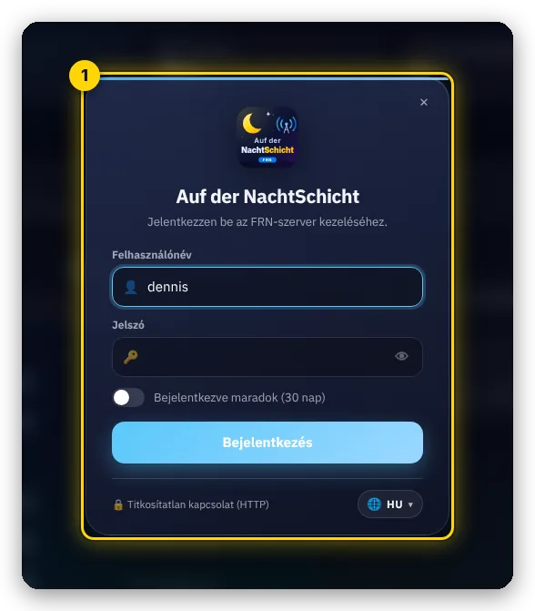
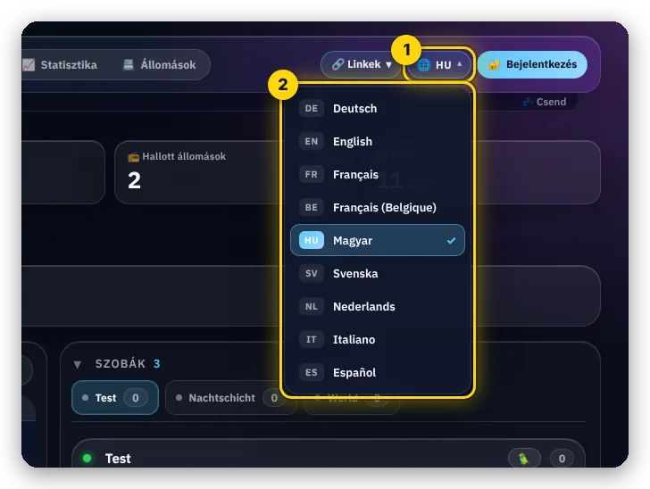
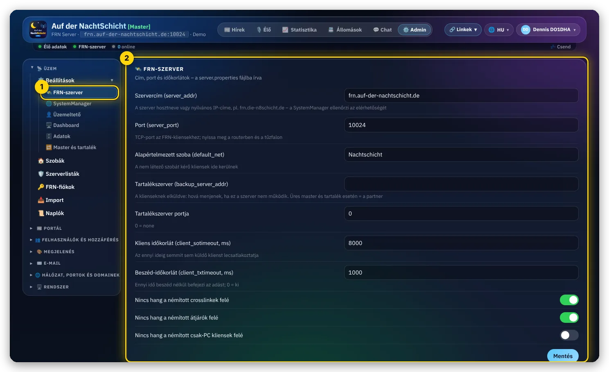
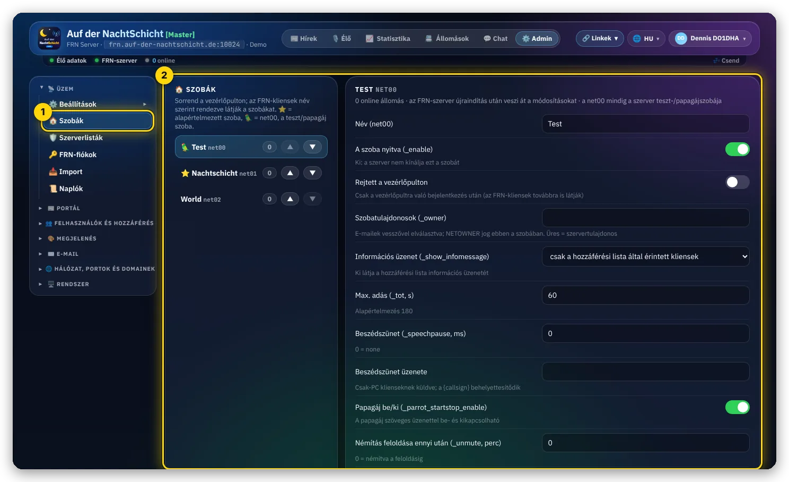
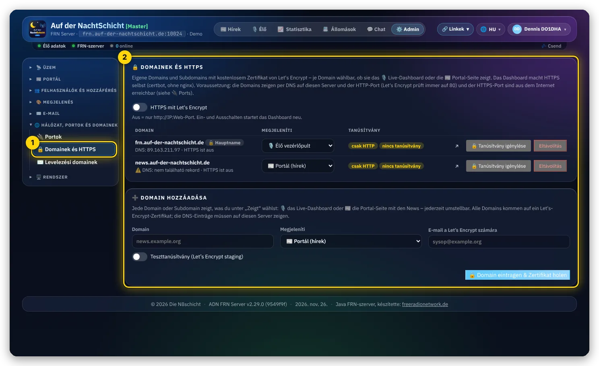
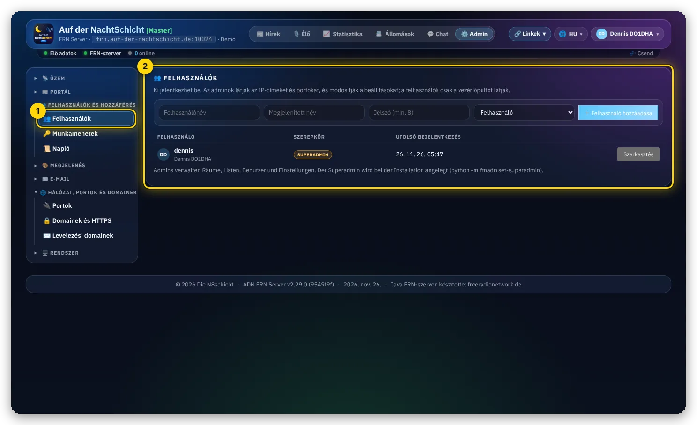
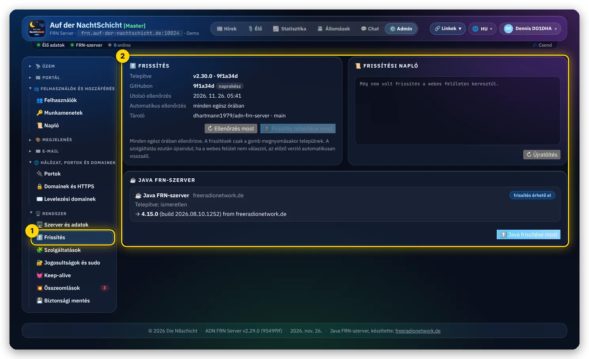
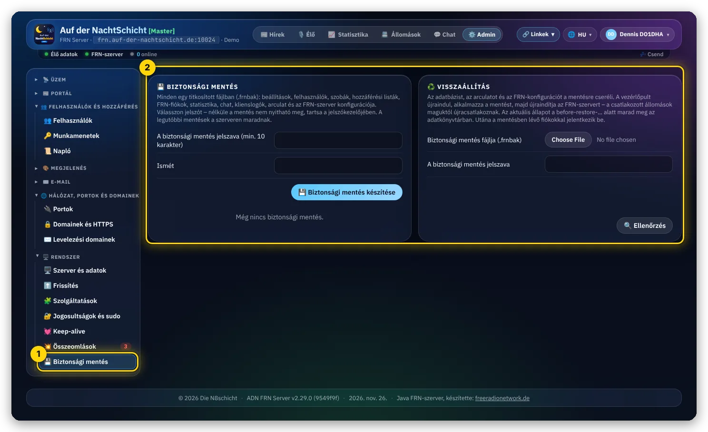

# 📘 ADN FRN Server – Lépésről lépésre

<sub>Nyelv: [🇩🇪 Deutsch](../de/README.md) · [🇬🇧 English](../en/README.md) · [🇫🇷 Français](../fr/README.md) · [🇧🇪 Français (Belgique)](../fr-BE/README.md) · **🇭🇺 Magyar** · [🇸🇪 Svenska](../sv/README.md) · [🇳🇱 Nederlands](../nl/README.md) · [🇮🇹 Italiano](../it/README.md) · [🇪🇸 Español](../es/README.md)</sub>

Az ADN FRN Server egy FreeRadioNetwork-szerver vezérlőpulttal, admin területtel, hírportállal és levelezőszerverrel. Ez az útmutató végigvezet az első lépéseken.

> 💡 A képeken lévő sárga számok a szövegben szereplő számokhoz tartoznak.

## Tartalom

1. [Telepítés](#1-telepítés)
2. [Bejelentkezés](#2-bejelentkezés)
3. [Nyelv kiválasztása](#3-nyelv-kiválasztása)
4. [Az FRN-szerver beállítása](#4-az-frn-szerver-beállítása)
5. [Szobák létrehozása](#5-szobák-létrehozása)
6. [Saját domain HTTPS-sel](#6-saját-domain-https-sel)
7. [Felhasználók hozzáadása](#7-felhasználók-hozzáadása)
8. [Frissítés](#8-frissítés)
9. [Biztonsági mentés](#9-biztonsági-mentés)

## 1. Telepítés

Debian vagy Ubuntu szerveren, sudo-jogosultságú felhasználóként:

```bash
git clone https://github.com/dhartmann1979/adn-frn-server
cd adn-frn-server
sudo ./scripts/install.sh
```

A telepítő beállítja a Javát, az FRN-szervert, a vezérlőpultot, a szolgáltatásokat és a jogosultságokat, majd bekéri a superadmint. Utána a vezérlőpult itt érhető el: `http://<szerver>:8080`.

## 2. Bejelentkezés

<p align="center"></p>

Kattintson jobbra fent a **🔐 Bejelentkezés** gombra. A bejelentkezési ablakban ① adja meg a felhasználónevet és a jelszót; a 👁 megmutatja a jelszót, a „Bejelentkezve maradok” megspórolja a következő bejelentkezést. Öt hibás próbálkozás után a név 15 percre zárolódik. Bejelentkezve megjelenik az avatar és a név ▾ a fiókkal, az admin területtel és a kijelentkezéssel.

## 3. Nyelv kiválasztása

<p align="center"></p>

Jobbra fent a **🌐 HU ▾** ① megnyitja a nyelvi menüt ② kilenc nyelvvel. A választás azonnal érvényes, és a szerver összes N8-felületére vonatkozik. Az első látogatáskor a böngésző nyelve érvényes.

## 4. Az FRN-szerver beállítása

<p align="center"></p>

Az admin területen az **📡 Üzem → ⚙️ Beállítások → 🛰️ FRN-szerver** alatt ① található az FRN-szerver címe, portja és időkorlátai ②. A **🌐 SystemManager** alatt választhatja ki, hogy a szerver regisztrálva legyen a SystemManagernél, vagy önállóan fusson. Mentés után indítsa újra az FRN-szervert.

## 5. Szobák létrehozása

<p align="center"></p>

A **🏠 Szobák** alatt ① hozza létre a szobákat (neteket) ②: név, emoji, tulajdonosok, ki adhat, és a papagáj visszhangteszt. A sorrendet a vezérlőpulton a ▲ ▼ gombokkal állíthatja be. Az FRN-szerver újraindítás után veszi át a módosításokat.

## 6. Saját domain HTTPS-sel

<p align="center"></p>

A **🌐 Hálózat, portok és domainek → 🔒 Domainek és HTTPS** alatt ① adjon meg egy domaint, amely DNS-sel a szerverre mutat, valamint egy e-mail-címet a Let’s Encrypt számára ②. A tanúsítvány beszerzése és megújítása automatikus. A 80-as és 443-as portnak elérhetőnek kell lennie az internetről.

## 7. Felhasználók hozzáadása

<p align="center"></p>

A **👥 Felhasználók és hozzáférés → Felhasználók** alatt ① további fiókokat hozhat létre, és szerepkört adhat nekik ②. Az adminok látják az IP-címeket és módosítják a beállításokat, a felhasználók csak a vezérlőpultot látják. A **Munkamenetek** alatt bejelentkezéseket fejezhet be, a **Napló** minden változást mutat.

## 8. Frissítés

<p align="center"></p>

A **🖥️ Rendszer → ⬆️ Frissítés** alatt ① látja a telepített verziót, és hogy van-e újabb a GitHubon ②. A **⬆️ Frissítés telepítése most** letölti, majd ellenőrzi a webes felületet, és hiba esetén automatikusan visszaállítja az előző verziót. Ehhez nem kell jelszó.

## 9. Biztonsági mentés

<p align="center"></p>

A **🖥️ Rendszer → 💾 Biztonsági mentés** alatt ① titkosított mentést készíthet minden adatról ②, és szükség esetén visszaállíthatja – új szerveren is. Őrizze meg jól a mentés jelszavát: nélküle a mentés nem nyitható meg.

---

📖 Részletes leírás (német): [docs/de/installation.md](../../../docs/de/installation.md)
