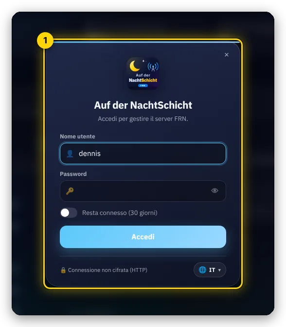
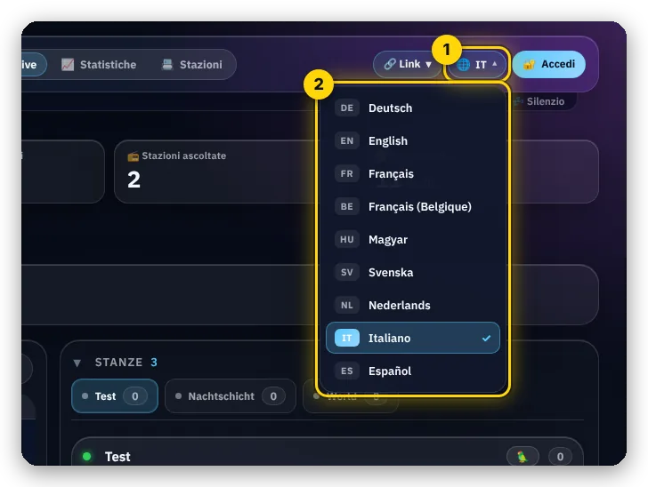
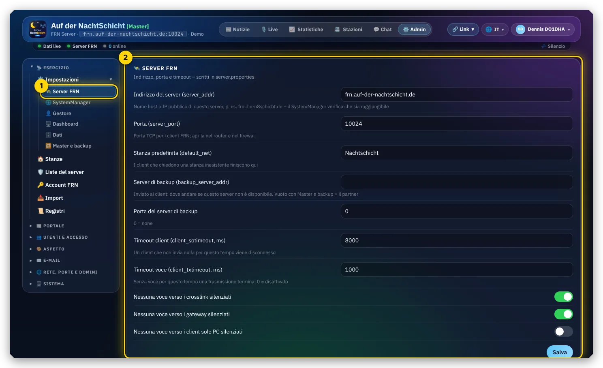
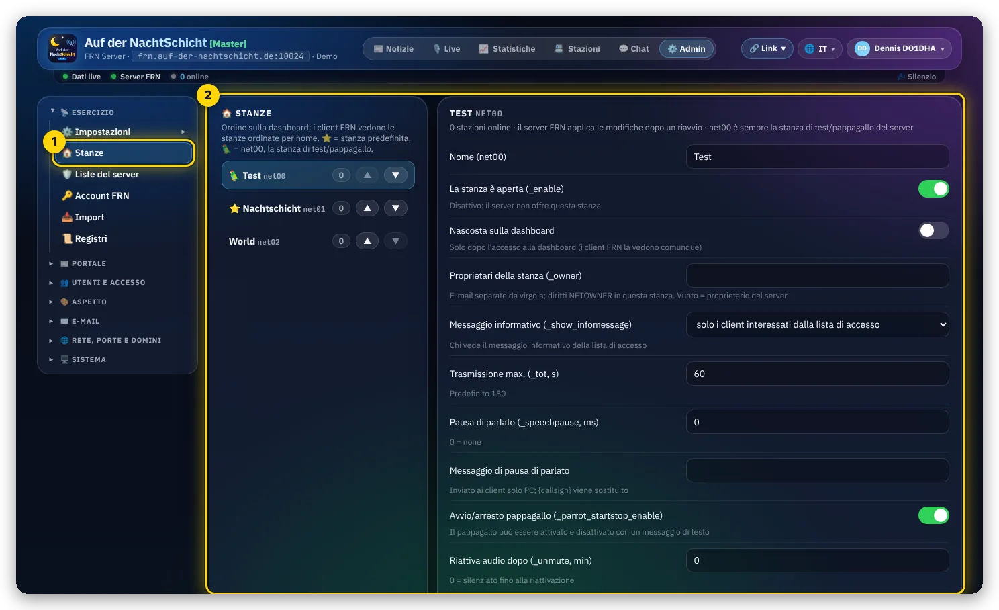
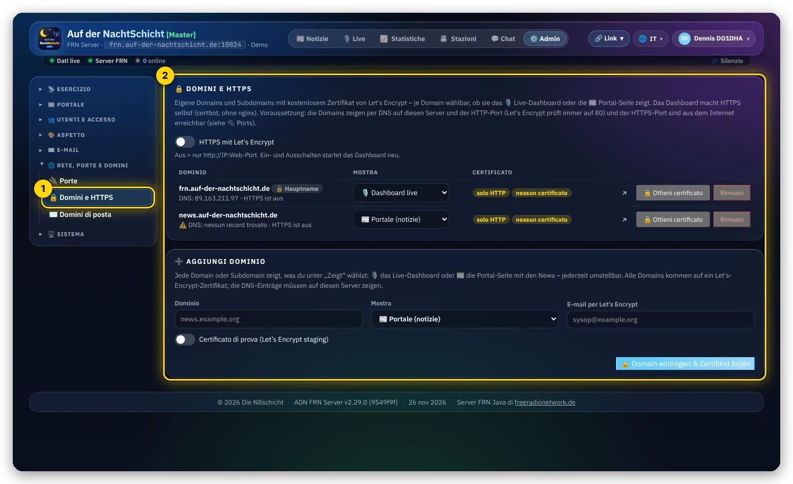
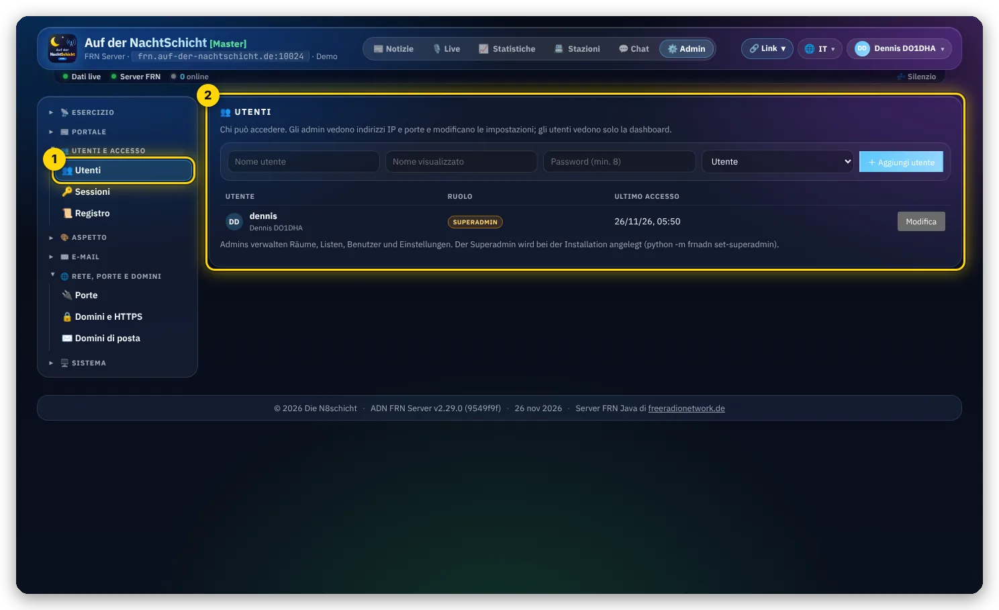
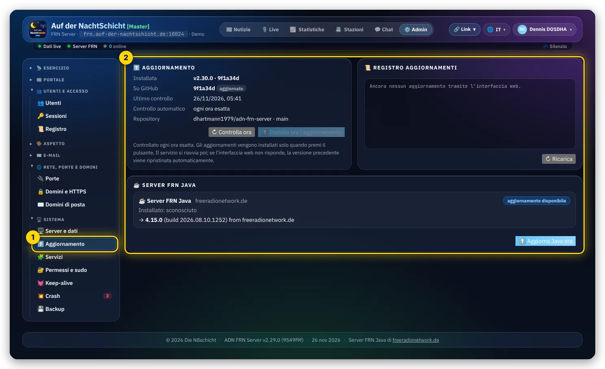
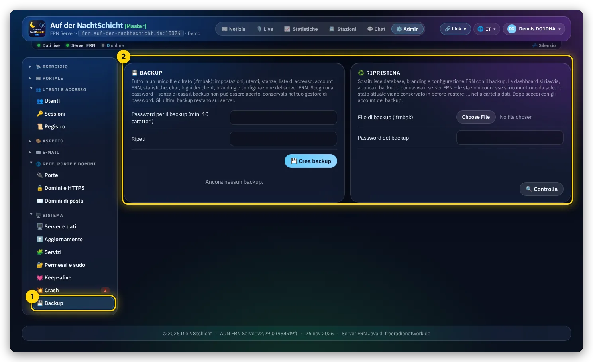

# 📘 ADN FRN Server – Passo dopo passo

<sub>Lingua: [🇩🇪 Deutsch](../de/README.md) · [🇬🇧 English](../en/README.md) · [🇫🇷 Français](../fr/README.md) · [🇧🇪 Français (Belgique)](../fr-BE/README.md) · [🇭🇺 Magyar](../hu/README.md) · [🇸🇪 Svenska](../sv/README.md) · [🇳🇱 Nederlands](../nl/README.md) · **🇮🇹 Italiano** · [🇪🇸 Español](../es/README.md)</sub>

ADN FRN Server è un server FreeRadioNetwork con dashboard, area admin, portale notizie e server di posta. Questa guida ti accompagna nei primi passi.

> 💡 I numeri gialli nelle immagini corrispondono ai numeri nel testo.

## Indice

1. [Installare](#1-installare)
2. [Accedere](#2-accedere)
3. [Scegliere la lingua](#3-scegliere-la-lingua)
4. [Configurare il server FRN](#4-configurare-il-server-frn)
5. [Creare le stanze](#5-creare-le-stanze)
6. [Dominio proprio con HTTPS](#6-dominio-proprio-con-https)
7. [Aggiungere utenti](#7-aggiungere-utenti)
8. [Aggiornare](#8-aggiornare)
9. [Eseguire il backup](#9-eseguire-il-backup)

## 1. Installare

Su un server Debian o Ubuntu come utente con diritti sudo:

```bash
git clone https://github.com/dhartmann1979/adn-frn-server
cd adn-frn-server
sudo ./scripts/install.sh
```

L’installer configura Java, il server FRN, la dashboard, i servizi e i permessi e chiede il superadmin. Dopo la dashboard è raggiungibile su `http://<server>:8080`.

## 2. Accedere

<p align="center"></p>

Fai clic su **🔐 Accedi** in alto a destra. Nella finestra di accesso ① inserisci nome utente e password; 👁 mostra la password, «Resta connesso» evita l’accesso la volta successiva. Dopo cinque tentativi errati il nome viene bloccato per 15 minuti. Dopo l’accesso compaiono avatar e nome ▾ con account, area admin ed esci.

## 3. Scegliere la lingua

<p align="center"></p>

In alto a destra **🌐 IT ▾** ① apre il menu delle lingue ② con nove lingue. La scelta vale subito e per tutte le interfacce N8 di questo server. Alla prima visita viene usata la lingua del browser.

## 4. Configurare il server FRN

<p align="center"></p>

Nell’area admin, in **📡 Esercizio → ⚙️ Impostazioni → 🛰️ Server FRN** ①, trovi indirizzo, porta e timeout del server FRN ②. In **🌐 SystemManager** scegli se il server è registrato presso il SystemManager o funziona in modo autonomo. Dopo il salvataggio riavvia il server FRN.

## 5. Creare le stanze

<p align="center"></p>

In **🏠 Stanze** ① crei le stanze (net) ②: nome, emoji, proprietari, chi può trasmettere e il test eco pappagallo. L’ordine nella dashboard si imposta con ▲ ▼. Il server FRN applica le modifiche dopo un riavvio.

## 6. Dominio proprio con HTTPS

<p align="center"></p>

In **🌐 Rete, porte e domini → 🔒 Domini e HTTPS** ① inserisci un dominio che punta al server tramite DNS e un indirizzo e-mail per Let’s Encrypt ②. Il certificato viene ottenuto e rinnovato automaticamente. Le porte 80 e 443 devono essere raggiungibili da Internet.

## 7. Aggiungere utenti

<p align="center"></p>

In **👥 Utenti e accesso → Utenti** ① aggiungi altri account e assegni loro un ruolo ②. Gli admin vedono gli indirizzi IP e modificano le impostazioni, gli utenti vedono solo la dashboard. In **Sessioni** termini gli accessi, il **Registro** mostra ogni modifica.

## 8. Aggiornare

<p align="center"></p>

In **🖥️ Sistema → ⬆️ Aggiornamento** ① vedi la versione installata e se GitHub ne ha una più recente ②. **⬆️ Installa ora l’aggiornamento** la scarica, poi controlla l’interfaccia web e in caso di errore ripristina automaticamente la versione precedente. Non serve alcuna password.

## 9. Eseguire il backup

<p align="center"></p>

In **🖥️ Sistema → 💾 Backup** ① crei un backup cifrato di tutti i dati ② e lo ripristini quando serve – anche su un nuovo server. Conserva bene la password del backup: senza di essa non si può aprire.

---

📖 Descrizione dettagliata (tedesco): [docs/de/installation.md](../../../docs/de/installation.md)
