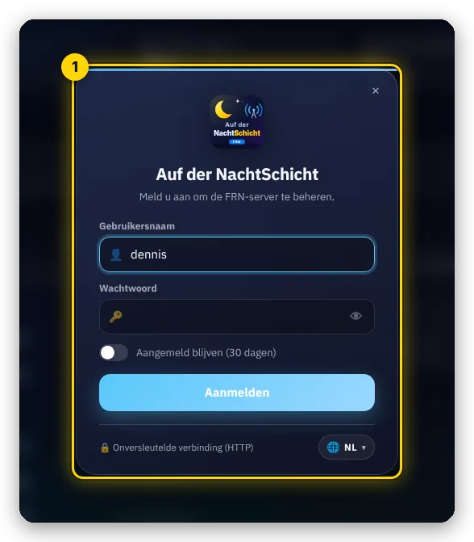
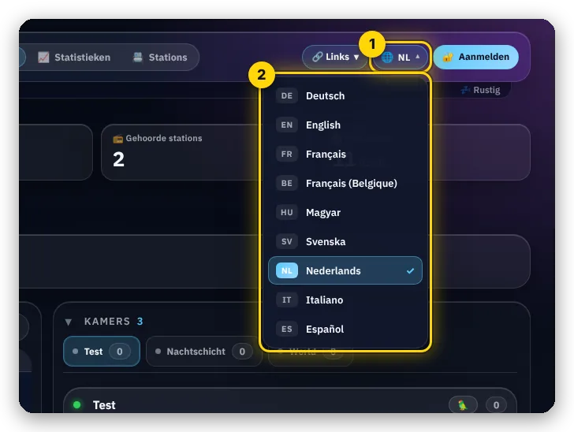
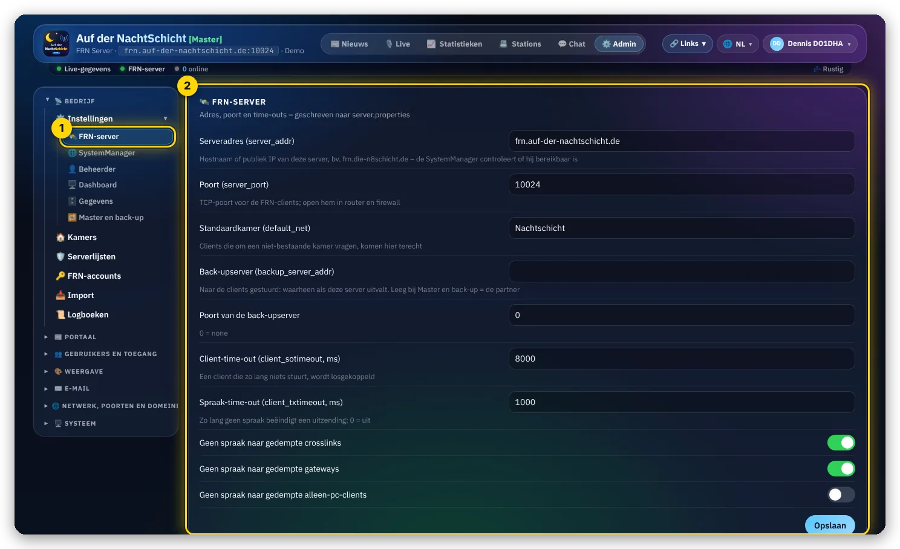
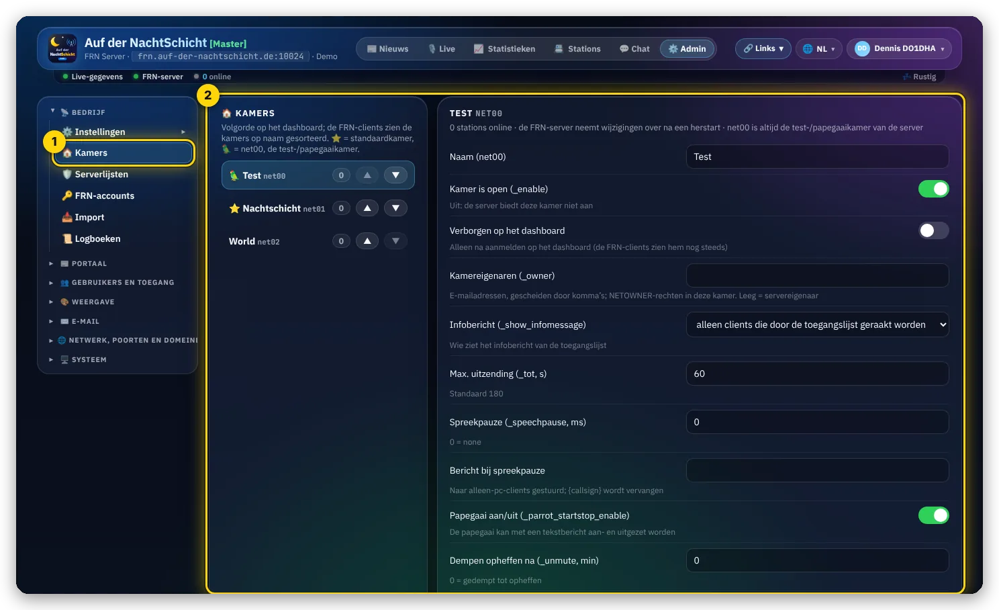
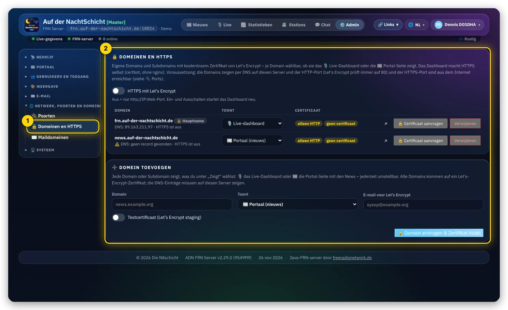
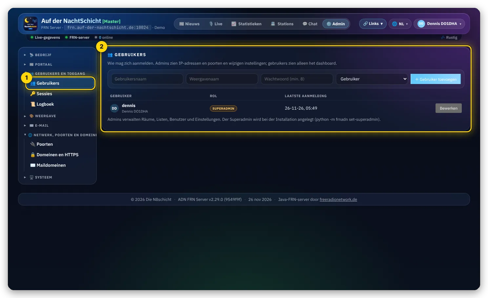
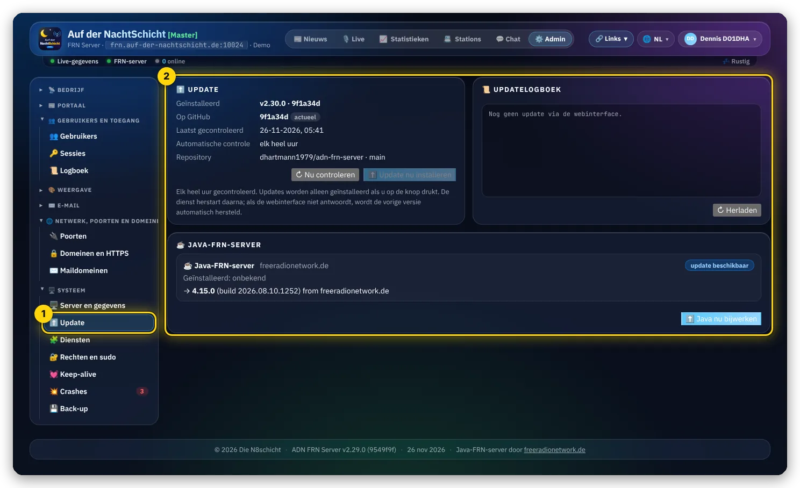
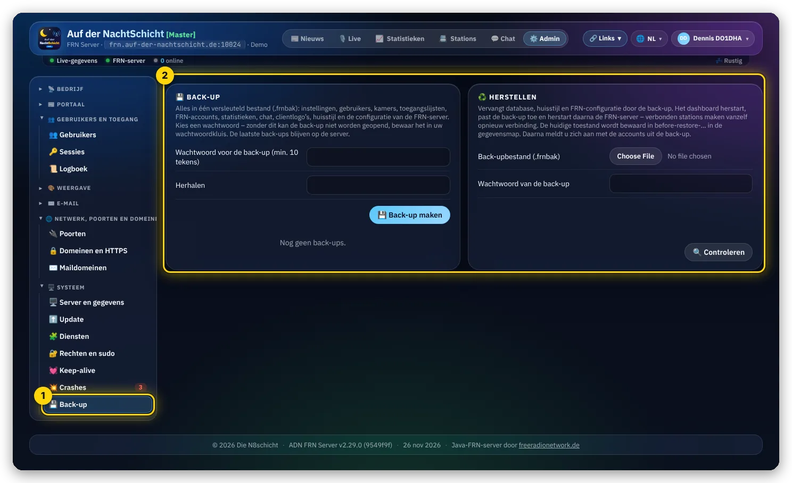

# 📘 ADN FRN Server – Stap voor stap

<sub>Taal: [🇩🇪 Deutsch](../de/README.md) · [🇬🇧 English](../en/README.md) · [🇫🇷 Français](../fr/README.md) · [🇧🇪 Français (Belgique)](../fr-BE/README.md) · [🇭🇺 Magyar](../hu/README.md) · [🇸🇪 Svenska](../sv/README.md) · **🇳🇱 Nederlands** · [🇮🇹 Italiano](../it/README.md) · [🇪🇸 Español](../es/README.md)</sub>

De ADN FRN Server is een FreeRadioNetwork-server met dashboard, beheergedeelte, nieuwsportaal en mailserver. Deze handleiding leidt u door de eerste stappen.

> 💡 De gele cijfers in de afbeeldingen horen bij de cijfers in de tekst.

## Inhoud

1. [Installeren](#1-installeren)
2. [Aanmelden](#2-aanmelden)
3. [Taal kiezen](#3-taal-kiezen)
4. [De FRN-server instellen](#4-de-frn-server-instellen)
5. [Kamers aanmaken](#5-kamers-aanmaken)
6. [Eigen domein met HTTPS](#6-eigen-domein-met-https)
7. [Gebruikers toevoegen](#7-gebruikers-toevoegen)
8. [Bijwerken](#8-bijwerken)
9. [Back-up maken](#9-back-up-maken)

## 1. Installeren

Op een Debian- of Ubuntu-server als gebruiker met sudo-rechten:

```bash
git clone https://github.com/dhartmann1979/adn-frn-server
cd adn-frn-server
sudo ./scripts/install.sh
```

Het installatieprogramma richt Java, de FRN-server, het dashboard, de diensten en de rechten in en vraagt naar de superadmin. Daarna is het dashboard bereikbaar op `http://<server>:8080`.

## 2. Aanmelden

<p align="center"></p>

Klik rechtsboven op **🔐 Aanmelden**. Voer in het aanmeldvenster ① gebruikersnaam en wachtwoord in; 👁 toont het wachtwoord, „Aangemeld blijven” bespaart de volgende keer het aanmelden. Na vijf verkeerde pogingen wordt de naam 15 minuten geblokkeerd. Aangemeld verschijnen avatar en naam ▾ met account, beheergedeelte en afmelden.

## 3. Taal kiezen

<p align="center"></p>

Rechtsboven opent **🌐 NL ▾** ① het taalmenu ② met negen talen. De keuze geldt direct en voor alle N8-interfaces op deze server. Bij het eerste bezoek wordt de taal van de browser gebruikt.

## 4. De FRN-server instellen

<p align="center"></p>

In het beheergedeelte onder **📡 Bedrijf → ⚙️ Instellingen → 🛰️ FRN-server** ① staan adres, poort en tijdslimieten van de FRN-server ②. Onder **🌐 SystemManager** kiest u of de server bij de SystemManager is geregistreerd of zelfstandig draait. Herstart na het opslaan de FRN-server.

## 5. Kamers aanmaken

<p align="center"></p>

Onder **🏠 Kamers** ① maakt u de kamers (nets) aan ②: naam, emoji, eigenaren, wie mag zenden en de papegaai-echotest. De volgorde op het dashboard stelt u in met ▲ ▼. De FRN-server neemt wijzigingen over na een herstart.

## 6. Eigen domein met HTTPS

<p align="center"></p>

Onder **🌐 Netwerk, poorten en domeinen → 🔒 Domeinen en HTTPS** ① voert u een domein in dat via DNS naar de server wijst, plus een e-mailadres voor Let’s Encrypt ②. Het certificaat wordt automatisch opgehaald en vernieuwd. Poorten 80 en 443 moeten vanaf internet bereikbaar zijn.

## 7. Gebruikers toevoegen

<p align="center"></p>

Onder **👥 Gebruikers en toegang → Gebruikers** ① voegt u meer accounts toe en geeft u ze een rol ②. Admins zien IP-adressen en wijzigen instellingen, gebruikers zien alleen het dashboard. Onder **Sessies** beëindigt u aanmeldingen, het **Logboek** toont elke wijziging.

## 8. Bijwerken

<p align="center"></p>

Onder **🖥️ Systeem → ⬆️ Update** ① ziet u de geïnstalleerde versie en of GitHub een nieuwere heeft ②. **⬆️ Update nu installeren** downloadt hem, controleert daarna de webinterface en zet bij een fout automatisch de vorige versie terug. Hiervoor is geen wachtwoord nodig.

## 9. Back-up maken

<p align="center"></p>

Onder **🖥️ Systeem → 💾 Back-up** ① maakt u een versleutelde back-up van alle gegevens ② en zet u die indien nodig terug – ook op een nieuwe server. Bewaar het wachtwoord van de back-up goed: zonder kan hij niet worden geopend.

---

📖 Uitgebreide beschrijving (Duits): [docs/de/installation.md](../../../docs/de/installation.md)
