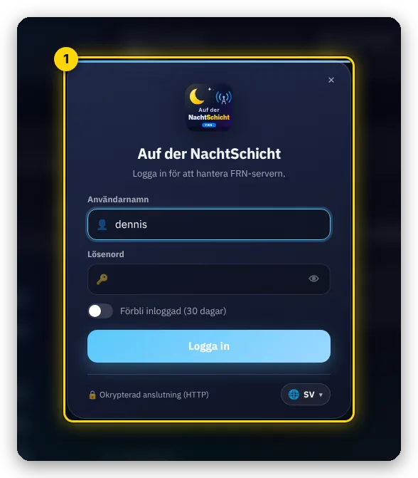
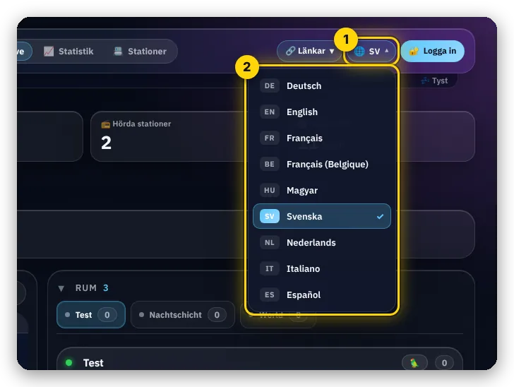
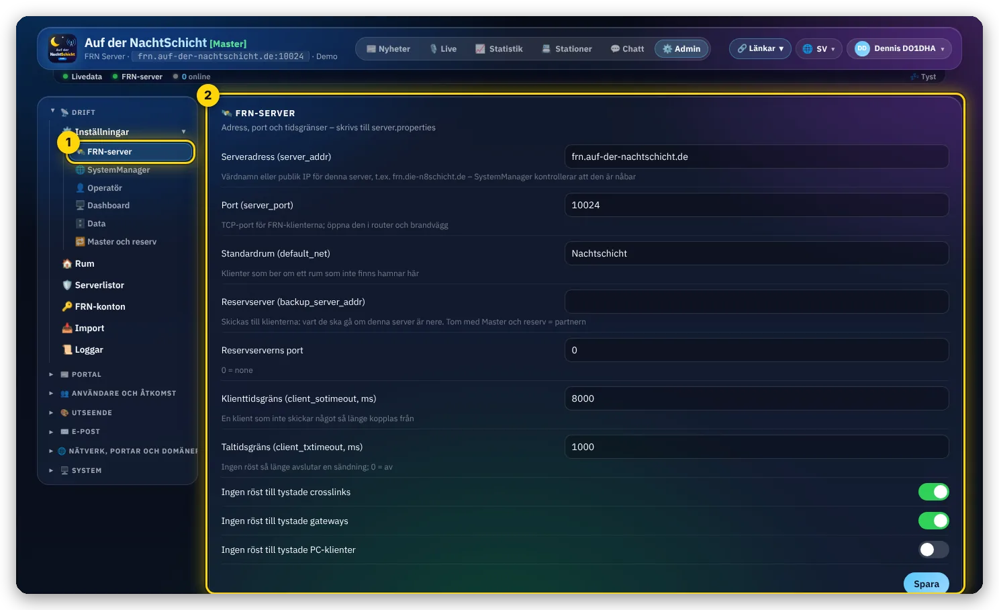
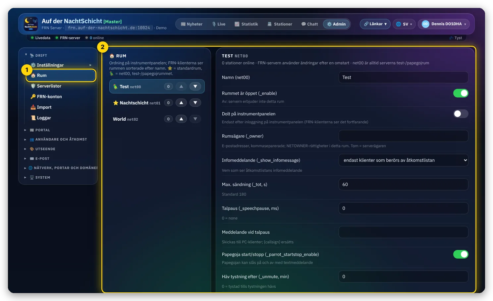
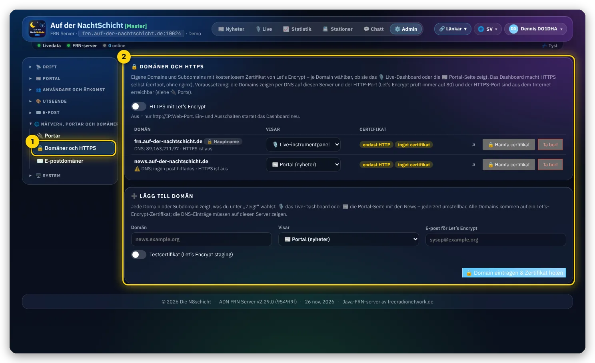
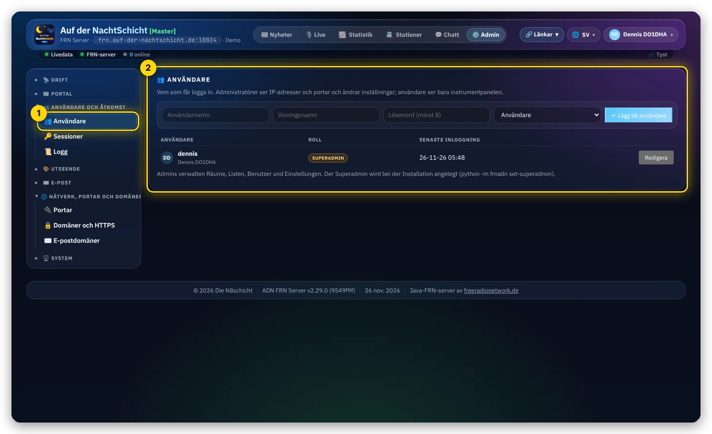
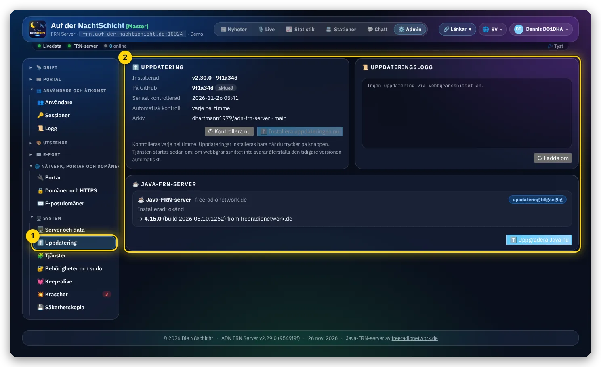
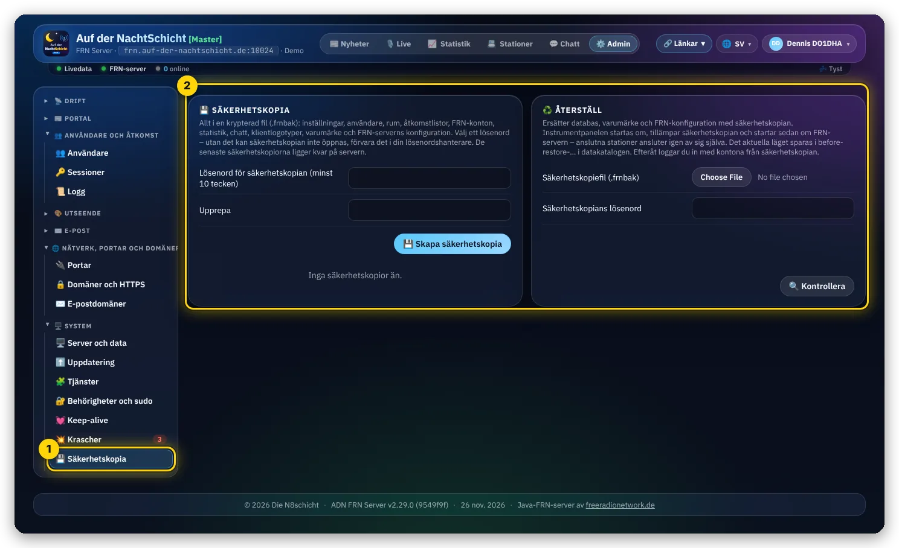

# 📘 ADN FRN Server – Steg för steg

<sub>Språk: [🇩🇪 Deutsch](../de/README.md) · [🇬🇧 English](../en/README.md) · [🇫🇷 Français](../fr/README.md) · [🇧🇪 Français (Belgique)](../fr-BE/README.md) · [🇭🇺 Magyar](../hu/README.md) · **🇸🇪 Svenska** · [🇳🇱 Nederlands](../nl/README.md) · [🇮🇹 Italiano](../it/README.md) · [🇪🇸 Español](../es/README.md)</sub>

ADN FRN Server är en FreeRadioNetwork-server med instrumentpanel, adminområde, nyhetsportal och e-postserver. Denna guide tar dig genom de första stegen.

> 💡 De gula siffrorna i bilderna hör till siffrorna i texten.

## Innehåll

1. [Installera](#1-installera)
2. [Logga in](#2-logga-in)
3. [Välj språk](#3-välj-språk)
4. [Konfigurera FRN-servern](#4-konfigurera-frn-servern)
5. [Skapa rum](#5-skapa-rum)
6. [Egen domän med HTTPS](#6-egen-domän-med-https)
7. [Lägg till användare](#7-lägg-till-användare)
8. [Uppdatera](#8-uppdatera)
9. [Säkerhetskopiera](#9-säkerhetskopiera)

## 1. Installera

På en Debian- eller Ubuntu-server som användare med sudo-rättigheter:

```bash
git clone https://github.com/dhartmann1979/adn-frn-server
cd adn-frn-server
sudo ./scripts/install.sh
```

Installationsprogrammet sätter upp Java, FRN-servern, instrumentpanelen, tjänsterna och behörigheterna och frågar efter superadmin. Därefter nås instrumentpanelen på `http://<server>:8080`.

## 2. Logga in

<p align="center"></p>

Klicka på **🔐 Logga in** uppe till höger. Ange användarnamn och lösenord i inloggningsfönstret ①; 👁 visar lösenordet, ”Förbli inloggad” sparar inloggningen nästa gång. Efter fem felaktiga försök spärras namnet i 15 minuter. Inloggad visas avatar och namn ▾ med konto, adminområde och utloggning.

## 3. Välj språk

<p align="center"></p>

Uppe till höger öppnar **🌐 SV ▾** ① språkmenyn ② med nio språk. Valet gäller direkt och för alla N8-gränssnitt på denna server. Vid första besöket används webbläsarens språk.

## 4. Konfigurera FRN-servern

<p align="center"></p>

I adminområdet under **📡 Drift → ⚙️ Inställningar → 🛰️ FRN-server** ① finns FRN-serverns adress, port och tidsgränser ②. Under **🌐 SystemManager** väljer du om servern är registrerad hos SystemManager eller körs fristående. Starta om FRN-servern efter att du sparat.

## 5. Skapa rum

<p align="center"></p>

Under **🏠 Rum** ① skapar du rummen (nät) ②: namn, emoji, ägare, vem som får sända och papegojans ekotest. Ordningen i instrumentpanelen ställer du in med ▲ ▼. FRN-servern tar över ändringarna efter en omstart.

## 6. Egen domän med HTTPS

<p align="center"></p>

Under **🌐 Nätverk, portar och domäner → 🔒 Domäner och HTTPS** ① anger du en domän som pekar på servern via DNS, samt en e-postadress för Let’s Encrypt ②. Certifikatet hämtas och förnyas automatiskt. Portarna 80 och 443 måste kunna nås från internet.

## 7. Lägg till användare

<p align="center"></p>

Under **👥 Användare och åtkomst → Användare** ① lägger du till fler konton och ger dem en roll ②. Administratörer ser IP-adresser och ändrar inställningar, användare ser bara instrumentpanelen. Under **Sessioner** avslutar du inloggningar, **Loggen** visar varje ändring.

## 8. Uppdatera

<p align="center"></p>

Under **🖥️ System → ⬆️ Uppdatering** ① ser du den installerade versionen och om GitHub har en nyare ②. **⬆️ Installera uppdateringen nu** laddar ner den, kontrollerar sedan webbgränssnittet och återställer automatiskt den tidigare versionen om något går fel. Inget lösenord behövs för detta.

## 9. Säkerhetskopiera

<p align="center"></p>

Under **🖥️ System → 💾 Säkerhetskopia** ① skapar du en krypterad säkerhetskopia av all data ② och återställer den vid behov – även på en ny server. Förvara säkerhetskopians lösenord väl: utan det kan den inte öppnas.

---

📖 Utförlig beskrivning (tyska): [docs/de/installation.md](../../../docs/de/installation.md)
