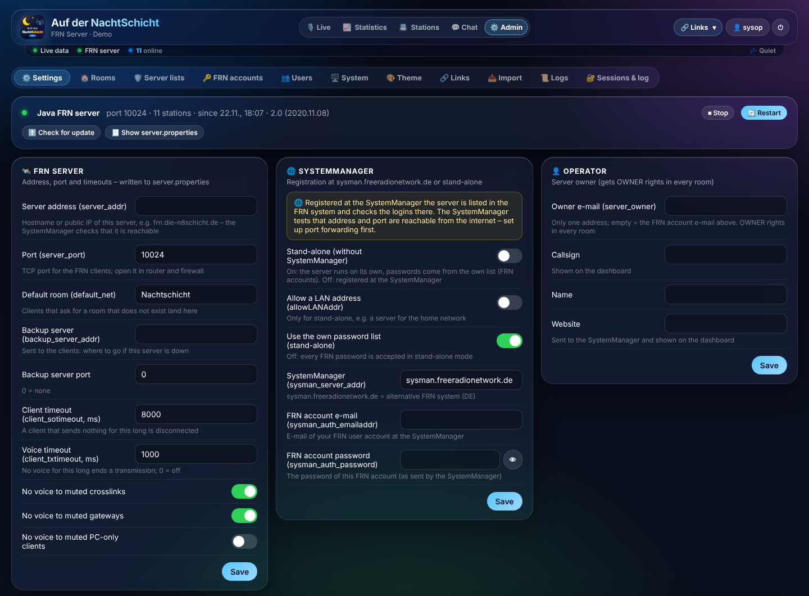
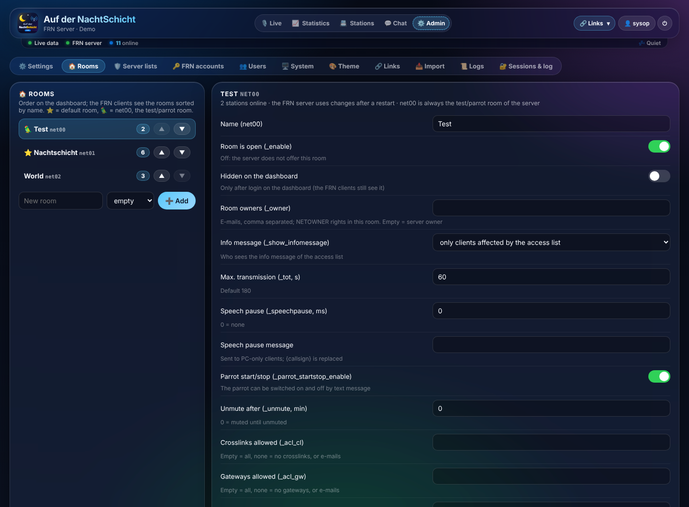
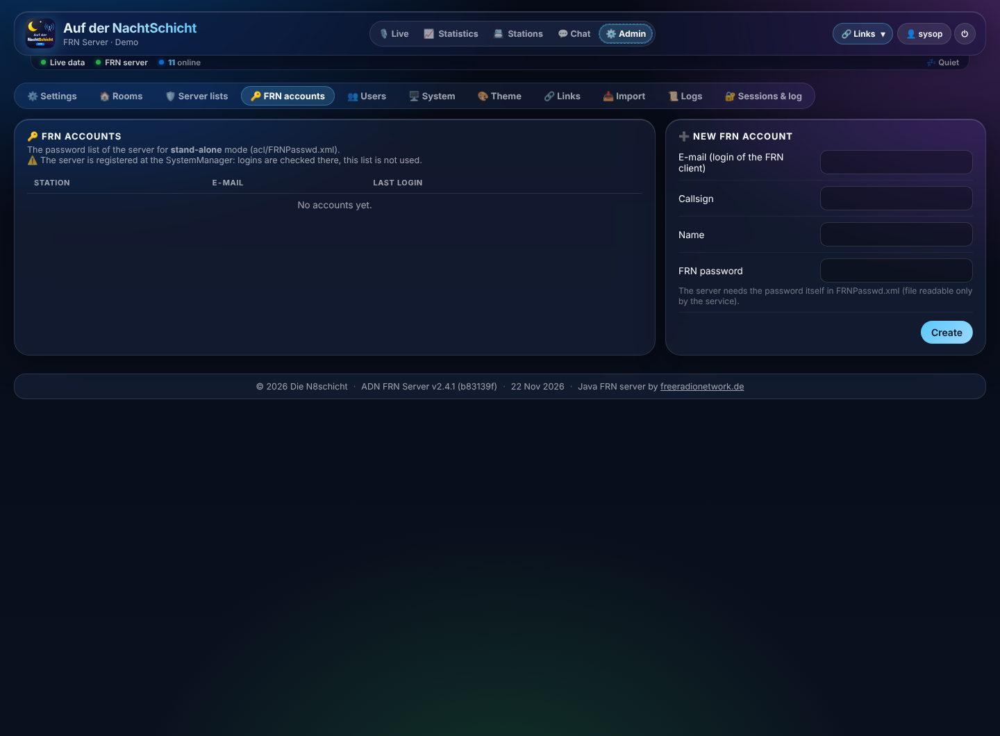
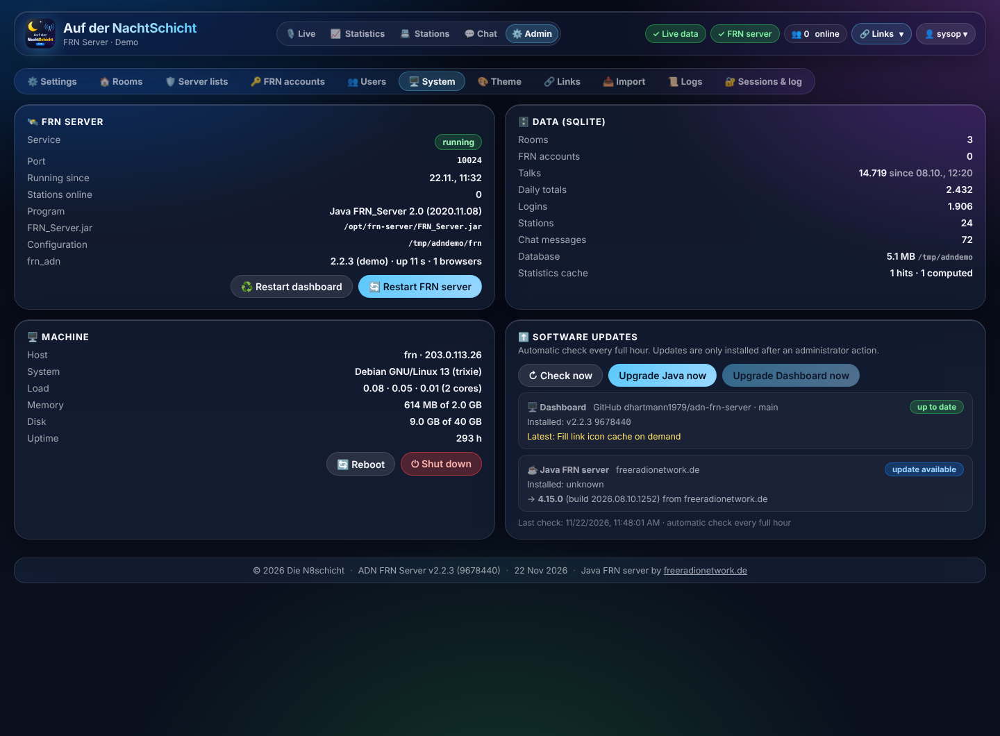

# ⚙️ Admin-Portal

[← Übersicht](../../readme.md) · [Installation](installation.md) · [Dashboard](dashboard.md) · **Admin-Portal** · [Konfiguration](konfiguration.md) · [Betrieb & Fehlersuche](betrieb.md)

Oben rechts **🔐 Login**, dann im Benutzer-Menü oder im Tab **⚙️ Admin**. Das Admin-Portal ersetzt das Bearbeiten von `server.properties`: alles wird in SQLite gespeichert, frn_adn schreibt die Datei daraus neu. Der Java-FRN-Server liest sie beim Start – nach einer Änderung erscheint oben **Restart now**.

## Rollen

| Rolle | Darf |
|---|---|
| **Superadmin** | alles; als einziger Admins anlegen, ändern und löschen und die Maschine neu starten/herunterfahren. Wird bei der Installation festgelegt (`sudo frnadn set-superadmin NAME`) |
| **Admin** | FRN-Server steuern und aktualisieren, alle Einstellungen, Räume, FRN-Konten; Benutzer mit Rolle *User* verwalten |
| **User** | sieht das Dashboard auch, wenn es nicht öffentlich ist, dazu versteckte Räume; ändert nur sein eigenes Passwort |

Passwörter: mindestens 10 Zeichen, gespeichert als scrypt-Hash. Nach 5 Fehlversuchen ist der Login für diesen Namen und diese IP 15 Minuten gesperrt. Unter **👤 → My account** ändert jeder seinen Benutzernamen und sein Passwort.

## ⚙️ Settings

Oben der **Java-FRN-Server**: Zustand, Port, Stationen, Version, mit **▶ Start / ⏹ Stop / 🔄 Restart**, **⬆️ Check for update** (vergleicht mit freeradionetwork.de und installiert auf Wunsch) und **🧾 Show server.properties** (die erzeugte Datei, Passwort maskiert). Meldet der SystemManager einen Fehler, steht er hier im Klartext.

Darunter fünf Karten, jede mit eigenem *Save*:

| Karte | Inhalt | landet in |
|---|---|---|
| 🛰️ FRN server | Serveradresse, Port, Standardraum, Backup-Server, Timeouts, Sprache an stumme Clients | `server.properties` |
| 🌐 SystemManager | Stand-alone an/aus, LAN-Adresse, eigene Passwortliste, SystemManager-Adresse, FRN-Konto (E-Mail, Passwort) | `server.properties` |
| 👤 Operator | Besitzer-E-Mail (`server_owner`), Rufzeichen, Name, Website | `server.properties` / Dashboard |
| 🖥️ Dashboard | Titel, Untertitel, öffentliche Ansicht, versteckte Räume, Chat, Login-Dauer | nur SQLite |
| 🗄️ Data | Aufbewahrung von Durchgängen, Logins, Chat | nur SQLite |

## 🏠 Rooms

Links die Räume mit ihrem Index **net00 … net63** und der Zahl der Stationen: ⭐ Standardraum, 🦜 net00 (Test-/Parrot-Raum), 🔒 auf dem Dashboard versteckt, ⛔ abgeschaltet. ▲▼ ändert nur die Reihenfolge im Dashboard – die FRN-Clients sehen die Räume alphabetisch.

Ein Raum behält seinen Index für immer, denn der Server benennt auch seine Listen danach (`MuteList01.xml` …). Neue Räume bekommen den nächsten freien Index; ein gelöschter Index wird wiederverwendet. `net00` lässt sich umbenennen und abschalten, aber nicht löschen.

Rechts alle Parameter des Raums mit ihrem Namen aus `server.properties` – Bedeutung im Einzelnen: [Konfiguration → Räume](konfiguration.md#räume-net00--net63).

## 🛡️ Server lists

Die Admin-, Stumm-, Sperr- und Zugangslisten gehören dem FRN-Server selbst: Owner und Admins ändern sie im **FRN-Client** (Rechtsklick auf eine Station). Der Server speichert sie als XML in `acl/`; das Admin-Portal zeigt sie hier zum Nachsehen an.

## 🔑 FRN accounts

Die eigene Passwortliste für den **Stand-alone-Betrieb** (`acl/FRNPasswd.xml`): E-Mail, Rufzeichen, Name, Passwort, gesperrt. Am SystemManager prüft dieser die Passwörter, die Liste wird dann nicht benutzt. Ist *Use the own password list* aus, nimmt der Server im Stand-alone-Betrieb jedes Passwort an.

Der Java-Server braucht die Passwörter im Klartext in seiner Datei; frn_adn legt sie deshalb nur dort und in der Datenbank ab, beide nur für den Dienstbenutzer lesbar.

## 👥 Users

Benutzer des Dashboards (nicht zu verwechseln mit FRN-Konten). Den Superadmin kann hier niemand ändern oder löschen; Admins bearbeitet nur der Superadmin.

## 🖥️ System

FRN-Server (Dienst, Port, Version, Pfade), Datenbank (Zeilen, Größe, Cache), Maschine (Last, Speicher, Platte) und Updates.

| Knopf | Wirkung |
|---|---|
| 🔄 Restart FRN server | `systemctl restart frn-server` mit neu geschriebener `server.properties` – alle Stationen verbinden sich neu |
| ♻️ Restart dashboard | nur frn_adn startet neu, der FRN-Server läuft weiter |
| 🔄 Reboot / ⏻ Shut down | nur Superadmin |
| ⬆️ Check FRN server | neue Version auf freeradionetwork.de? |

## 🔄 Updates, Import und Erscheinungsbild

Im Bereich **Admin → System** prüft das Dashboard automatisch zu jeder vollen Stunde auf neue Commits im GitHub-Repository und eine neue Version des Java-FRN-Servers. Die Prüfung installiert nichts automatisch. Mit **Check now** kann sie jederzeit manuell gestartet werden. Bei verfügbarer Version wird der passende Knopf **Upgrade Java now** oder **Upgrade Dashboard now** aktiv.

- **Java-Upgrade:** lädt die vom FRN-Server bereitgestellte neue Version und ersetzt die installierte JAR nach dem vorgesehenen Updateablauf.
- **Dashboard-Upgrade:** übernimmt ausschließlich einen Fast-Forward von GitHub. Bei lokalen Änderungen im Programmverzeichnis wird das Update aus Sicherheitsgründen abgebrochen. Nach erfolgreichem Update startet der Dashboard-Dienst neu.
- **Import server.properties:** wählt eine vorhandene Konfigurationsdatei aus. Erkannte Serverparameter und Raumdefinitionen werden in die SQLite-Konfiguration übernommen. Vor dem Schreiben wird die bisherige `server.properties` mit Zeitstempel gesichert. Vorhandene ACL- und Passwort-XML-Dateien werden durch den Import nicht ersetzt.
- **Appearance:** setzt die Akzentfarbe und lädt ein eigenes PNG-Logo (maximal 2 MB) hoch. Das Logo wird im Datenverzeichnis gespeichert und bleibt bei Programmupdates erhalten.

**Wichtig:** Vor einem Import sollte zusätzlich ein vollständiges Backup des Datenverzeichnisses erstellt werden. Nicht unterstützte oder unbekannte Properties werden nicht in die Einstellungen übernommen. Nach dem Import ist ein Neustart des Java-FRN-Servers erforderlich.
## 📜 Logs

Ereignisse live (Logins, Abweisungen, Moderation aus dem FRN-Client, Konfigurationsänderungen), auf Knopfdruck **server.log** des FRN-Servers und das Journal von `frn-server` und `frnadn`, darunter alle Logins mit E-Mail und IP-Adresse.

## 🔐 Sessions & log

Angemeldete Sitzungen (beenden mit *End*) und das Protokoll aller Änderungen: wer hat wann was geändert, mit IP.
