# ⚙️ Admin-Portal

[← Übersicht](../../readme.md) · [Installation](installation.md) · [Dashboard](dashboard.md) · **Admin-Portal** · [Konfiguration](konfiguration.md) · [Betrieb & Fehlersuche](betrieb.md) · [Updates](updates.md) · [Anleitungen](anleitungen.md)

Oben rechts **🔐 Anmelden**, danach erscheint im Menü der Punkt **⚙️ Admin** (auch im Benutzermenü **Name ▾**). Das Admin-Portal ersetzt das Bearbeiten von `server.properties`: alles wird in SQLite gespeichert, frn_adn schreibt die Datei daraus neu. Der Java-FRN-Server liest sie beim Start – nach einer Änderung erscheint oben **Restart now**.

## Das Menü

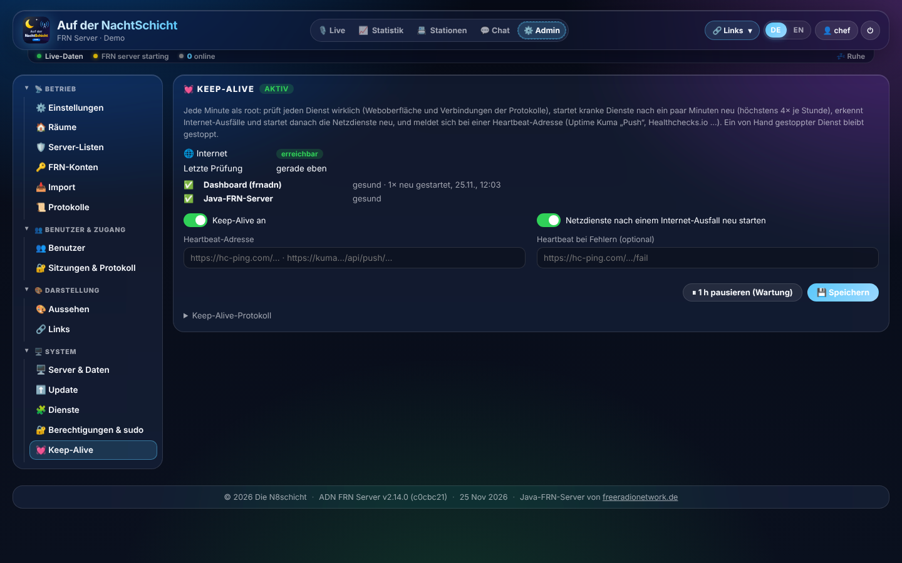

Seit **2.14.0** steht links ein **Baum-Menü** – dasselbe wie in HBlink4-FreeRadioID, N8 Hotspot und N8 Crosslink,
mit denselben Gruppen in derselben Reihenfolge:

| Gruppe | Einträge |
|---|---|
| 📡 **Betrieb** | ⚙️ Einstellungen (Zweige: FRN-Server, SystemManager, Operator, Dashboard, Daten) · 🏠 Räume · 🛡️ Server-Listen · 🔑 FRN-Konten · 📥 Import · 📜 Protokolle |
| 📰 **Portal** (seit 2.24) | 📝 News · ⚙️ Portal-Seite – nur Admins sind Autoren, siehe [Portal-Seite](portal.md) |
| 👥 **Benutzer & Zugang** | 👥 Benutzer · 🔑 Sitzungen · 📜 Protokoll |
| ✉️ **E-Mail** (seit 2.25) | 📮 Mailserver · 📬 Postfächer · 🛡️ DMARC & BIMI · 🧾 DNS-Vorlagen – siehe [E-Mail](email.md) |
| 🌐 **Netz, Ports & Domains** | 🔌 Ports · 🔒 Domains & HTTPS · ✉️ Mail-Domains |
| 🎨 **Darstellung** | 🎨 Aussehen (Theme) · 🔗 Links |
| 🖥️ **System** | 🖥️ Server & Daten · ⬆️ Update · 🧩 Dienste · 🔐 Berechtigungen & sudo · 💓 Keep-Alive · 💥 Abstürze · 💾 Backup (nur Superadmin) |

Alle Gruppen sind **anfangs zugeklappt** – offen ist nur die Gruppe der gerade gewählten Seite; seit 2.14.2 hängen die Abschnitte der Einstellungen als Zweige darunter (ein Zweig zeigt nur diesen Abschnitt). Auf dem Handy wird das Menü zu einer aufklappbaren Leiste. Kacheln einer Reihe sind gleich hoch.

## Rollen

| Rolle | Darf |
|---|---|
| **Superadmin** | alles; als einziger Admins anlegen, ändern und löschen und die Maschine neu starten/herunterfahren. Wird bei der Installation festgelegt (`sudo frnadn set-superadmin NAME`) |
| **Admin** | FRN-Server steuern und aktualisieren, alle Einstellungen, Räume, FRN-Konten; Benutzer mit Rolle *User* verwalten; **News schreiben und veröffentlichen** (einzige Autoren der Portal-Seite) |
| **User** | sieht das Dashboard auch, wenn es nicht öffentlich ist, dazu versteckte Räume; ändert nur sein eigenes Passwort |

Passwörter: mindestens 10 Zeichen, gespeichert als scrypt-Hash. Nach 5 Fehlversuchen ist der Login für diesen Namen und diese IP 15 Minuten gesperrt. Unter **👤 → My account** ändert jeder seinen Benutzernamen und sein Passwort.

## ⚙️ Settings

Oben der **Java-FRN-Server**: Zustand, Port, Stationen, Version, mit **▶ Start / ⏹ Stop / 🔄 Restart**, **⬆️ Check for update** (vergleicht mit freeradionetwork.de und installiert auf Wunsch) und **🧾 Show server.properties** (die erzeugte Datei, Passwort maskiert). Meldet der SystemManager einen Fehler, steht er hier im Klartext.

Darunter sechs Karten, jede mit eigenem *Save*:

| Karte | Inhalt | landet in |
|---|---|---|
| 🛰️ FRN server | Serveradresse, Port, Standardraum, Backup-Server, Timeouts, Sprache an stumme Clients | `server.properties` |
| 🌐 SystemManager | Stand-alone an/aus, LAN-Adresse, eigene Passwortliste, SystemManager-Adresse, FRN-Konto (E-Mail, Passwort) | `server.properties` |
| 👤 Operator | Besitzer-E-Mail (`server_owner`), Rufzeichen, Name, Website | `server.properties` / Dashboard |
| 🖥️ Dashboard | Titel, Untertitel, öffentliche Ansicht, versteckte Räume, Chat, Login-Dauer | nur SQLite |
| 🗄️ Data | Aufbewahrung von Durchgängen, Logins, Chat | nur SQLite |
| 🔁 Master & Backup | Rolle (Einzelserver/Master/Backup), Dashboard des Partners, Sync-Schlüssel, stündlicher Abgleich; Status, **🔄 Jetzt abgleichen**, **🛠️ Übergeben / ↩️ Zurückholen**, **📧 FRN-Passwort Master/Backup**. Siehe [Master & Backup](master-backup.md) | nur SQLite |

## 🌐 Netz, Ports & Domains

Seit **2.16.0** steht alles zu Netz, HTTPS und Domains **nur noch hier** – wie in N8 Crosslink und allen N8-Systemen (vorher unter
*Einstellungen → HTTPS & web*).

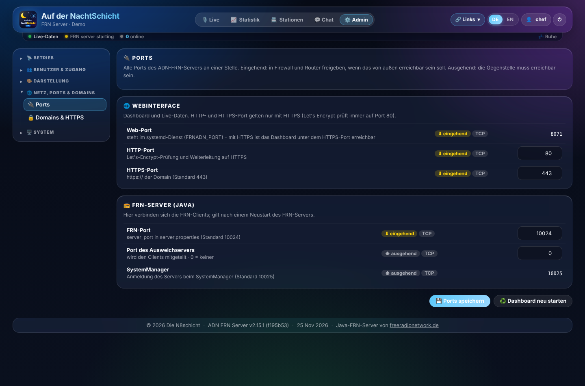 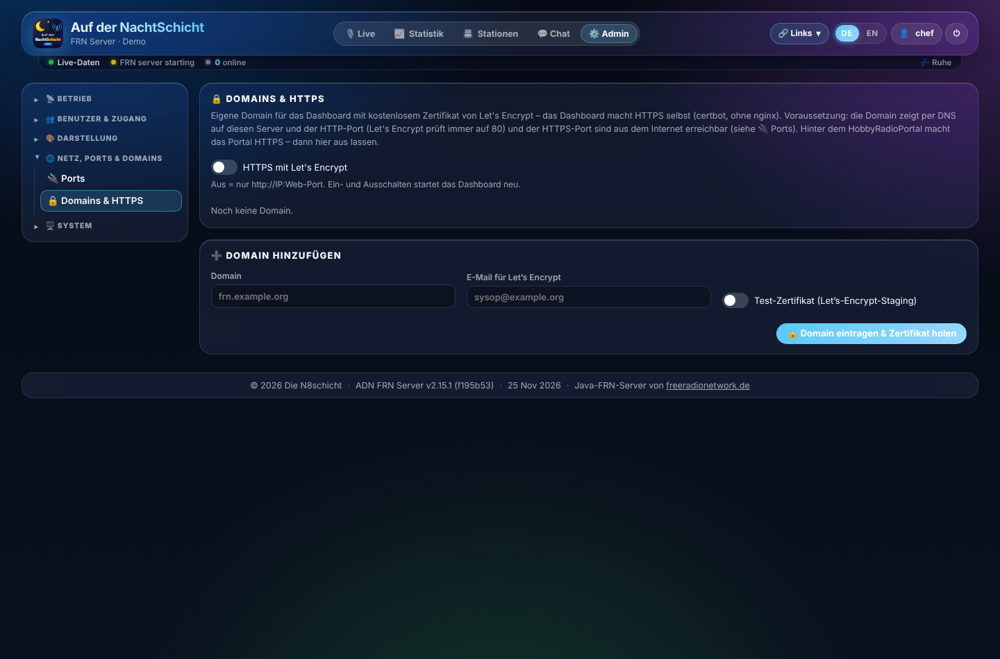

- **🔌 Ports:** Web-Port (steht im systemd-Dienst, `FRNADN_PORT`), HTTP-Port (Let's-Encrypt-Prüfung, normalerweise 80), HTTPS-Port (443),
  FRN-Port der Clients (10024), Port des Ausweichservers und SystemManager – jeweils *eingehend/ausgehend* mit Protokoll.
  **💾 Ports speichern**; was einen Neustart braucht, steht danach unten, **♻️ Dashboard neu starten** erledigt ihn.
- **🔒 Domains & HTTPS:** Domain und E-Mail eintragen (optional Test-Zertifikat) → **Domain eintragen & Zertifikat holen**: HTTPS wird
  eingeschaltet, das Dashboard startet neu und holt das Zertifikat. Danach Tabelle mit DNS-Auflösung, Zertifikat (gültig/Test/abgelaufen,
  bis wann), **🔄 Erneuern**, **Entfernen** und Schalter *HTTPS mit Let's Encrypt*.

**Zeigt (seit 2.26):** Jede Domain und Subdomain zeigt wahlweise das 🎙️ Live-Dashboard oder die 📰 [Portal-Seite](portal.md#-domains-live-oder-portal) – beliebig viele Domains, alle auf einem Let's-Encrypt-Zertifikat, umstellen ohne Neustart.

Der Listener auf HTTP beantwortet ACME-Challenges und leitet sonst mit HTTP 301 auf HTTPS um. Certbot läuft als Benutzer `frnadn`; seine Daten liegen im Datenverzeichnis unter `letsencrypt/`. Die Erneuerung wird alle zwölf Stunden geprüft. Ein erneuertes Zertifikat wird in den laufenden TLS-Kontext geladen, ohne den Dienst neu zu starten.

Voraussetzung sind ein korrekt auf den Server zeigender öffentlicher DNS-Eintrag und eingehend freigegebene Ports TCP 80 und 443. Wenn die erste Zertifikatsausstellung scheitert, bleibt das Dashboard vorübergehend auf HTTP-Port 8080 erreichbar (sofern Port 80 für den ACME-Listener verwendet wird); die Ursache steht im Journal.

### 📧 FRN-Passwort anfordern

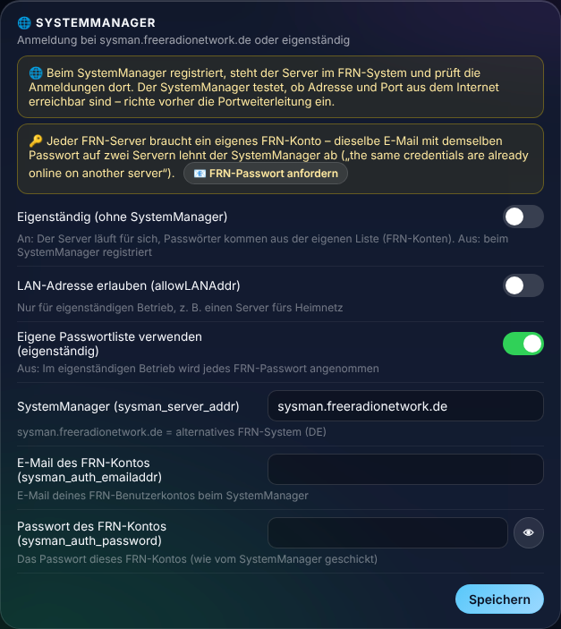 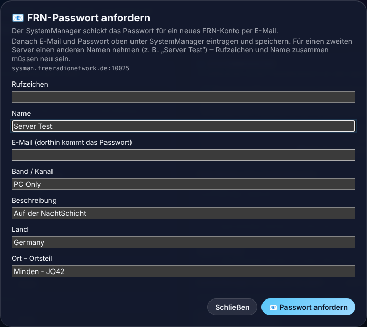

Lehnt der SystemManager ab, steht der Grund im **öffentlichen FRN-Fehlerprotokoll** – Knopf *📋 FRN-Fehlerprotokoll* in derselben Kachel.

Jeder FRN-Server braucht ein **eigenes FRN-Konto**. Laufen zwei Server (z. B. Live und Test) mit derselben E-Mail und demselben Passwort,
lehnt der SystemManager den zweiten ab: *SystemManager: the same credentials are already online on another server* – der Server bleibt offline.

*Settings → 🌐 SystemManager → 📧 FRN-Passwort anfordern* macht dasselbe wie **„Get Password“ im FRN-Client**: Rufzeichen, Name, E-Mail,
Band/Kanal (für einen Server `PC Only`), Beschreibung, Land und *Ort - Ortsteil* eintragen → **Passwort anfordern**. Das Dashboard schickt
die Anfrage an den eingestellten SystemManager (TCP-Port 10025), der das Passwort **per E-Mail** schickt (auch im Spam-Ordner nachsehen).
Danach E-Mail und Passwort oben eintragen, speichern, FRN-Server neu starten.

| Antwort | Bedeutung |
|---|---|
| ✅ *Angefordert* | Der SystemManager hat die Anfrage angenommen – das Passwort kommt per E-Mail |
| ⚠️ *Es gibt schon ein FRN-Konto mit diesem Rufzeichen und Namen* | Rufzeichen + Name sind schon registriert. Für einen zweiten Server einen anderen Namen wählen, z. B. `DO1ABC, Server Test`, und eine andere E-Mail |

Höchstens eine Anfrage pro Minute; jede steht im Protokoll (*FRN-Passwort angefordert*).

## 🏠 Rooms

Links die Räume mit ihrem Index **net00 … net63** und der Zahl der Stationen: ⭐ Standardraum, 🦜 net00 (Test-/Parrot-Raum), 🔒 auf dem Dashboard versteckt, ⛔ abgeschaltet. ▲▼ ändert nur die Reihenfolge im Dashboard – die FRN-Clients sehen die Räume alphabetisch.

Ein Raum behält seinen Index für immer, denn der Server benennt auch seine Listen danach (`MuteList01.xml` …). Neue Räume bekommen den nächsten freien Index; ein gelöschter Index wird wiederverwendet. `net00` lässt sich umbenennen und abschalten, aber nicht löschen.

Rechts alle Parameter des Raums mit ihrem Namen aus `server.properties` – Bedeutung im Einzelnen: [Konfiguration → Räume](konfiguration.md#räume-net00--net63).

## 🛡️ Server lists

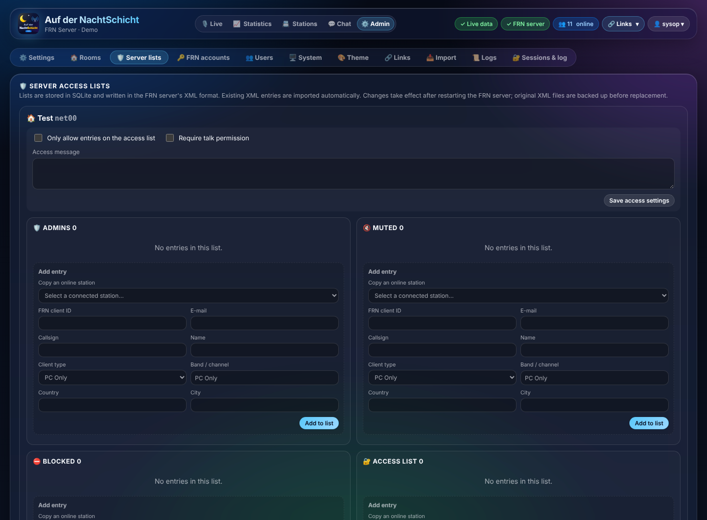

Das Dashboard importiert vorhandene `AdminList`, `MuteList`, `BlockList` und `AccessList` XML-Dateien beim Start und vor jeder Anzeige oder Änderung nach SQLite. Auch Änderungen, die Owner oder Admins weiterhin im **FRN-Client** vornehmen, werden beim nächsten Öffnen der ACL-Seite übernommen.

Im Admin-Portal lassen sich Einträge je Raum hinzufügen, bearbeiten und entfernen. Für neue Einträge kann eine aktuell verbundene Station übernommen werden; alternativ werden FRN-ID und E-Mail von Hand eingetragen. Die Access-Liste steuert zusätzlich, wer dem Raum beitreten und wer sprechen darf.

Beim Speichern schreibt frn_adn die Listen im FRN-kompatiblen XML-Format zurück. Die vorherige Datei wird unter `acl/backups/` gesichert. Der FRN-Server braucht danach einen Neustart, um die Änderungen zu übernehmen; das Dashboard zeigt dafür den Neustart-Hinweis an.

## 🔑 FRN accounts

Die eigene Passwortliste für den **Stand-alone-Betrieb** (`acl/FRNPasswd.xml`): E-Mail, Rufzeichen, Name, Passwort, gesperrt. Am SystemManager prüft dieser die Passwörter, die Liste wird dann nicht benutzt. Ist *Use the own password list* aus, nimmt der Server im Stand-alone-Betrieb jedes Passwort an.

Der Java-Server braucht die Passwörter im Klartext in seiner Datei; frn_adn legt sie deshalb nur dort und in der Datenbank ab, beide nur für den Dienstbenutzer lesbar.

## 👥 Users

Benutzer des Dashboards (nicht zu verwechseln mit FRN-Konten). Den Superadmin kann hier niemand ändern oder löschen; Admins bearbeitet nur der Superadmin.

## 🖥️ Server & Daten

FRN-Server (Dienst, Port, Version, Pfade), Datenbank (Zeilen, Größe, Cache) und Maschine (Last, Speicher, Platte). Das Backup hat seit 2.14.2 einen eigenen Eintrag **System → 💾 Backup**. Update, Dienste, Berechtigungen und Keep-Alive haben seit 2.14.0 eigene Einträge unter **System**.

| Knopf | Wirkung |
|---|---|
| 🔄 Restart FRN server | `systemctl restart frn-server` mit neu geschriebener `server.properties` – alle Stationen verbinden sich neu |
| ♻️ Restart dashboard | nur frn_adn startet neu, der FRN-Server läuft weiter |
| 🔄 Reboot / ⏻ Shut down | nur Superadmin |

### 💾 Backup & Wiederherstellen (nur Superadmin)

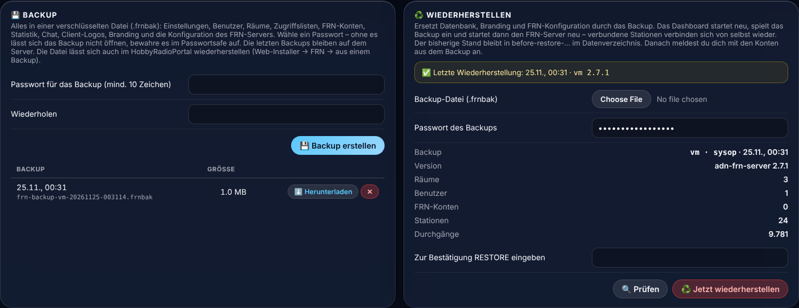

Unter **System → 💾 Backup** stehen zwei Kacheln, die nur der **Superadmin** sieht – ein Backup enthält alle Zugangsdaten.

**💾 Backup** – Passwort zweimal eingeben (mindestens 10 Zeichen), **Backup erstellen**. Der Browser lädt die Datei
`frn-backup-<host>-<datum>.frnbak` sofort herunter; die letzten **5** Backups bleiben zusätzlich in `/var/lib/frnadn/backups/`
(nur `frnadn` lesbar, 600) und lassen sich dort erneut herunterladen oder löschen.

| im Backup | nicht im Backup |
|---|---|
| Datenbank (Einstellungen, Benutzer, Räume, FRN-Konten, Stationen, Statistik, Chat, Protokoll, Client-Logos) | Sitzungen (alle melden sich neu an) |
| `branding/` (Logo, Site-Icons, Links) | Zertifikate `letsencrypt/` – werden neu geholt |
| `frn/` des FRN-Servers: `server.properties`, `log4j.xml`, Zugriffslisten `acl/` | Logdateien `frn/logs/`, alte Backups |

Die Datei ist mit dem Passwort **verschlüsselt und gegen Veränderung gesichert** (scrypt + SHAKE-256 + HMAC-SHA256, Format `N8MIG1` –
dasselbe wie beim Umzug von HBlink4 ins Portal). Ohne Passwort ist sie wertlos – auch für dich: Passwort in den Passwortsafe.

**♻️ Wiederherstellen** – `.frnbak` wählen, Passwort, **🔍 Prüfen**. Das Dashboard lädt die Datei hoch, entschlüsselt sie zur Probe und zeigt,
was drin ist (Host, Datum, Version, Räume, Benutzer, FRN-Konten, Stationen, Durchgänge). Dann `RESTORE` eintippen und **Jetzt wiederherstellen**:

1. Das Dashboard legt das entschlüsselte Archiv als `restore.pending.tar` ab und startet neu.
2. Beim Start – bevor die Datenbank geöffnet wird – wandert der bisherige Stand nach `/var/lib/frnadn/before-restore-<datum>/`
   (Datenbank, `branding/`, `frn/` ohne Logs), dann wird das Backup eingespielt und die Datenbank geprüft. Geht etwas schief,
   kommt der alte Stand automatisch zurück.
3. `server.properties` wird neu geschrieben und der **FRN-Server neu gestartet** – verbundene Stationen verbinden sich selbst wieder.
4. Anmelden mit den Konten **aus dem Backup**. Die Kachel zeigt *Letzte Wiederherstellung* mit Zeit, Host und Version.

Das Protokoll vermerkt *💾 Backup created/downloaded/deleted*, *♻️ Restore started* und *♻️ Backup restored*.

## ⬆️ Update · 🧩 Dienste · 🔐 Berechtigungen & sudo · 💓 Keep-Alive · 💥 Abstürze

**💥 Abstürze** (seit 2.15.0): jeder Absturz, Hänger und Notfall-Neustart von Dashboard und Java-FRN-Server mit Teil, Ursache und Protokoll; neue Befunde erscheinen nach der Anmeldung als Hinweisfenster – siehe [Betrieb → Abstürze](betrieb.md#-abstürze-erkennen-und-aufklären).

Diese vier Einträge unter **System** sind gemeinsame Ansichten des N8 Kit und sehen in allen N8-Systemen gleich aus.

- **⬆️ Update**: installierte Version, Stand auf GitHub, **↻ Jetzt prüfen**, **⬆️ Update jetzt installieren** (ohne Passwort, mit
  Fortschritt und automatischem Zurücksetzen) und rechts das **📜 Update-Protokoll**. Darunter der **☕ Java-FRN-Server** von
  freeradionetwork.de mit **Java jetzt aktualisieren** (lädt `FRN_Server.zip`, ersetzt die JAR, startet den Java-Server neu).
  Geprüft wird 30 Sekunden nach dem Start und zu jeder vollen Stunde; installiert wird nur auf Knopfdruck. Einzelheiten: [Updates](updates.md).
- **🧩 Dienste**: Dashboard, Java-FRN-Server und Update-Auslöser mit Zustand, Autostart und Starten · Stoppen · Neu starten.
- **🔐 Berechtigungen & sudo**: zeigt nur, was nicht stimmt; **🛠️ Korrigieren** repariert und prüft erneut.
- **💓 Keep-Alive**: siehe [Betrieb & Fehlersuche → Keep-Alive](betrieb.md#-keep-alive).

  
  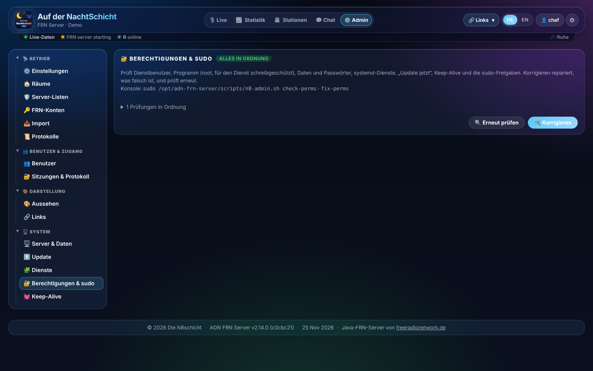

## 🔗 Links und 📥 Import

### 🔗 Links

Mit **🔁 Master & Backup** steht der Partner zusätzlich automatisch als erster Eintrag im Menü (Master → „FRN Backup“, Backup → „FRN Master“) – siehe [Master & Backup](master-backup.md#-partner-im-link-menü).

Eigener Admin-Tab **🔗 Links** mit Schalter *Show links on the dashboard*, Menütext, Darstellung als Aufklapp-Menü oder Knopfreihe und einer sortierbaren Liste. Je Link legst du Name, Adresse, Fallback-Emoji, **Site icon** und **New tab** fest. Website-Icons werden über die üblichen Favicon-Pfade oder die `rel=icon`-Angabe der Zielseite gefunden und in SQLite gecacht. Der erste Bildaufruf füllt den Cache bei Bedarf direkt; **Save & refresh site icons** lädt sie sofort neu. Zusätzlich werden die Icons jede Nacht um Mitternacht aktualisiert. Wenn ein Ziel kein Icon anbietet, erscheint das Emoji. Bis zu 20 Links; erlaubt sind `https://`, `http://`, `mailto:`, `#stats` / `#stations` (Tab wechseln) und `/pfad`. Schritt für Schritt: [Anleitungen → Link-Menü](anleitungen.md#-link-menü-einrichten).

### 📥 Import

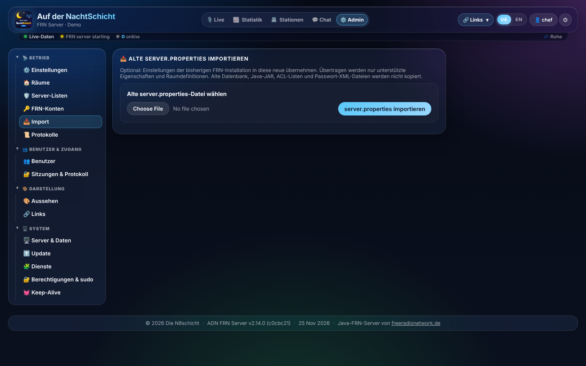

Eigener Admin-Tab **📥 Import**. Hier kann nach der frischen Installation eine einzelne `server.properties` der früheren FRN-Installation ausgewählt werden. Übernommen werden nur erkannte Properties und Raumdefinitionen; Installation, Datenbank, JAR, ACL-Dateien und Passwort-XML nicht. Vor dem Schreiben wird die bisherige `server.properties` mit Zeitstempel gesichert.

**Wichtig:** Vor einem Import zusätzlich das Datenverzeichnis sichern. Nicht unterstützte Properties werden nicht übernommen. Nach dem Import den Java-FRN-Server neu starten.

### 🎨 Theme

Eigener Admin-Tab **🎨 Theme** mit drei Bereichen. Seit Version 2.3.0 arbeitet hier dieselbe Farb-Engine (**N8 Theme**) wie im
Dashboard von [HBlink4-FreeRadioID](https://github.com/dhartmann1979/HBlink4-FreeRadioID) und im
[N8-Hotspot](https://github.com/dhartmann1979/N8-HotSpot) – ein Farbschema sieht also in allen drei Oberflächen gleich aus.

### 🔤 Schrift (N8 Theme 2.1)

Unter *Darstellung → 🎨 Aussehen* gibt es jetzt eine **Schriftauswahl mit Vorschau** – jede Karte zeigt Rufzeichen, TG, Frequenz,
Umlaute und Ziffern in ihrer Schrift; ein Klick wirkt sofort auf der ganzen Seite, gespeichert wird mit dem Aussehen.

| Schrift | Charakter |
|---|---|
| **IBM Plex Sans** (Standard) | technisch, sehr gut lesbar |
| Inter | neutral, am Bildschirm sehr gut lesbar |
| Barlow | wie DIN-Beschilderung, kompakt |
| Exo 2 | technisch mit futuristischem Einschlag |
| Rajdhani | schmal, wie ein Funkgeräte-Display |
| System | Schrift des Geräts (kein Download) |

Zahlen, Anzeigen und Code stehen immer in **JetBrains Mono** (CSS-Variable `--n8-mono`). Alle Schriften liegen im Projekt
(`fonts/` neben `n8-theme.js`, SIL Open Font License 1.1) – es gibt keine Anfrage an Google Fonts oder andere fremde Server.
Gleich in allen N8-Systemen.

**🎨 Colours**

| Teil | Bedeutung |
|---|---|
| **Colour profile** | sieben fertige Profile: *N8 Night* (Vorgabe), *Ocean*, *Aurora*, *Ember*, *Violet*, *Graphite* und das helle *Daylight* |
| **Own colours** | jede Farbe einzeln: *Accent* (Knöpfe, aktive Reiter, Zahlen), *Accent 2* (Verlauf von Knöpfen und Titel), *Background*, drei Leuchtfarben (*Glow top left / top right / bottom*), *Text*, *Card tint*. „from profile“ = Farbe kommt aus dem Profil, ↺ nimmt eine eigene Farbe wieder zurück |
| **Background glow** | Stärke der farbigen Lichtflecken im Hintergrund, 0 = flacher Hintergrund |
| **Card brightness** | wie deutlich sich die Glas-Karten vom Hintergrund abheben |
| **Roundness** | Rundung von Karten und Knöpfen (0–28 px) |
| **Glass blur** | Unschärfe hinter den Karten; aus = schneller auf alten Handys |
| **Vorschau** | Titel, Reiter, Zahl und Knopf in den gewählten Farben, dazu die **Lesbarkeit** (Kontrast Text/Hintergrund, Warnung unter 4,5 : 1) |

Jede Änderung wirkt sofort als Vorschau auf der ganzen Seite. Gespeichert – global in SQLite, für alle Besucher – wird erst mit
**💾 Save colours, logo & icon**. **Discard changes** holt den gespeicherten Stand zurück, **↺ N8 standard** die Werksfarben.
Schemata aus Version 2.2 (*Midnight, Forest, Sunset, Light* …) werden beim ersten Laden automatisch übernommen: eigene Farben bleiben,
das Profil wird auf das passende neue gesetzt.

**🖼️ Logo & site icon**

Das Dashboard-Logo akzeptiert PNG bis 2 MB (Kopfzeile und Login-Dialog). Das Site-Icon (Favicon für Browser-Tab und Lesezeichen)
akzeptiert PNG oder ICO bis 2 MB. Beide Dateien liegen im Datenverzeichnis, überstehen Updates und lassen sich mit
*Use default …* auf das Standardmotiv zurücksetzen.

**📡 Client logos**

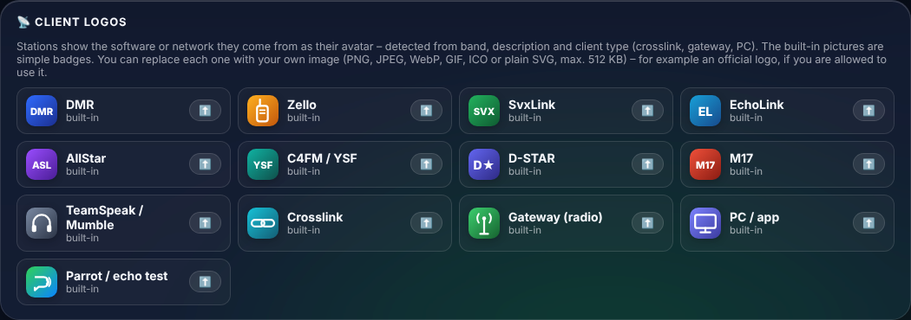

Jede Station bekommt als Avatar ein Bild der **Software bzw. des Netzes, aus dem sie kommt**. Erkannt wird das aus dem Band-Text,
der Beschreibung und der Client-Art, die der FRN-Server meldet:

| Logo | erkannt an (Beispiele) |
|---|---|
| **DMR** | „DMR“, „Brandmeister“, „BM 2623“, „TG 262“, „TGIF“, „HBlink“, „FreeDMR“ |
| **Zello** | „Zello“ |
| **SvxLink** | alles mit „svx“ (SvxLink, SVXReflector) |
| **EchoLink** | „EchoLink“, „Echo Link“ |
| **AllStar** | „AllStar“, „ASL“, „HamVoIP“ |
| **C4FM / YSF**, **D-STAR**, **M17** | „YSF“, „C4FM“, „Wires-X“, „Fusion“ · „D-STAR“, „DPlus“, „DExtra“, „REF001“, „XLX…“ · „M17“ |
| **TeamSpeak / Mumble** | „TeamSpeak“, „TS3“, „Mumble“ |

Der erste Treffer gewinnt (Reihenfolge wie in der Tabelle). Ohne Treffer entscheidet die Client-Art:

| Logo | erkannt an |
|---|---|
| **Crosslink** | Client-Art *Crosslink* |
| **Gateway (radio)** | Client-Art *Gateway* mit Frequenz, z. B. „438.950 MHz FM“ |
| **PC / app** | Band „PC Only“ oder Client-Art *PC* |
| **Parrot / echo test** | der Parrot des Servers |

Ab Werk sind das **selbst gezeichnete Abzeichen** (Farbe + Kürzel), keine Original-Logos der Hersteller: Die Marken von Zello,
EchoLink, TeamSpeak usw. sind geschützt und dürfen nicht einfach mitgeliefert werden. Mit **⬆️** lädst du für jede Art ein eigenes Bild
hoch (PNG, JPEG, WebP, GIF, ICO oder SVG ohne Skripte, max. 512 KB) – z. B. das offizielle Logo, wenn du es verwenden darfst.
**✕** löscht es wieder. Das neue Bild erscheint sofort bei allen Besuchern.

## 📜 Logs

Oben das **📋 öffentliche FRN-Fehlerprotokoll** von freeradionetwork.de mit allen Einträgen zu diesem Server – bei Problemen immer zuerst
hier schauen (siehe [Betrieb](betrieb.md#-bei-problemen-immer-zuerst-das-öffentliche-frn-fehlerprotokoll)). Darunter Ereignisse live (Logins,
Abweisungen, Moderation aus dem FRN-Client, Konfigurationsänderungen, neue Einträge aus dem FRN-Fehlerprotokoll), auf Knopfdruck **server.log** des FRN-Servers und das Journal von `frn-server` und `frnadn`, darunter alle Logins mit E-Mail und IP-Adresse.

## 🔑 Sitzungen · 📜 Protokoll

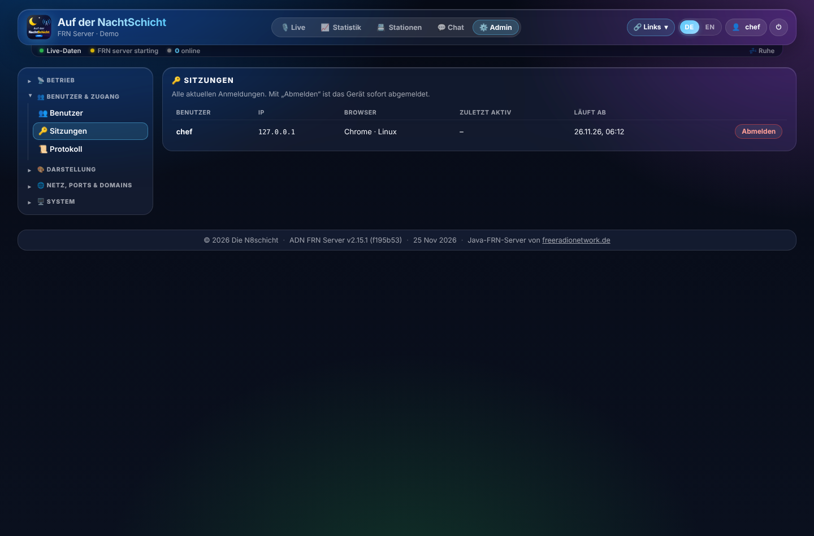 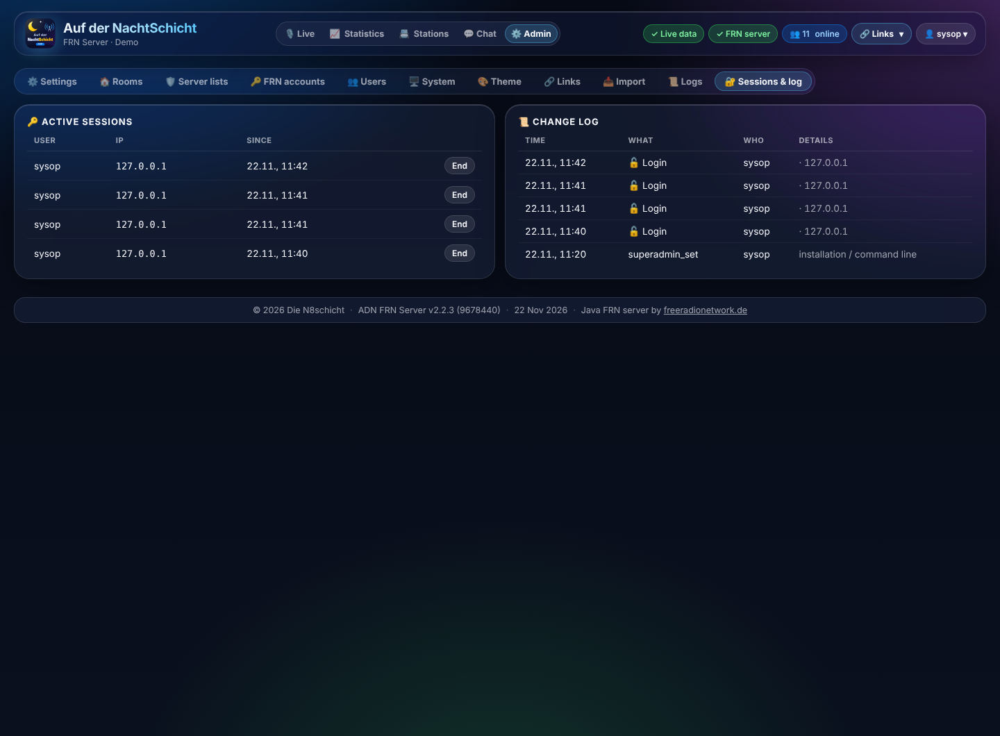

Seit **2.16.0** wie in HBlink4-FreeRadioID (gemeinsame Ansicht aller N8-Systeme): **🔑 Sitzungen** mit Benutzer, Rolle, IP, Browser,
zuletzt aktiv und Ablauf – **Abmelden** beendet eine Sitzung sofort. **📜 Protokoll**: Anmeldungen, Fehlversuche und jede Änderung im
Adminbereich, mit Zeit, Person und IP.
