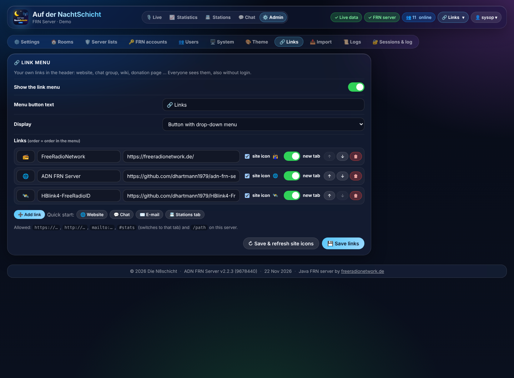
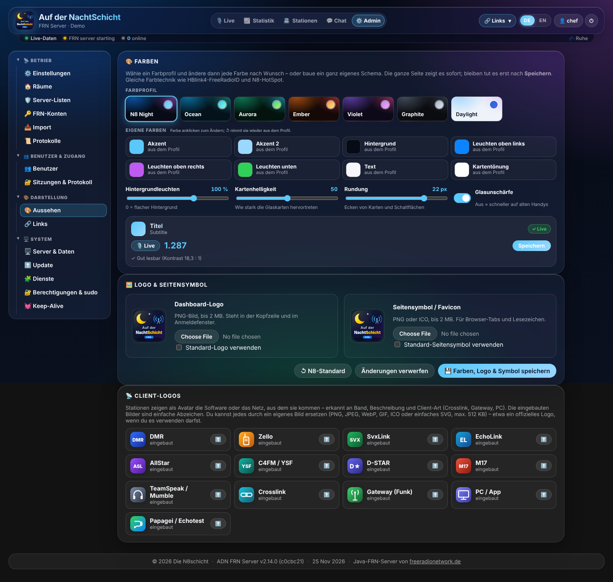

# ⚙️ Admin-Portal

[← Übersicht](../../readme.md) · [Installation](installation.md) · [Dashboard](dashboard.md) · **Admin-Portal** · [Konfiguration](konfiguration.md) · [Betrieb & Fehlersuche](betrieb.md) · [Updates](updates.md) · [Anleitungen](anleitungen.md)

Oben rechts **🔐 Login**, dann im Benutzer-Menü oder im Tab **⚙️ Admin**. Das Admin-Portal ersetzt das Bearbeiten von `server.properties`: alles wird in SQLite gespeichert, frn_adn schreibt die Datei daraus neu. Der Java-FRN-Server liest sie beim Start – nach einer Änderung erscheint oben **Restart now**.

## Rollen

| Rolle | Darf |
|---|---|
| **Superadmin** | alles; als einziger Admins anlegen, ändern und löschen und die Maschine neu starten/herunterfahren. Wird bei der Installation festgelegt (`sudo frnadn set-superadmin NAME`) |
| **Admin** | FRN-Server steuern und aktualisieren, alle Einstellungen, Räume, FRN-Konten; Benutzer mit Rolle *User* verwalten |
| **User** | sieht das Dashboard auch, wenn es nicht öffentlich ist, dazu versteckte Räume; ändert nur sein eigenes Passwort |

Passwörter: mindestens 10 Zeichen, gespeichert als scrypt-Hash. Nach 5 Fehlversuchen ist der Login für diesen Namen und diese IP 15 Minuten gesperrt. Unter **👤 → My account** ändert jeder seinen Benutzernamen und sein Passwort.

## ⚙️ Settings

<p align="center"></p>

Oben der **Java-FRN-Server**: Zustand, Port, Stationen, Version, mit **▶ Start / ⏹ Stop / 🔄 Restart**, **⬆️ Check for update** (vergleicht mit freeradionetwork.de und installiert auf Wunsch) und **🧾 Show server.properties** (die erzeugte Datei, Passwort maskiert). Meldet der SystemManager einen Fehler, steht er hier im Klartext.

Darunter fünf Karten, jede mit eigenem *Save*:

| Karte | Inhalt | landet in |
|---|---|---|
| 🛰️ FRN server | Serveradresse, Port, Standardraum, Backup-Server, Timeouts, Sprache an stumme Clients | `server.properties` |
| 🌐 SystemManager | Stand-alone an/aus, LAN-Adresse, eigene Passwortliste, SystemManager-Adresse, FRN-Konto (E-Mail, Passwort) | `server.properties` |
| 👤 Operator | Besitzer-E-Mail (`server_owner`), Rufzeichen, Name, Website | `server.properties` / Dashboard |
| 🖥️ Dashboard | Titel, Untertitel, öffentliche Ansicht, versteckte Räume, Chat, Login-Dauer | nur SQLite |
| 🗄️ Data | Aufbewahrung von Durchgängen, Logins, Chat | nur SQLite |

## 🔒 HTTPS & web – Let's Encrypt

<p align="center"></p>
<small>Schematische UI-Vorschau, kein Live-Screenshot.</small>

Der Abschnitt **HTTPS & web** übernimmt das automatische Zertifikatsmanagement aus HBlink4-FreeRadioID:

- **Enable HTTPS with Let's Encrypt:** aktiviert den HTTPS-Listener und den HTTP-01-Challenge-Endpunkt.
- **Public domain:** öffentlicher DNS-Name des Dashboards, ohne Schema oder Pfad.
- **Certificate e-mail:** Kontaktadresse für Let's Encrypt.
- **Use test certificates (staging):** Testumgebung zum Prüfen von DNS und Portfreigaben; Browser vertrauen diesen Zertifikaten nicht.
- **HTTP challenge / redirect port:** normalerweise TCP 80.
- **HTTPS port:** normalerweise TCP 443.

Nach dem Speichern ist ein Neustart des Dashboard-Dienstes erforderlich:

```bash
sudo systemctl restart frnadn
sudo journalctl -u frnadn -n 80 --no-pager
```

Der Listener auf HTTP beantwortet ACME-Challenges und leitet sonst mit HTTP 301 auf HTTPS um. Certbot läuft als Benutzer `frnadn`; seine Daten liegen im Datenverzeichnis unter `letsencrypt/`. Die Erneuerung wird alle zwölf Stunden geprüft. Ein erneuertes Zertifikat wird in den laufenden TLS-Kontext geladen, ohne den Dienst neu zu starten.

Voraussetzung sind ein korrekt auf den Server zeigender öffentlicher DNS-Eintrag und eingehend freigegebene Ports TCP 80 und 443. Wenn die erste Zertifikatsausstellung scheitert, bleibt das Dashboard vorübergehend auf HTTP-Port 8080 erreichbar (sofern Port 80 für den ACME-Listener verwendet wird); die Ursache steht im Journal.

## 🏠 Rooms

<p align="center"></p>

Links die Räume mit ihrem Index **net00 … net63** und der Zahl der Stationen: ⭐ Standardraum, 🦜 net00 (Test-/Parrot-Raum), 🔒 auf dem Dashboard versteckt, ⛔ abgeschaltet. ▲▼ ändert nur die Reihenfolge im Dashboard – die FRN-Clients sehen die Räume alphabetisch.

Ein Raum behält seinen Index für immer, denn der Server benennt auch seine Listen danach (`MuteList01.xml` …). Neue Räume bekommen den nächsten freien Index; ein gelöschter Index wird wiederverwendet. `net00` lässt sich umbenennen und abschalten, aber nicht löschen.

Rechts alle Parameter des Raums mit ihrem Namen aus `server.properties` – Bedeutung im Einzelnen: [Konfiguration → Räume](konfiguration.md#räume-net00--net63).

## 🛡️ Server lists

<p align="center"></p>
<small>Schematische Vorschau mit Beispieldaten.</small>

Das Dashboard importiert vorhandene `AdminList`, `MuteList`, `BlockList` und `AccessList` XML-Dateien beim Start und vor jeder Anzeige oder Änderung nach SQLite. Auch Änderungen, die Owner oder Admins weiterhin im **FRN-Client** vornehmen, werden beim nächsten Öffnen der ACL-Seite übernommen.

Im Admin-Portal lassen sich Einträge je Raum hinzufügen, bearbeiten und entfernen. Für neue Einträge kann eine aktuell verbundene Station übernommen werden; alternativ werden FRN-ID und E-Mail von Hand eingetragen. Die Access-Liste steuert zusätzlich, wer dem Raum beitreten und wer sprechen darf.

Beim Speichern schreibt frn_adn die Listen im FRN-kompatiblen XML-Format zurück. Die vorherige Datei wird unter `acl/backups/` gesichert. Der FRN-Server braucht danach einen Neustart, um die Änderungen zu übernehmen; das Dashboard zeigt dafür den Neustart-Hinweis an.

## 🔑 FRN accounts

<p align="center"></p>

Die eigene Passwortliste für den **Stand-alone-Betrieb** (`acl/FRNPasswd.xml`): E-Mail, Rufzeichen, Name, Passwort, gesperrt. Am SystemManager prüft dieser die Passwörter, die Liste wird dann nicht benutzt. Ist *Use the own password list* aus, nimmt der Server im Stand-alone-Betrieb jedes Passwort an.

Der Java-Server braucht die Passwörter im Klartext in seiner Datei; frn_adn legt sie deshalb nur dort und in der Datenbank ab, beide nur für den Dienstbenutzer lesbar.

## 👥 Users

<p align="center"></p>

Benutzer des Dashboards (nicht zu verwechseln mit FRN-Konten). Den Superadmin kann hier niemand ändern oder löschen; Admins bearbeitet nur der Superadmin.

## 🖥️ System

<p align="center"></p>

FRN-Server (Dienst, Port, Version, Pfade), Datenbank (Zeilen, Größe, Cache), Maschine (Last, Speicher, Platte) und Updates.

| Knopf | Wirkung |
|---|---|
| 🔄 Restart FRN server | `systemctl restart frn-server` mit neu geschriebener `server.properties` – alle Stationen verbinden sich neu |
| ♻️ Restart dashboard | nur frn_adn startet neu, der FRN-Server läuft weiter |
| 🔄 Reboot / ⏻ Shut down | nur Superadmin |
| ↻ Check now | prüft Dashboard (GitHub) und Java-FRN-Server auf neue Versionen |
| Upgrade Dashboard now / Upgrade Java now | installiert das jeweilige Update – Einzelheiten: [Updates](updates.md) |

## 🔄 Updates, Links und Import

<p align="center"></p>

### ⬆️ Software updates (System)

Das Dashboard prüft 30 Sekunden nach dem Start und danach zu **jeder vollen Stunde** auf neue Commits im GitHub-Repository und auf eine neue Version des Java-FRN-Servers. Nichts wird automatisch installiert. **↻ Check now** prüft sofort. Für jedes Programm zeigt die Karte die installierte und die neue Version; bei GitHub außerdem die neuen Commits und einen Vergleichslink.

- **Upgrade Java now:** lädt `FRN_Server.zip` von freeradionetwork.de, ersetzt die JAR und startet den Java-Server neu.
- **Upgrade Dashboard now:** holt genau den angezeigten Stand per Fast-Forward, installiert geänderte Python-Pakete und startet zuerst den FRN-Server für einen frischen Live-Site-Status und danach das Dashboard neu. Verbundene Stationen verbinden sich automatisch wieder; die Seite lädt sich selbst. Falls der FRN-Neustart fehlschlägt, zeigt das Dashboard eine Meldung mit dem manuellen Neustart-Hinweis. Bei lokalen Änderungen im Programmverzeichnis oder fehlenden Schreibrechten ist der Knopf grau und die Karte nennt den Grund. Nach der Neuinstallation einmal `sudo ./scripts/update.sh` als root ausführen; das setzt die nötigen Schreibrechte. Für das öffentliche Standard-Repository ist kein GitHub-Token nötig: [Update-Funktion einrichten](updates.md#upgrade-dashboard-now-einmalig-freischalten).

Alle Meldungen und Lösungen: **[Updates](updates.md)**.

### 🔗 Links

<p align="center"></p>

Eigener Admin-Tab **🔗 Links** mit Schalter *Show links on the dashboard*, Menütext, Darstellung als Aufklapp-Menü oder Knopfreihe und einer sortierbaren Liste. Je Link legst du Name, Adresse, Fallback-Emoji, **Site icon** und **New tab** fest. Website-Icons werden über die üblichen Favicon-Pfade oder die `rel=icon`-Angabe der Zielseite gefunden und in SQLite gecacht; **Save & refresh site icons** ruft sie erneut ab. Wenn ein Ziel kein Icon anbietet, erscheint das Emoji. Bis zu 20 Links; erlaubt sind `https://`, `http://`, `mailto:`, `#stats` / `#stations` (Tab wechseln) und `/pfad`. Schritt für Schritt: [Anleitungen → Link-Menü](anleitungen.md#-link-menü-einrichten).

### 📥 Import

Eigener Admin-Tab **📥 Import**. Hier kann nach der frischen Installation eine einzelne `server.properties` der früheren FRN-Installation ausgewählt werden. Übernommen werden nur erkannte Properties und Raumdefinitionen; Installation, Datenbank, JAR, ACL-Dateien und Passwort-XML nicht. Vor dem Schreiben wird die bisherige `server.properties` mit Zeitstempel gesichert.

**Wichtig:** Vor einem Import zusätzlich das Datenverzeichnis sichern. Nicht unterstützte Properties werden nicht übernommen. Nach dem Import den Java-FRN-Server neu starten.

### 🎨 Theme

<p align="center"></p>
<small>Schematische Vorschau mit Beispieldaten.</small>

Eigener Admin-Tab **🎨 Theme**. Wähle eines der Farbschemata **Midnight, Ocean, Forest, Sunset, Violet** oder **Light** und passe Akzent, Seitenhintergrund, Kartenfarbe und Textfarbe einzeln an. Die Vorschau wirkt sofort; **Save theme & assets** speichert das Schema global in SQLite.

Das Dashboard-Logo akzeptiert PNG bis 2 MB. Das Site-Icon (Favicon für Browser-Tab und Lesezeichen) akzeptiert PNG oder ICO bis 2 MB. Beide Dateien liegen im Datenverzeichnis, überstehen Updates und lassen sich auf das jeweilige Standardmotiv zurücksetzen.

Website-Links können außerdem ihr Site-Icon verwenden. Die Icons werden beim Speichern der Links bzw. beim Dashboard-Start abgerufen, geprüft und als Bilddaten in der SQLite-Tabelle `link_icons` zwischengespeichert. Nicht erreichbare oder private Adressen werden nicht abgerufen; in diesem Fall bleibt das Fallback-Emoji sichtbar.

## 📜 Logs

<p align="center"></p>

Ereignisse live (Logins, Abweisungen, Moderation aus dem FRN-Client, Konfigurationsänderungen), auf Knopfdruck **server.log** des FRN-Servers und das Journal von `frn-server` und `frnadn`, darunter alle Logins mit E-Mail und IP-Adresse.

## 🔐 Sessions & log

<p align="center"></p>

Angemeldete Sitzungen (beenden mit *End*) und das Protokoll aller Änderungen: wer hat wann was geändert, mit IP.
