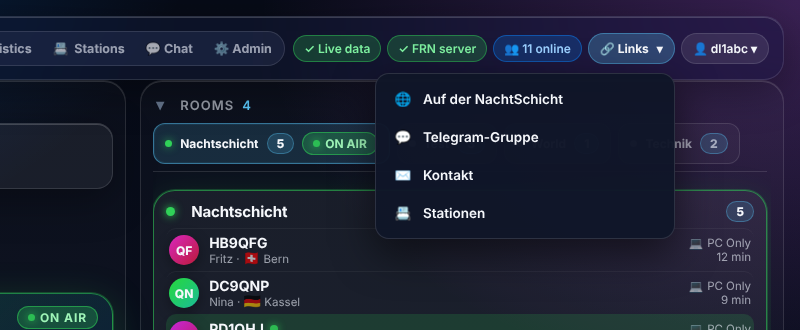
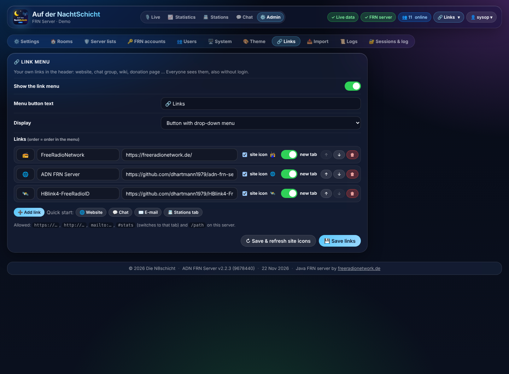
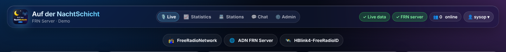
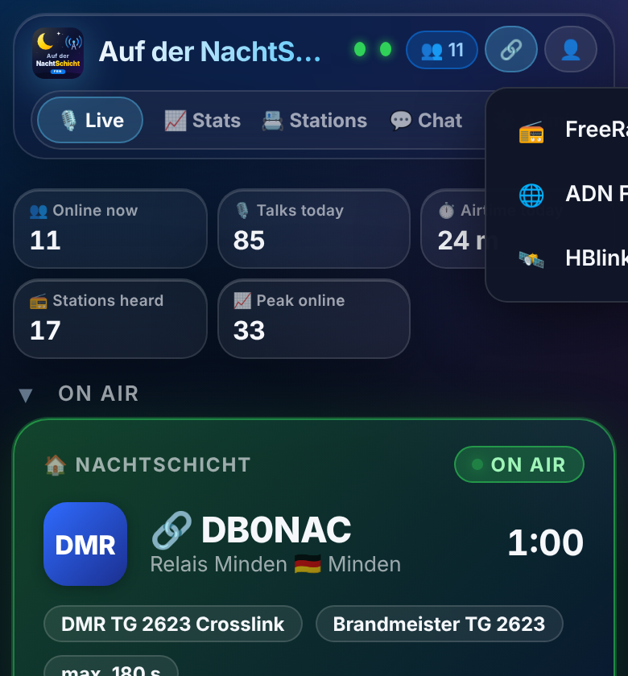
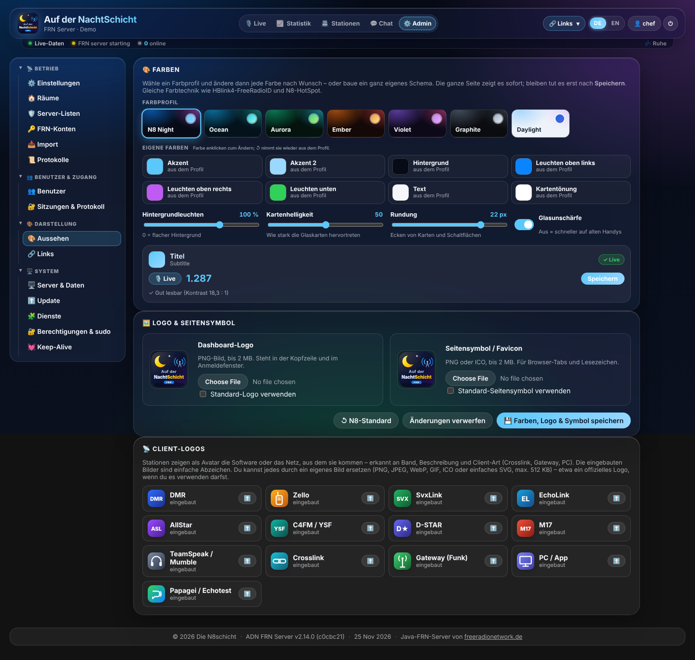

# 🧭 Anleitungen

[← Übersicht](../../readme.md) · [Installation](installation.md) · [Dashboard](dashboard.md) · [Admin-Portal](adminbereich.md) · [Konfiguration](konfiguration.md) · [Betrieb & Fehlersuche](betrieb.md) · [Updates](updates.md) · **Anleitungen**

Kurze Schritt-für-Schritt-Anleitungen für die häufigsten Aufgaben.

## 🔗 Link-Menü einrichten

Eigene Links (Webseite, Chat-Gruppe, Kontakt …) erscheinen in der Kopfzeile, für alle sichtbar, auch ohne Login.

1. Als Admin anmelden → **⚙️ Admin → 🔗 Links**.
2. Auf **＋ Add link** klicken oder einen **Quick start**-Knopf (🌐 Website, 💬 Chat, ✉️ E-mail, 📇 Stations tab) wählen.
3. Je Link: Name, Adresse, Fallback-Emoji, **Site icon** und ob er in einem **neuen Tab** öffnet. Site-Icons werden in SQLite gecacht; wenn kein Icon verfügbar ist, bleibt das Emoji sichtbar. Mit **↑ / ↓** ändert sich die Reihenfolge, **×** entfernt den Eintrag.
4. Oben bei Bedarf **Menu button text** ändern und **Display** wählen:
   - *Button with drop-down menu* – ein Knopf „🔗 Links“, die Einträge klappen darunter auf.
   - *Row of buttons below the header* – alle Links als Knopfreihe unter der Kopfzeile.
5. **Save links**. Die Kopfzeile aktualisiert sich sofort. Mit **Save & refresh site icons** werden die Favicons zusätzlich neu abgerufen.

Erlaubte Adressen: `https://…`, `http://…`, `mailto:…`, `#stats` bzw. `#stations` (wechselt zu diesem Tab, ohne die Seite zu verlassen) und `/pfad` auf diesem Server. Alles andere – etwa `javascript:` – lehnt das Dashboard ab. Bis zu 20 Links sind möglich. Mit dem Schalter **Show the link menu** blendest du das Menü aus, ohne die Liste zu löschen.

Als Knopfreihe:

Auf dem Smartphone klappt das Menü unter dem Knopf auf:

## ⬆️ Dashboard aktualisieren

1. **⚙️ Admin → 🖥️ System → ⬆️ Updates → ↻ Jetzt prüfen** (oder der Hinweis *Update verfügbar* unter der Statusleiste).
2. Steht dort *Update verfügbar*: **⬆️ Update jetzt installieren** und im Fenster **Jetzt aktualisieren**.
3. Warten, bis sich die Seite neu lädt.

Ist der Knopf grau, steht der Grund auf der Karte. Meist hilft einmalig `sudo ./scripts/update.sh` – Einzelheiten und alle Meldungen: **[Updates](updates.md)**.

## 🎨 Theme, Logo und Site-Icon ändern

**⚙️ Admin → 🎨 Theme**: Farbschema wählen oder Akzent-, Hintergrund-, Karten- und Textfarbe individuell festlegen. Du kannst ein Dashboard-Logo als PNG und ein Site-Icon als PNG oder ICO hochladen (jeweils bis 2 MB). **Save theme & assets** speichert die Theme-Farben global in SQLite. Logo und Site-Icon liegen im Datenverzeichnis und überstehen Programmupdates. Über **Use default logo/site icon** setzt du ein Bild zurück.

## 📥 Umzug von einer alten FRN-Installation

Nach der frischen Installation: **⚙️ Admin → 📥 Import** und nur die alte `server.properties` auswählen. Übernommen werden die erkannten Einstellungen und Raumdefinitionen; Datenbank, JAR, ACL-Dateien und Passwort-XML nicht. Danach den Java-FRN-Server neu starten. Details: [Installation → Alte Konfiguration übernehmen](installation.md#alte-konfiguration-optional-übernehmen).

## 🔐 Weiteren Admin anlegen

Nur der Superadmin: **⚙️ Admin → 👥 Users → neuer Benutzer**, Rolle *Admin*. Passwörter haben mindestens 10 Zeichen. Rollen im Überblick: [Admin-Portal → Rollen](adminbereich.md#rollen).

## 🧪 Ausprobieren ohne Funkbetrieb

Mit erfundenen Stationen und Statistik (nie auf einem echten Server): [Betrieb & Fehlersuche → Testen ohne Funk](betrieb.md#testen-ohne-funk).
