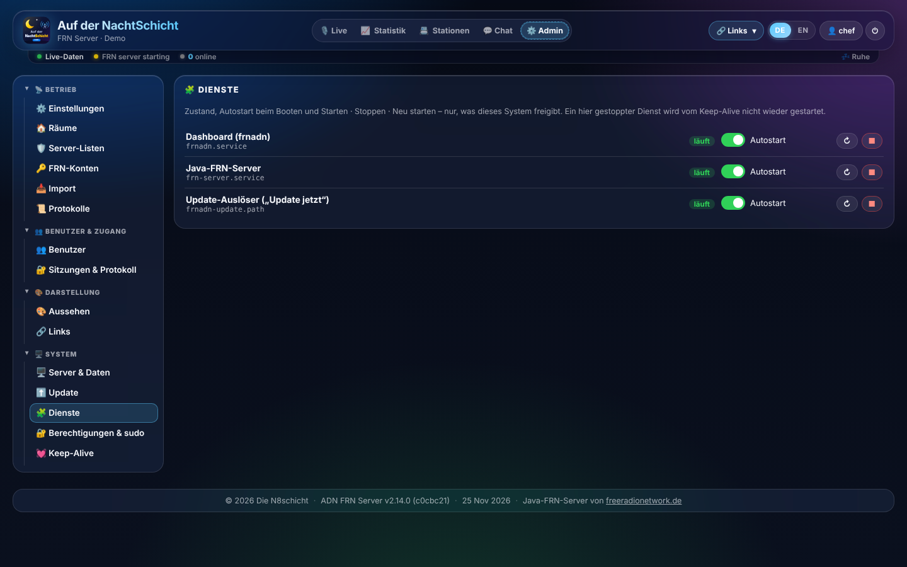
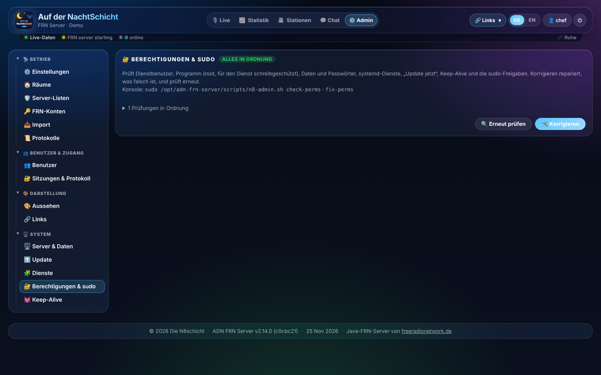
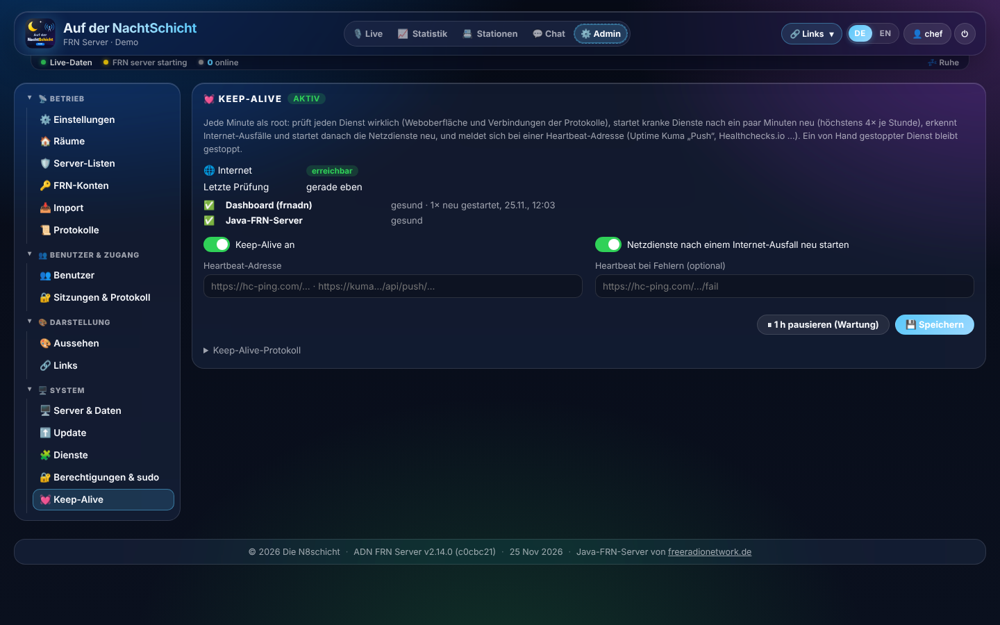
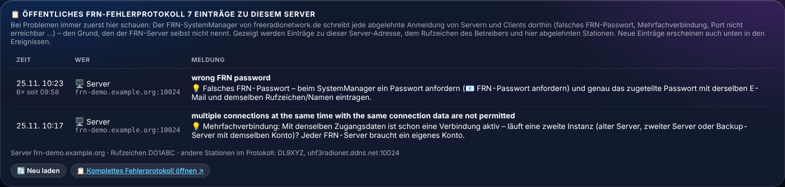

# 🩺 Betrieb & Fehlersuche

[← Übersicht](../../readme.md) · [Installation](installation.md) · [Dashboard](dashboard.md) · [Admin-Portal](adminbereich.md) · [Konfiguration](konfiguration.md) · **Betrieb & Fehlersuche** · [Updates](updates.md) · [Anleitungen](anleitungen.md)

## Dienste

**Admin → System → 🧩 Dienste** zeigt `frnadn`, `frn-server` und den Update-Auslöser schlank mit Status, **Autostart**-Schalter
und **▶ Starten / ↻ Neu starten / ■ Stoppen**. Der eigene Eintrag **🔐 Berechtigungen & sudo** zeigt alle Prüfungen von `scripts/n8-admin.sh`, mit
**🛠️ Korrigieren** (prüfen → korrigieren → erneut prüfen). Konsole: `sudo /opt/adn-frn-server/scripts/n8-admin.sh check-perms` bzw. `fix-perms`.

<p align="center">
  
  
</p>

```bash
systemctl status frn-server frnadn     # laufen sie?
journalctl -u frn-server -f            # Java-FRN-Server
journalctl -u frnadn -f                # Dashboard
tail -f /var/lib/frnadn/frn/logs/server.log
```

Beide Dienste laufen als Benutzer `frnadn` ohne Root-Rechte. frn_adn darf per sudoers-Regel (`/etc/sudoers.d/frnadn`) genau `frn-server` starten, stoppen, neu starten sowie *Reboot* und *Shut down* auslösen – sonst nichts.

`frn-server` startet nach einem Absturz nach **60 Sekunden** neu. Der Java-Server beendet sich bei schweren SystemManager-Fehlern selbst; die Wartezeit verhindert, dass er den SystemManager mit Anmeldeversuchen überflutet.


## 💓 Keep-Alive

<p align="center"></p>

Seit **2.14.0** wacht ein Keep-Alive über das Dashboard und den Java-FRN-Server. `frnadn-keepalive.timer` startet **jede Minute
als root** `scripts/n8-admin.sh keepalive`:

| Was | Wie |
|---|---|
| **Dashboard** | antwortet es auf `/api/info`? |
| **Java-FRN-Server** | läuft er (`/api/n8/health`, nur lokal erreichbar) **und** nimmt er Verbindungen auf seinem FRN-Port an? |
| **Neustart** | nach **3 Minuten** krank (sofort bei `failed`), **höchstens 4× je Stunde** – danach „aufgegeben“ im Protokoll |
| **Internet-Ausfall** | 1.1.1.1, 9.9.9.9 und github.com (Port 443) nicht erreichbar → keine sinnlosen Neustarts; ist das Netz nach mindestens 60 s wieder da, wird der FRN-Server einmal neu gestartet, damit er sich sofort wieder am SystemManager meldet |
| **Heartbeat** | optional jede Minute ein Ping an Uptime Kuma („Push“) oder Healthchecks.io, bei Fehlern an die Fehler-Adresse |
| **Wartung** | **⏸ 1 h pausieren**; ein unter *Dienste* gestoppter Dienst bleibt gestoppt, bis du ihn dort startest |

Dateien im Datenordner (`/var/lib/frnadn`): `keepalive.conf`, `keepalive.json`, `keepalive.log` (höchstens 400 Zeilen).
Eingerichtet wird der Timer von Installer, Update und `fix-perms`; `check-perms` prüft ihn mit.

```bash
systemctl status frnadn-keepalive.timer
sudo /opt/adn-frn-server/scripts/n8-admin.sh keepalive    # eine Runde von Hand
tail -f /var/lib/frnadn/keepalive.log
```

## 📋 Bei Problemen immer zuerst: das öffentliche FRN-Fehlerprotokoll

Der FRN-SystemManager von freeradionetwork.de schreibt **jede abgelehnte Anmeldung** von Servern und Clients in ein öffentliches
Fehlerprotokoll – auf freeradionetwork.de im Seitenmenü unter *Hilfe → Fehlerprotokoll*, direkt: <http://log.freeradionetwork.de:60080/error_log.php>.
Dort steht der Grund, den der Java-Server oft nur als Nummer oder gar nicht meldet, z. B. *wrong FRN password*, *multiple connections at the
same time with the same connection data are not permitted* oder *not listening on specified port*.

adn-frn-server nutzt es ab 2.12.0 selbst:

* **Admin → 📜 Logs → 📋 Öffentliches FRN-Fehlerprotokoll:** Einträge zu **dieser Server-Adresse**, dem **Rufzeichen des Betreibers** und zu
  **hier abgelehnten Stationen** (letzte Stunde) – gleiche Meldungen zusammengefasst („6× seit 09:58“), mit Erklärung und Abhilfe.
  **🔄 Neu laden** und **📋 Komplettes Fehlerprotokoll öffnen**.
* **Automatisch:** alle 10 Minuten, solange der SystemManager einen Fehler meldet alle 2 Minuten – neue Einträge erscheinen als Ereignis im Log
  (`FRN error log: server frn.example.org:10024 – wrong FRN password …`), jede Meldung einmal. Nicht im eigenständigen Betrieb.
* **Hinweise:** unter *Settings → SystemManager* und im Fehlerkasten des Java-Servers ein Link dorthin.

<p align="center"></p>

| Meldung im Protokoll | Bedeutung / Lösung |
|---|---|
| `wrong FRN password` | Falsches FRN-Passwort – *📧 FRN-Passwort anfordern* und genau das zugeteilte Passwort mit derselben E-Mail eintragen |
| `multiple connections at the same time with the same connection data are not permitted` | Mit denselben Zugangsdaten ist schon eine Verbindung aktiv – zweite Instanz (alter Server, Test- oder Backup-Server mit demselben Konto) beenden; jeder Server braucht ein eigenes Konto |
| `not listening on specified port` | Der SystemManager erreicht `server_addr:Port` nicht – Portweiterleitung TCP, Firewall, Adresse |

Das Protokoll enthält nur die letzten etwa 100 Fehler des ganzen FRN-Netzes. Ist es nicht erreichbar (ausgehend Port 60080 gesperrt), steht
das in der Kachel.

## Fehlermeldungen des SystemManagers

Sie stehen im Admin-Portal oben unter *Settings* und im Log – den ausführlichen Grund liefert das [FRN-Fehlerprotokoll](#-bei-problemen-immer-zuerst-das-öffentliche-frn-fehlerprotokoll):

| Fehler | Bedeutung | Lösung |
|---|---|---|
| **−4** wrong credentials | E-Mail oder Passwort des FRN-Kontos falsch | Settings → SystemManager |
| **−5** not accessible | Der SystemManager erreicht den Server nicht | `server_addr` richtig? Portweiterleitung TCP 10024? Firewall? Test von außen: `nc -vz frn.example.org 10024` |
| **−6** version too old | FRN_Server.jar zu alt | Settings → Check for update |
| **−7** access denied | Zugang verweigert | beim Betreiber von freeradionetwork.de nachfragen |
| **−8** address occupied | Adresse und Port nutzt schon ein anderer Server | anderen Port wählen |
| **−9** same credentials online | Dieses FRN-Konto ist schon mit einem anderen Server online | anderen Server abmelden |

## Weitere Probleme

| Problem | Ursache / Lösung |
|---|---|
| **FRN server** mit rotem Punkt in der Statusleiste | Dienst gestoppt oder Fehler: Admin-Portal → Settings zeigt den Grund; Logs → *server.log* |
| Port belegt | `sudo ss -ltnp \| grep 10024` – läuft noch ein anderer FRN-Server? |
| Dashboard zeigt keine Stationen, obwohl Clients verbunden sind | `server_clients.log` fehlt? `sudo frnadn write-config` schreibt `log4j.xml` neu, danach FRN-Server neu starten |
| Änderungen wirken nicht | Der Java-Server liest `server.properties` nur beim Start: oben *Restart now* |
| Client meldet „wrong password“ | am SystemManager: Konto des Benutzers prüfen; stand-alone: *FRN accounts* |
| Dashboard zeigt „No superadmin yet“ | `sudo frnadn set-superadmin NAME` |
| Passwort vergessen | `sudo frnadn reset-password NAME` |
| Java fehlt nach Systemupdate | `sudo apt install default-jre-headless` |
| **Update jetzt installieren** ist grau oder meldet keine Updates | Update-Auslöser/sudo nicht eingerichtet oder fehlender Git-Stand: einmal `sudo /opt/adn-frn-server/scripts/n8-admin.sh fix-perms` – alt: `cd /opt/adn-frn-server && sudo ./scripts/update.sh`, siehe [Updates](updates.md#wenn-etwas-nicht-klappt) |
| Update-Prüfung: „rate limit“ oder „not reachable“ | GitHub begrenzt anonyme Abfragen bzw. der Server erreicht github.com nicht – später prüfen, Netz und DNS testen |
| Link-Menü fehlt in der Kopfzeile | *Show the link menu* aus oder keine Links eingetragen: Admin → 🔗 Links |

## Sicherung

Am einfachsten im Dashboard: *Admin → System → 💾 Backup* – siehe [Backup & Wiederherstellen](adminbereich.md#-backup--wiederherstellen-nur-superadmin).
Dasselbe auf der Konsole (z. B. für einen Cronjob):

```bash
# Backup – Passwort aus der Umgebung oder interaktiv; landet in /var/lib/frnadn/backups/
sudo -u frnadn FRNADN_PASSWORD='…' /opt/adn-frn-server/.venv/bin/python -m frnadn backup
sudo -u frnadn /opt/adn-frn-server/.venv/bin/python -m frnadn backup /var/lib/frnadn/backups   # fragt nach dem Passwort

# Wiederherstellen – Dienste stoppen, einspielen, starten
sudo systemctl stop frnadn
sudo -u frnadn /opt/adn-frn-server/.venv/bin/python -m frnadn restore /pfad/frn-backup-….frnbak
sudo systemctl start frnadn && sudo systemctl restart frn-server
```

`restore` legt den alten Stand nach `/var/lib/frnadn/before-restore-<datum>/` und nennt den Ordner.

**Neuer Server aus einem Backup** – der Installer spielt es gleich mit ein:

```bash
echo 'Backup-Passwort' > /root/frn.pw && chmod 600 /root/frn.pw
sudo FRNADN_RESTORE=/root/frn-backup-….frnbak FRNADN_RESTORE_PASSWORD_FILE=/root/frn.pw ./scripts/install.sh
rm /root/frn.pw
```

Mit `FRNADN_BEHIND_PROXY=1` bleibt das eigene HTTPS dabei aus (für einen Reverse-Proxy wie nginx).
Sonst danach HTTPS unter *Admin → Settings → HTTPS & web* neu einschalten (Zertifikate sind nicht im Backup) – oder das Ganze gleich

## Testen ohne Funk

```bash
python3 tools/sim_clients.py --port 10024 --stations 10 --minutes 5   # simulierte Stationen (nur stand-alone!)
FRNADN_DATA=/tmp/demo python3 tools/seed_demo.py --days 60           # erfundene Statistik – nie auf einem echten Server
FRN_TEST_JAR=/opt/frn-server/FRN_Server.jar python3 -m pytest tests  # Tests, auch gegen den echten Java-Server
```

Zum Ausprobieren ohne systemd: `FRNADN_DATA=/tmp/test FRNADN_FRN_DIRECT=1 FRNADN_PORT=8080 python3 -m frnadn` – frn_adn startet den Java-Server dann selbst.
