# 🎙️ Dashboard

[← Übersicht](../../readme.md) · [Installation](installation.md) · **Dashboard** · [Admin-Portal](adminbereich.md) · [Konfiguration](konfiguration.md) · [Betrieb & Fehlersuche](betrieb.md) · [Updates](updates.md) · [Anleitungen](anleitungen.md)

Das Dashboard ist eine einzige Seite mit Tabs. Die Live-Daten liest frn_adn aus den beiden Logdateien des Java-FRN-Servers: `server_clients.log` – die vollständige Clientliste jedes Raums nach jeder Änderung, vom Autor des Servers genau dafür eingebaut – und `server.log` mit Logins, E-Mail, Client-Art, Sprechbeginn und -ende. Änderungen gehen per WebSocket sofort an alle Browser.

## Startseite wie beim DMR-Dashboard

Seit Version 2.3 ist die Live-Seite wie die Startseite von **DMR Die N8schicht** aufgebaut, ab 2.4 so, dass man am Desktop
praktisch nicht mehr scrollen muss:

1. **Kacheln** mit den Tageszahlen
2. **On air** über die ganze Breite – wer gerade spricht, pro Raum eine Karte; ist es still, eine schmale Zeile mit dem letzten Durchgang
3. **Last heard** (links) und **Rooms** (rechts) **nebeneinander und gleich hoch**. Beide füllen den Rest des Fensters und rollen
   in sich; die Höhe passt sich an, wenn On air wächst oder das Fenster sich ändert.

| Bereich | Inhalt |
|---|---|
| **Kacheln** | *Online now*, *Talks today*, *Airtime today*, *Stations heard*, *Peak online* mit Uhrzeit |
| **On air** | Avatar, Rufzeichen, Name, Ort, Band und laufende Zeit |
| **Last heard** | eine Zeile pro Durchgang: Zeit, Avatar, Rufzeichen mit Flagge, Raum, Dauer, Band; filterbar nach Raum. Am Desktop stehen alle letzten 20 Durchgänge in der Liste (sie rollt), bis 1400 px Breite ohne die Spalte *Band* |
| **Rooms** | Raum-Chips mit Stationszahl und ● ON AIR; geöffnet ist der Raum, in dem gesprochen wird, sonst der vollste |

**Comings & goings** (Logins und Logouts) steht seit 2.4 im Tab **📈 Statistics** ganz unten.

Unter 1100 px Breite (Tablet, Handy) ist alles einspaltig: Kacheln, On air, Räume, Last heard (5 bzw. 8 Einträge, **Show all**).

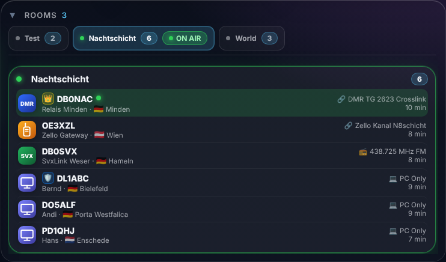

**Avatar = Client-Software.** Jede Station zeigt als Bild, woher sie kommt: **DMR**, **Zello**, **SVX** (SvxLink), **EL** (EchoLink),
**ASL**, **YSF**, **D★**, **M17**, TeamSpeak/Mumble, Crosslink, Funk-Gateway (Antenne), PC/App (Monitor) oder der Parrot.
Erkannt wird das an Band, Beschreibung und Client-Art; der Admin kann jedes Bild durch ein eigenes ersetzen
([Admin → Theme → Client logos](adminbereich.md#-theme)).

**Rollen:** 👑 *Owner* und 🛡️ *Admin* des Raums stehen direkt **hinter dem Avatar und vor dem Rufzeichen**. Ein grüner Punkt hinter
dem Rufzeichen heißt: spricht gerade.

## Kopfzeile und Menü

Wie bei HBlink4-FreeRadioID und N8-HotSpot gibt es oben **ein** Menü: links Logo, Titel und Untertitel, in der Mitte die **Reiter**,
rechts Links-Knopf und Anmeldung. Direkt darunter hängt eine schmale **Statusleiste** – bewusst niedriger als das Menü –, die nur den
Zustand der Dienste zeigt. Beides bleibt beim Scrollen oben stehen.

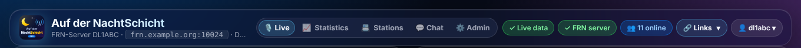

**Rolle hinter dem Titel:** `[Master]` (grün), `[Backup]` (gelb) oder `[Standalone]` (grau, Einzelserver) – je nach
*Einstellungen → 🔁 Master & Backup*, auch im Browser-Tab. So ist sofort klar, auf welchem Server man gerade ist.

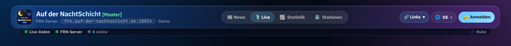

**Menü**

| Eintrag | Bedeutung |
|---|---|
| 🎙️ Live · 📈 Statistics · 📇 Stations · 💬 Chat | die Reiter; *Chat* nur mit Berechtigung |
| ⚙️ Admin | erscheint nach dem Login für Admins als eigener Menüpunkt (gestrichelt umrandet) |
| 🔗 Links ▾ | das Link-Menü (siehe unten) |
| 🔐 Anmelden | ganz rechts; öffnet das [Anmeldefenster](sicherheit.md#anmeldung). Angemeldet steht dort **Avatar + Name ▾** – das Menü darunter enthält Rolle, 🔑 Mein Konto (Passwort), ✉️ Webmail, ⚙️ Admin und ⏻ Abmelden |

**Statusleiste** – der farbige Punkt sagt den Zustand: grün = ok, gelb = wartet, rot = Problem, blau = Info.

| Anzeige | Bedeutung |
|---|---|
| Live data | Verbindung des Browsers zum Dashboard steht; rot: *Live data offline*, wird automatisch neu aufgebaut |
| FRN server | Der Dienst `frn-server` läuft und lauscht auf seinem Port; rot mit Grund (gestoppt, SystemManager-Fehler) |
| n online | Stationen in allen sichtbaren Räumen (ohne Parrot) |
| On air / Quiet (rechts) | wer gerade spricht bzw. 💤 *Quiet* |

Wer gerade spricht, steht im Bereich **On air** der Live-Seite. Das Farbschema (7 Profile, darunter das helle *Daylight*, jede Farbe frei wählbar) stellt der Admin unter **Admin → Theme** ein.

Unten auf jeder Seite steht die **Fußzeile** mit © Die N8schicht, der installierten Version mit Commit und deren Datum.

### 🔗 Link-Menü

Das Menü zeigt die eigenen Links des Betreibers – für alle, auch ohne Login. Es gibt zwei Darstellungen:

Jeder Weblink kann sein Website-Site-Icon anzeigen. Das Dashboard cached die abgerufenen Icons in SQLite und zeigt andernfalls das konfigurierte Fallback-Emoji.

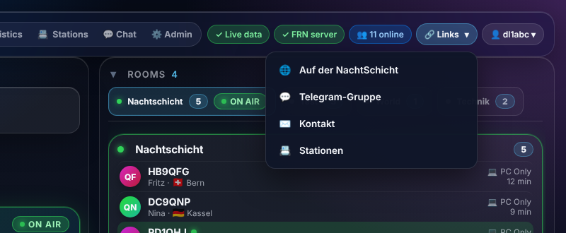 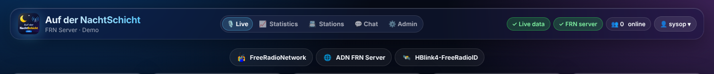

*Button with drop-down menu* öffnet die Liste unter dem Knopf (Esc oder Klick daneben schließt sie); *Row of buttons* zeigt alle Links als Reihe unter der Kopfzeile. Ein Link `#stations` wechselt zu diesem Reiter. Einrichten: [Anleitungen → Link-Menü](anleitungen.md#-link-menü-einrichten).

### Am Smartphone

Oben stehen Logo, Titel sowie Links und Benutzer als Symbole, darunter die Reiter in voller Breite (*Stats* statt *Statistics*).
Die Statusleiste bleibt eine einzige, niedrige Zeile. Die Kacheln bilden ein 3+2-Raster, alles Weitere ist einspaltig.

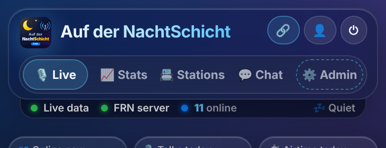 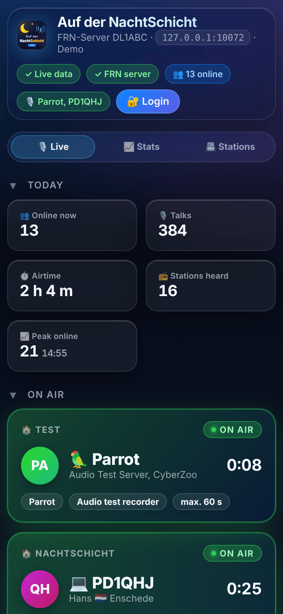

## Tab 🎙️ Live

Die Abschnitte lassen sich wie beim DMR-Dashboard mit **▾** zuklappen; der Browser merkt sich das.

- **Today** – Online jetzt, Durchgänge, Sprechzeit, gehörte Stationen und Spitzenwert heute.
- **On air** – pro Raum eine grüne Karte mit Client-Avatar, Rufzeichen, Name, Ort, Band und laufender Zeit; `max. 180 s` ist die maximale Sendezeit des Raums. Auch der Parrot erscheint hier, wenn er einen Durchgang abspielt.
- **Rooms** – jeder Raum mit seinen Stationen, Avatar = Client-Software (siehe oben), danach 👑/🛡️ und das Rufzeichen; rechts Band und Dauer; 🔇 stumm. Die Stationsliste sortiert Crosslinks zuerst, dann Admins/Owner, QRV, QRL und die übrigen Stationen. **PC Only steht immer am Ende.** 🔒 = auf dem Dashboard versteckt (nur nach Login).
- **Last heard** – die letzten Durchgänge mit Dauer laut FRN-Server, filterbar nach Raum (*All* oder ein Raum); neben den Räumen, gleich hoch.

Ein Klick auf eine Station öffnet ihre Detailansicht. Moderiert wird – wie bei FRN üblich – im FRN-Client als Owner oder Admin (Rechtsklick auf die Station); das Dashboard zeigt das Ergebnis sofort an.

## Tab 📈 Statistics

Zeitraum *Today, 24 h, 7/30/90 days, 1 year* und Maß *Airtime* oder *Talks*.

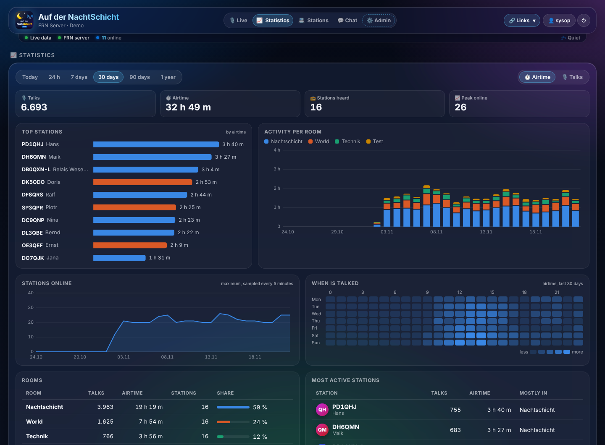

- **Top stations** und **Activity per room**
- **Stations online** – Maximum, alle 5 Minuten gemessen
- **When is talked** – Wochentag × Uhrzeit
- Tabellen **Rooms** und **Most active stations**
- **Comings & goings** – Logins und Logouts, live (die letzten 40)

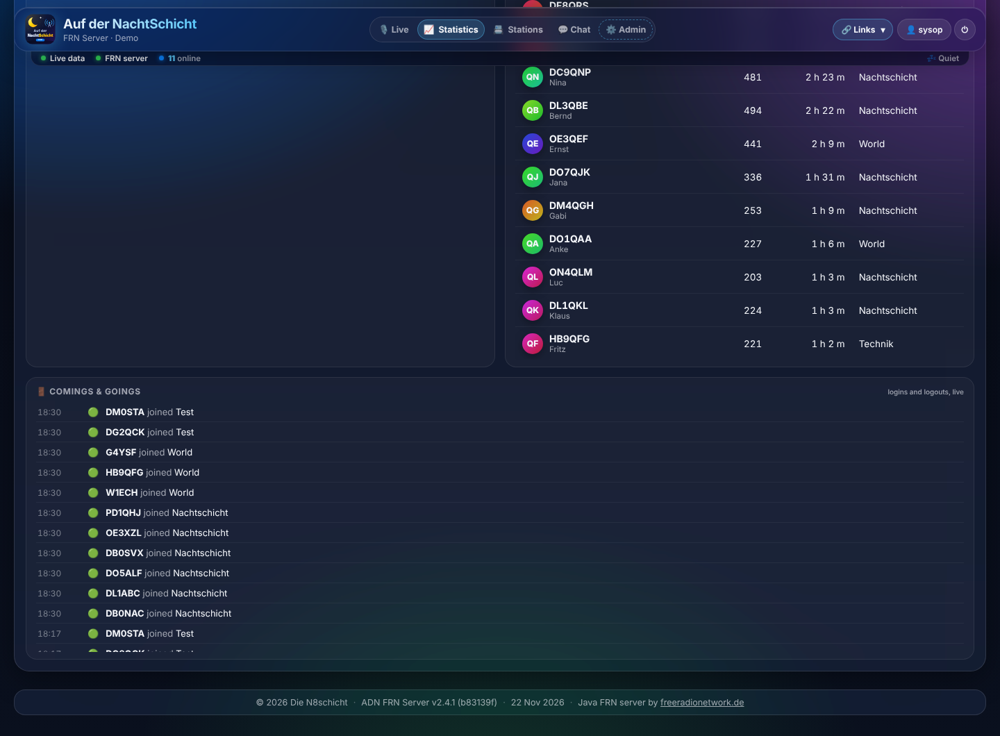

Für lange Zeiträume rechnet frn_adn mit Tagessummen und speichert Ergebnisse im Cache.

## Tab 📇 Stations

Alle gehörten Stationen mit Suche (Rufzeichen, Name, Ort, Land) und Filtern *Online now* und *Talked (30 d)*.

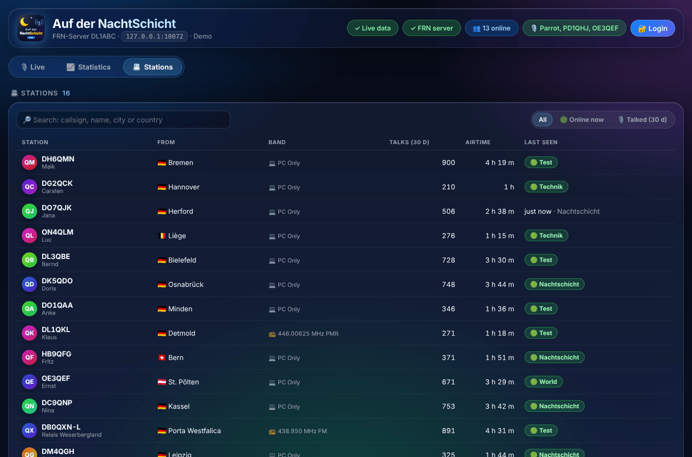

## Tab 💬 Chat

Öffentliche Textnachrichten aus den Räumen. Wer den Chat sieht, stellt der Admin ein (Vorgabe: nur Admins). Private Nachrichten zwischen Stationen werden nicht gespeichert.

## Login

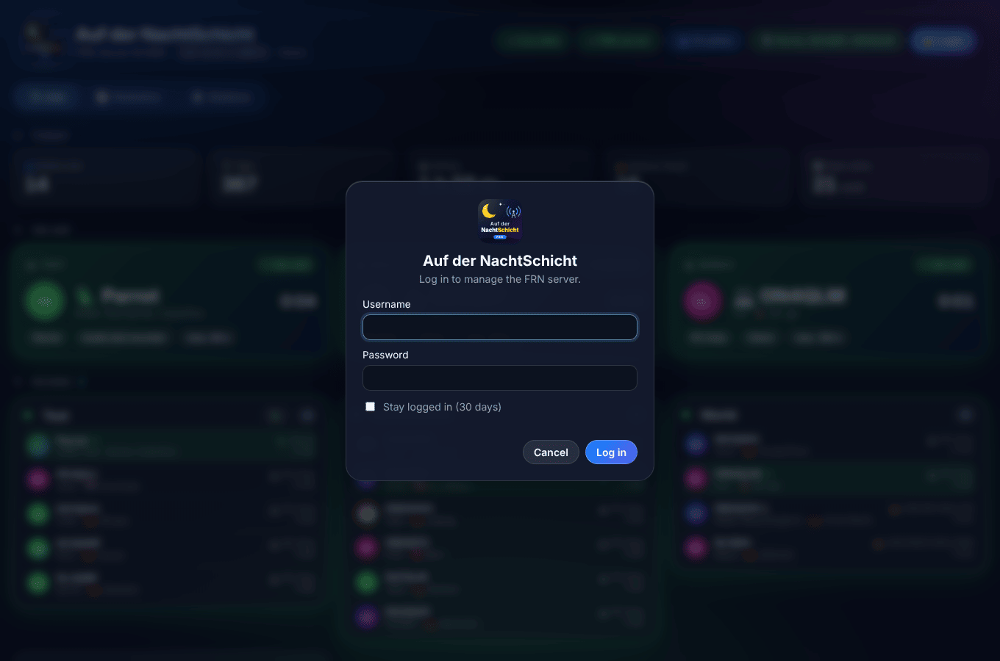

Ohne Anmeldung sieht man die öffentliche Ansicht – Räume, On air, Last heard und Statistik, aber keine E-Mail- oder IP-Adressen und keine versteckten Räume:

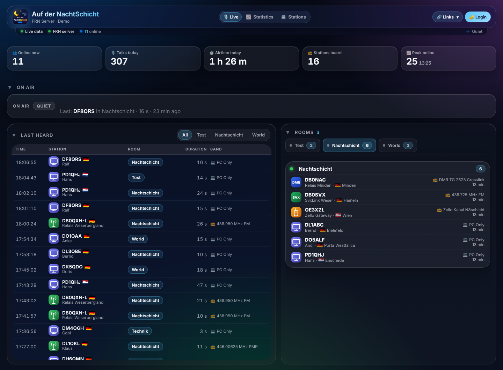

Ist die öffentliche Ansicht abgeschaltet, sehen nur angemeldete Benutzer das Dashboard. E-Mail- und IP-Adressen der Stationen sehen nur Admins.
