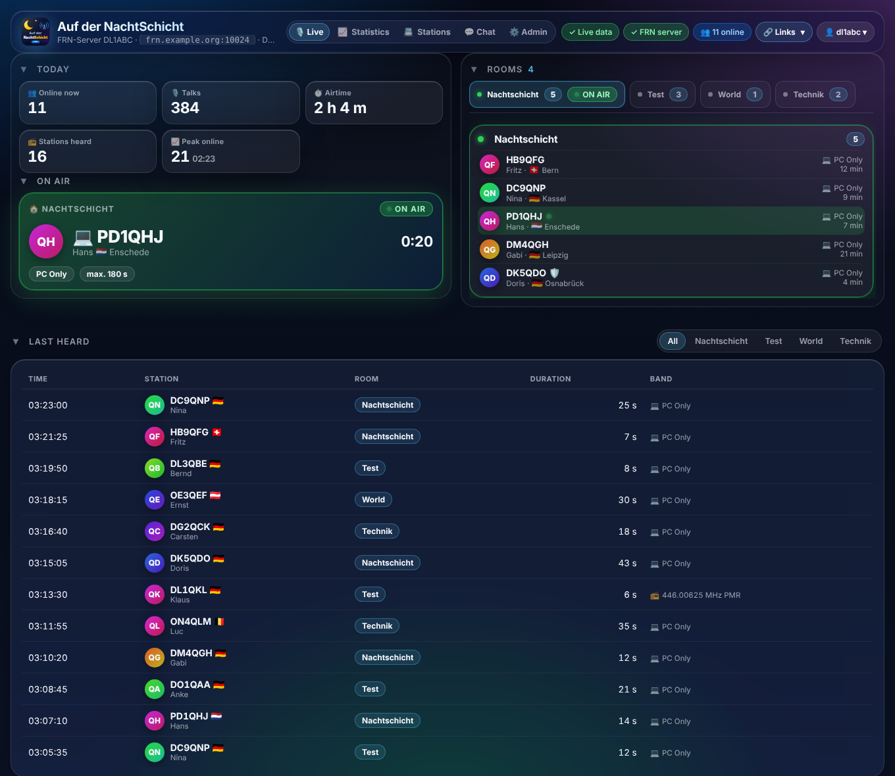
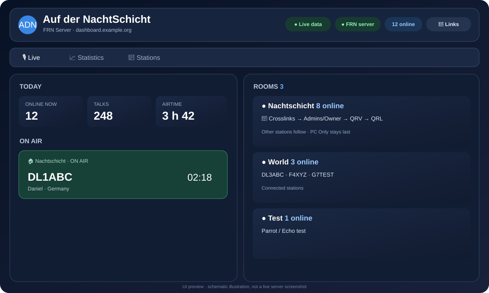

# 🎙️ Dashboard

[← Übersicht](../../readme.md) · [Installation](installation.md) · **Dashboard** · [Admin-Portal](adminbereich.md) · [Konfiguration](konfiguration.md) · [Betrieb & Fehlersuche](betrieb.md)

Das Dashboard ist eine einzige Seite mit Tabs. Die Live-Daten liest frn_adn aus den beiden Logdateien des Java-FRN-Servers: `server_clients.log` – die vollständige Clientliste jedes Raums nach jeder Änderung, vom Autor des Servers genau dafür eingebaut – und `server.log` mit Logins, E-Mail, Client-Art, Sprechbeginn und -ende. Änderungen gehen per WebSocket sofort an alle Browser.

## Kompakte Live-Startseite

Die Live-Startseite ist jetzt in zwei Hauptbereiche gegliedert: links die Tages-Kennzahlen und „On air“, rechts die Räume. Die Raumliste hat auf großen Bildschirmen einen eigenen Scrollbereich. „Last heard“ und „Comings & goings“ stehen gemeinsam darunter. Auf kleinen Displays wechseln die Bereiche automatisch in eine einspaltige Darstellung.

<small>Layout-Vorschau zur Dokumentation (schematische Darstellung, kein Live-Screenshot).</small>

Damit bleiben Serverstatus, Tageswerte, aktive Aussendungen und Räume auf Desktop-Bildschirmen deutlich kompakter erreichbar. Bei sehr vielen Räumen scrollt nur die Raumkarte statt der gesamten Seite.

## Kopfzeile

| Anzeige | Bedeutung |
|---|---|
| ✓ Live data | Verbindung des Browsers zum Dashboard steht |
| ✓ FRN server | Der Dienst `frn-server` läuft und lauscht auf seinem Port; ✕ mit Grund (gestoppt, SystemManager-Fehler) |
| 👥 n online | Stationen in allen sichtbaren Räumen (ohne Parrot) |
| 🎙️ … | Wer gerade spricht |
| 🔐 Login / 👤 Name | Anmelden bzw. Benutzer-Menü (Admin-Portal, eigenes Konto, Abmelden) |

## Tab 🎙️ Live

Die Abschnitte lassen sich wie beim DMR-Dashboard mit **▾** zuklappen; der Browser merkt sich das.

- **Today** – Online jetzt, Durchgänge, Sprechzeit, gehörte Stationen und Spitzenwert heute.
- **On air** – pro Raum eine grüne Karte mit Rufzeichen, Name, Ort, Client-Art und laufender Zeit; `max. 180 s` ist die maximale Sendezeit des Raums. Auch der Parrot erscheint hier, wenn er einen Durchgang abspielt.
- **Rooms** – jeder Raum mit seinen Stationen: 📻 Gateway (Funk), 💻 PC-Client, 🔗 Crosslink, 🦜 Parrot; 🔇 stumm. 🔒 = auf dem Dashboard versteckt (nur nach Login).
- **Last heard** – die letzten Durchgänge mit Dauer laut FRN-Server, filterbar nach Raum.
- **Comings & goings** – Logins und Logouts.

Ein Klick auf eine Station öffnet ihre Detailansicht. Moderiert wird – wie bei FRN üblich – im FRN-Client als Owner oder Admin (Rechtsklick auf die Station); das Dashboard zeigt das Ergebnis sofort an.

## Tab 📈 Statistics

Zeitraum *Today, 24 h, 7/30/90 days, 1 year* und Maß *Airtime* oder *Talks*.

- **Top stations** und **Activity per room**
- **Stations online** – Maximum, alle 5 Minuten gemessen
- **When is talked** – Wochentag × Uhrzeit
- Tabellen **Rooms** und **Most active stations**

Für lange Zeiträume rechnet frn_adn mit Tagessummen und speichert Ergebnisse im Cache.

## Tab 📇 Stations

Alle gehörten Stationen mit Suche (Rufzeichen, Name, Ort, Land) und Filtern *Online now* und *Talked (30 d)*.

## Tab 💬 Chat

Öffentliche Textnachrichten aus den Räumen. Wer den Chat sieht, stellt der Admin ein (Vorgabe: nur Admins). Private Nachrichten zwischen Stationen werden nicht gespeichert.

## Login

Ist die öffentliche Ansicht abgeschaltet, sehen nur angemeldete Benutzer das Dashboard. E-Mail- und IP-Adressen der Stationen sehen nur Admins.
