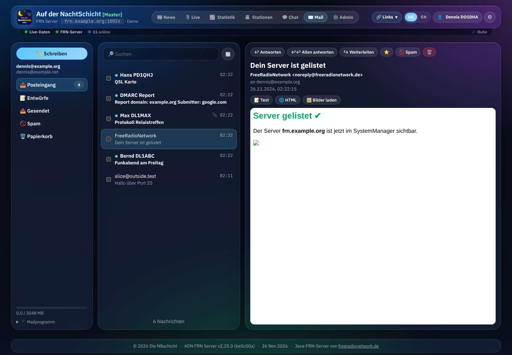
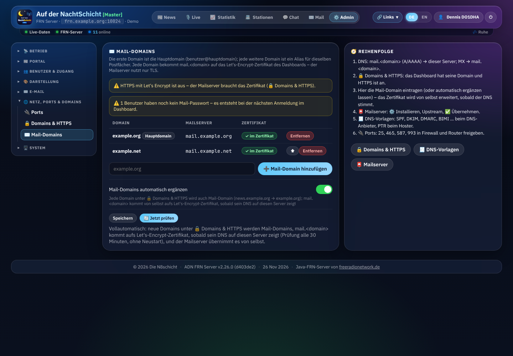
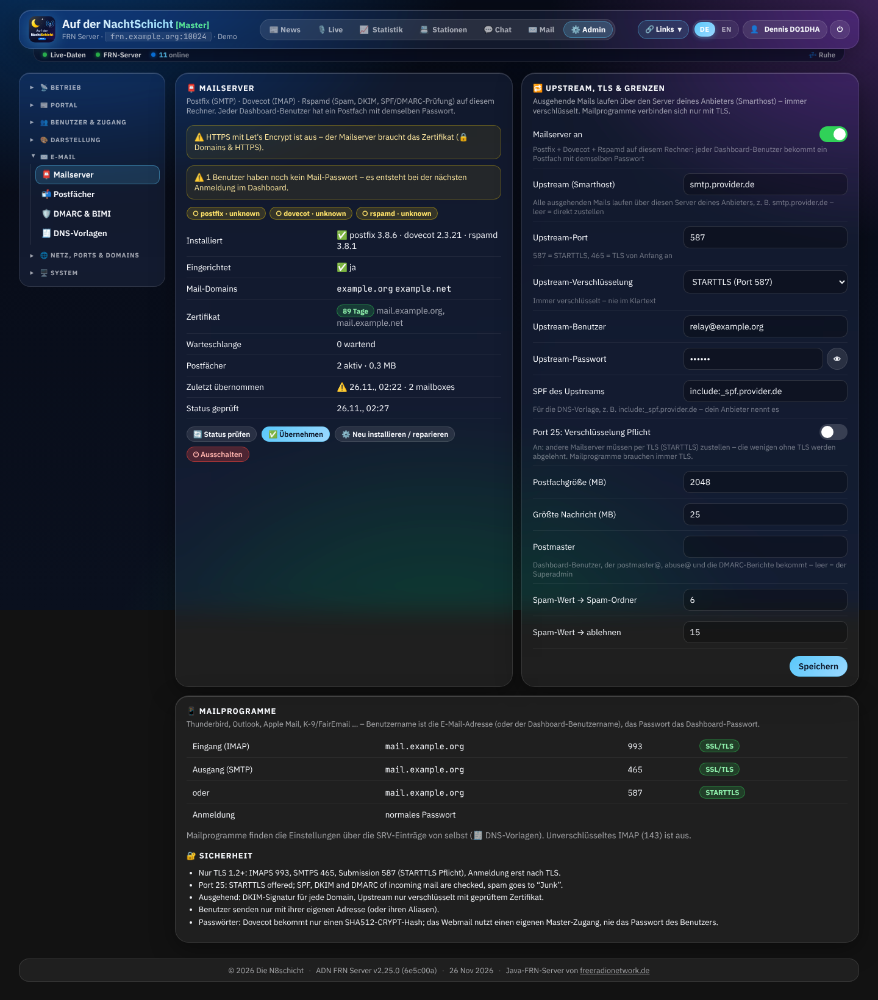
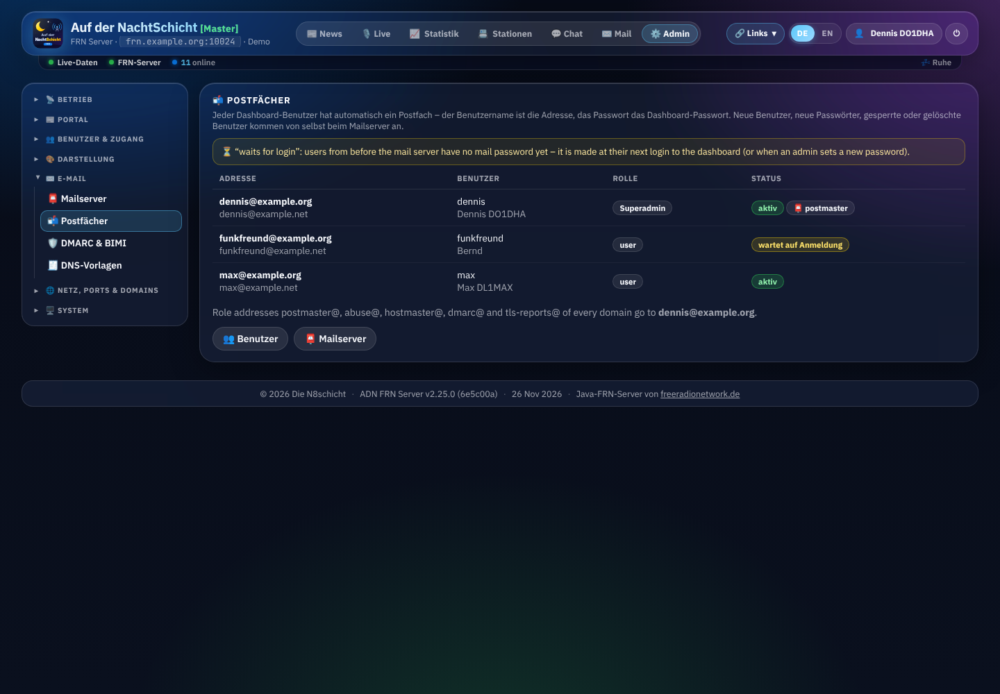
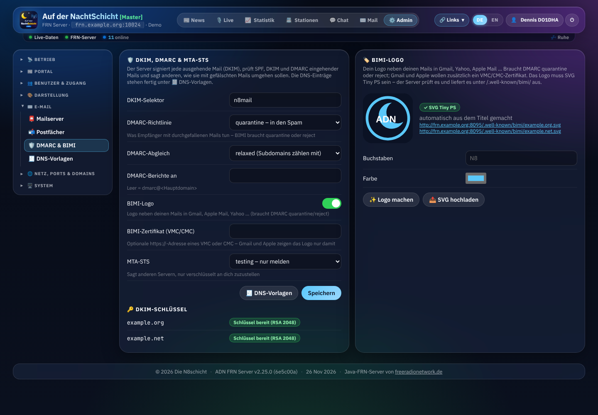
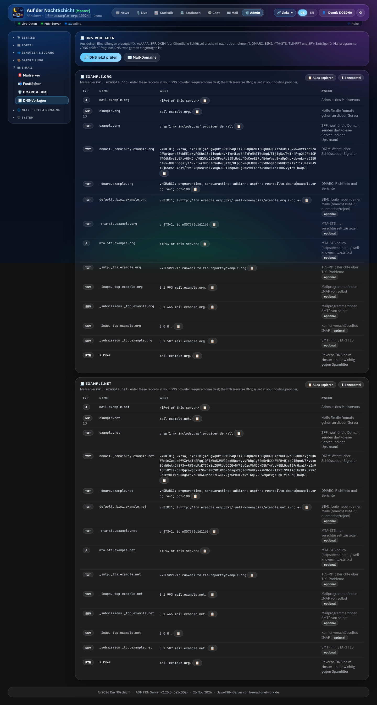
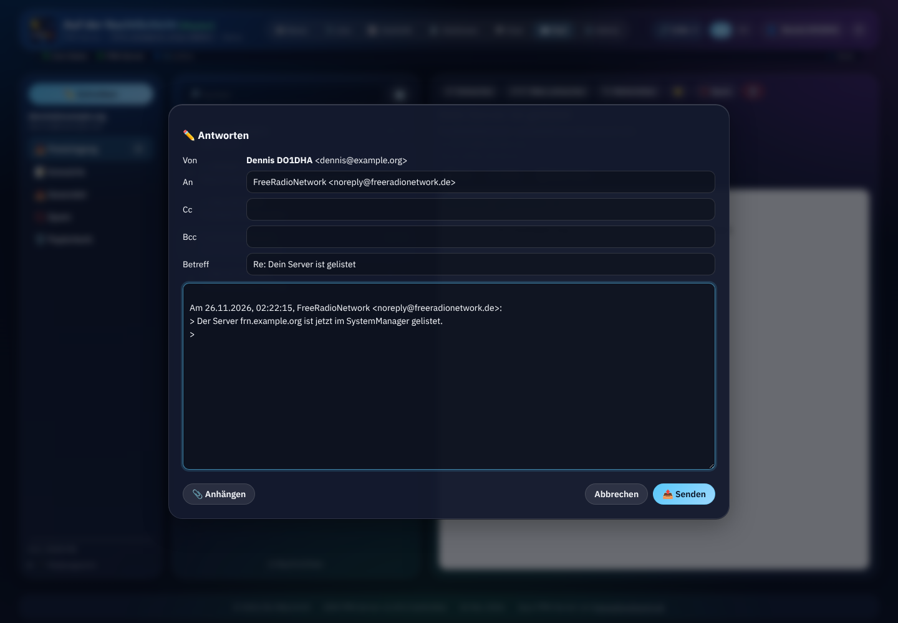
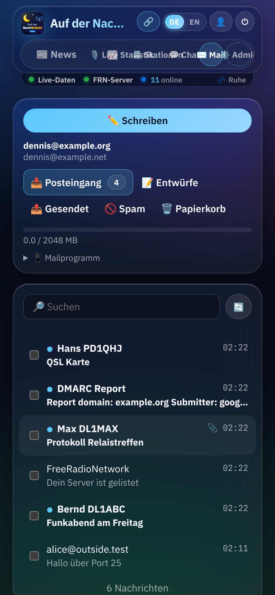

# ✉️ E-Mail (N8 Mail)

[← Übersicht](../../readme.md) · [Installation](installation.md) · [Dashboard](dashboard.md) · [Admin-Portal](adminbereich.md) · [Portal-Seite](portal.md) · **E-Mail** · [Betrieb & Fehlersuche](betrieb.md)

Seit **2.25.0** bringt der ADN-FRN-Server ein eigenes **Postfachsystem** mit: **Postfix** (SMTP), **Dovecot** (IMAP) und **Rspamd**
(Spam, DKIM-Signatur, SPF/DKIM/DMARC-Prüfung) laufen auf demselben Rechner, das Dashboard richtet sie ein.

- **Jeder Dashboard-Benutzer hat ein Postfach** `benutzername@hauptdomain` – mit **demselben Passwort** wie im Dashboard.
- **Eigene Mail-Domains**, beliebig viele; jede weitere Domain ist ein Alias für dieselben Postfächer.
- **Ausschließlich TLS** mit dem **Let's-Encrypt-Zertifikat** – `mail.<domain>` jeder Mail-Domain kommt mit auf das Zertifikat des Dashboards.
- **Versand über einen Upstream** (Smarthost deines Anbieters) ins Internet, immer verschlüsselt.
- **Empfang direkt per MX** auf Port 25.
- **DKIM, DMARC, BIMI, MTA-STS und TLS-RPT** werden automatisch vorbereitet, auf dem Server umgesetzt und als **DNS-Vorlagen** ausgegeben.
- **Webmail** im Dashboard (Menüpunkt **✉️ Mail**) und **Mailprogramme** (IMAPS/SMTPS).

## Einrichten – Reihenfolge

1. **DNS:** `mail.<domain>` (A, ggf. AAAA) auf diesen Server; MX der Domain auf `mail.<domain>`.
2. **🌐 Netz, Ports & Domains → 🔒 Domains & HTTPS:** das Dashboard hat seine Domain, HTTPS mit Let's Encrypt ist an.
3. **🌐 Netz, Ports & Domains → ✉️ Mail-Domains:** Mail-Domain(s) eintragen – oder automatisch ergänzen lassen (siehe unten). Das Zertifikat wird **ohne Neustart erweitert**, sobald der DNS stimmt,
   um `mail.<domain>` (und `mta-sts.<domain>`, wenn MTA-STS an ist). In *🔒 Domains & HTTPS* stehen diese Namen mit dem Etikett ✉️ Mail.
4. **✉️ E-Mail → 📮 Mailserver:** **⚙️ Mailserver installieren** (nur Superadmin; installiert `postfix dovecot-imapd dovecot-lmtpd
   dovecot-sieve rspamd` mit apt), Upstream eintragen, **✅ Übernehmen**.
5. **✉️ E-Mail → 🧾 DNS-Vorlagen:** SPF, DKIM, DMARC, BIMI, MTA-STS, TLS-RPT und SRV beim DNS-Anbieter eintragen, **PTR (Reverse-DNS)**
   beim Hoster auf `mail.<hauptdomain>` setzen. **🔎 DNS jetzt prüfen** vergleicht jeden Eintrag mit dem, was das DNS gerade sagt.
6. **🔌 Ports:** 25, 465, 587, 993 eingehend in Firewall und Router freigeben (die Ports-Seite listet sie, sobald der Mailserver an ist).

## 🔄 Automatisch: Mail-Domains und Zertifikate

Seit **2.27.0** läuft das meiste von selbst (Schalter *Mail-Domains automatisch ergänzen* unter ✉️ Mail-Domains, Standard an):

1. Jede Domain unter **🔒 Domains & HTTPS** bringt ihre Hauptdomain als **Mail-Domain** mit (`news.example.org` → `example.org`).
2. **Sobald der DNS-Eintrag** von `mail.<domain>` (bzw. `mta-sts.<domain>`) auf diesen Server zeigt, holt das Dashboard das
   **Let's-Encrypt-Zertifikat** mit dem neuen Namen – **im laufenden Betrieb, ohne Neustart**. Namen ohne DNS warten (⏳ wartet auf DNS),
   damit sie das Zertifikat der übrigen Domains nicht blockieren.
3. Danach **übernimmt der Mailserver** die neue Domain und das Zertifikat von selbst (Adressen, Aliase, DKIM-Schlüssel).

Geprüft wird alle 30 Minuten, sofort nach jeder Änderung und mit **🔄 Jetzt prüfen**. Eine von Hand entfernte Mail-Domain wird nicht
wieder ergänzt. Jeder Schritt steht im 📜 Protokoll.

## 📮 Mailserver

- **Status:** Dienste Postfix/Dovecot/Rspamd, Versionen, eingerichtet ja/nein, Mail-Domains, Zertifikat (Tage, Namen), Warteschlange,
  aktive Postfächer und Speicher, zuletzt übernommen. Hinweise oben nennen, was noch fehlt (HTTPS aus, Namen nicht im Zertifikat,
  kein Upstream, Benutzer ohne Mail-Passwort, BIMI ohne passende DMARC-Richtlinie).
- **Knöpfe:** 🔄 Status prüfen · ✅ Übernehmen · ⚙️ Installieren / reparieren (Superadmin) · ⏻ Ausschalten (Superadmin; Dovecot und
  Rspamd stoppen, Postfix bekommt seine Konfiguration von vor N8 Mail zurück; Postfächer und DKIM-Schlüssel bleiben).
- **Upstream, TLS & Grenzen:**

| Einstellung | Standard | Wirkung |
|---|---|---|
| Mailserver an | aus | schaltet N8 Mail im Dashboard ein (Menüpunkt ✉️ Mail, Zertifikatsnamen) |
| Upstream (Smarthost) | leer | z. B. `smtp.provider.de` – alle ausgehenden Mails laufen darüber; leer = direkt zustellen (ausgehend Port 25) |
| Upstream-Port / -Verschlüsselung | 587 / STARTTLS | oder 465 / TLS von Anfang an – **immer verschlüsselt**, Zertifikat des Upstreams wird geprüft (`secure`) |
| Upstream-Benutzer / -Passwort | leer | Zugang beim Anbieter (SASL) |
| SPF des Upstreams | leer | z. B. `include:_spf.provider.de` – kommt in die SPF-Vorlage |
| Port 25: Verschlüsselung Pflicht | aus | an = andere Mailserver müssen STARTTLS nutzen (die wenigen ohne TLS werden abgelehnt) |
| Postfachgröße / größte Nachricht | 2048 MB / 25 MB | Quota je Postfach (Dovecot) und Größe je Mail (Postfix) |
| Postmaster | leer | Benutzer, der postmaster@, abuse@, hostmaster@, dmarc@ und tls-reports@ jeder Domain bekommt – leer = Superadmin |
| Spam-Wert → Spam-Ordner / ablehnen | 6 / 15 | Rspamd: ab 6 in „Spam“ (Sieve), ab 15 schon beim Empfang abgelehnt |

### Nur verschlüsselt

| Port | Dienst | TLS |
|---|---|---|
| 993 | IMAPS | TLS 1.2+ von Anfang an – IMAP 143 ist aus |
| 465 | SMTPS (Senden aus Mailprogrammen) | TLS 1.2+ von Anfang an |
| 587 | Submission | STARTTLS **Pflicht**, Anmeldung erst nach TLS |
| 25 | MX (Empfang) | STARTTLS angeboten (oder Pflicht, siehe oben), TLS 1.2+ |
| → Upstream | Smarthost | immer verschlüsselt, Zertifikat geprüft |

Weitere Schutzmaßnahmen: Anmeldung nur über TLS, Benutzer senden nur mit ihrer eigenen Adresse (oder ihren Aliasen; `reject_sender_login_mismatch`),
kein offenes Relay, Systembenutzer (PAM) können sich an Dovecot nicht anmelden, Dovecot bekommt nur SHA512-CRYPT-Hashes.

## 📬 Postfächer

- Jeder Dashboard-Benutzer → `benutzername@hauptdomain`, dazu `benutzername@weitere-domain` als Alias. Gesperrte Benutzer haben kein
  aktives Postfach, gelöschte Benutzer verschwinden aus der Liste des Mailservers (die Mails bleiben auf der Platte).
- **Passwort = Dashboard-Passwort.** Das Dashboard speichert dafür zusätzlich einen SHA512-CRYPT-Hash, den nur Dovecot bekommt.
  Benutzer von vor 2.25 haben ihn noch nicht – er entsteht bei ihrer **nächsten Anmeldung** im Dashboard (oder wenn ein Admin ein neues
  Passwort setzt). Bis dahin steht *wartet auf Anmeldung*.
- Neue Benutzer, neue Passwörter, Sperren, Umbenennen und Löschen erreichen den Mailserver von selbst (nach 3 Sekunden).
- Benutzernamen, die keine gültige Adresse ergeben, und die Rollennamen postmaster, abuse, hostmaster, dmarc, tls-reports bekommen kein Postfach.

## 🛡️ DMARC & BIMI

- **DKIM:** je Domain ein RSA-2048-Schlüssel (`/var/lib/rspamd/dkim/<domain>.<selektor>.key`), beim ersten Übernehmen erzeugt und
  behalten. Rspamd signiert jede ausgehende Mail (auch aus dem Webmail); der öffentliche Schlüssel steht in den DNS-Vorlagen.
- **Eingehend** prüft Rspamd SPF, DKIM und DMARC (Ergebnis im Webmail als Abzeichen SPF/DKIM/DMARC).
- **DMARC-Richtlinie** none / quarantine (Standard) / reject, Abgleich relaxed/strict, Berichte an `dmarc@hauptdomain` (oder eigene Adresse).
- **BIMI:** Logo neben deinen Mails in Gmail, Yahoo, Apple Mail … Das Dashboard **macht automatisch ein Logo** (SVG Tiny PS: Mond,
  Buchstaben, Farbe) oder nimmt ein hochgeladenes SVG und **prüft** es (baseProfile tiny-ps, version 1.2, title, keine Skripte,
  Bilder, Links oder Entities, höchstens 32 KB). Ausgeliefert wird es unter `https://<dashboard-domain>/.well-known/bimi/<domain>.svg`.
  BIMI braucht DMARC quarantine oder reject; Gmail und Apple zeigen das Logo nur mit VMC/CMC-Zertifikat (Adresse optional eintragen).
- **MTA-STS** (aus / testing / enforce): Richtlinie unter `https://mta-sts.<domain>/.well-known/mta-sts.txt` (der Name kommt mit aufs
  Zertifikat), dazu TLS-RPT-Berichte an `tls-reports@hauptdomain`.

## 🧾 DNS-Vorlagen

Je Mail-Domain: A/AAAA von `mail.<domain>` (die öffentlichen Adressen des Servers), MX, SPF (`v=spf1 mx <upstream> -all`), DKIM,
DMARC, BIMI, MTA-STS + TLS-RPT, SRV für Mailprogramme (`_imaps`, `_submissions`, `_submission`, `_imap` = aus) und der PTR-Hinweis.
Jeder Wert mit **📋 Kopieren**, je Domain **📋 Alles kopieren** und **⬇ Zonendatei** (BIND-Format). **🔎 DNS jetzt prüfen** fragt die
Nameserver des Servers: ✓ gesetzt · ≠ weicht ab (Maus drüber zeigt, was eingetragen ist) · fehlt.

## ✉️ Webmail

- Ordner (Posteingang, Entwürfe, Gesendet, Spam, Papierkorb) mit ungelesenen Nachrichten, Speicherbalken, Suche, Seiten.
- Lesen als Text oder **HTML in einem abgeschotteten Rahmen** (keine Skripte, keine Formulare, **Bilder aus dem Internet erst auf Knopfdruck**,
  Links öffnen außerhalb), Anhänge herunterladen, SPF/DKIM/DMARC-Ergebnis und Spam-Hinweis.
- Schreiben, Antworten, Allen antworten, Weiterleiten, Anhänge (bis 20 MB), Markieren, gelesen/ungelesen, Spam/kein Spam, Löschen
  (in den Papierkorb, dort endgültig). Gesendetes landet in „Gesendet“, mit DKIM-Signatur über den Upstream.
- Das Webmail meldet sich mit einem eigenen Master-Zugang am Dovecot an – das Passwort des Benutzers wird dafür nie gebraucht oder gespeichert.
- Auf dem Handy: Ordner oben, Liste, Nachricht mit ← Zurück.

 

## 📱 Mailprogramme

| | Server | Port | Sicherheit |
|---|---|---|---|
| Eingang (IMAP) | `mail.<domain>` | 993 | SSL/TLS |
| Ausgang (SMTP) | `mail.<domain>` | 465 | SSL/TLS |
| oder | `mail.<domain>` | 587 | STARTTLS |

Benutzername: die E-Mail-Adresse (oder nur der Dashboard-Benutzername), Passwort: das Dashboard-Passwort. Dank der SRV-Einträge finden
Thunderbird & Co. die Einstellungen von selbst.

## Technik

- Das Dashboard schreibt nie selbst in Systemdateien. Es schreibt eine **Vorgabe** (`<daten>/mail/spec.json`, 600) und ruft den
  Root-Helfer **`frnadn/mailctl.py`** über feste sudo-Regeln auf (`status`, `apply`, `certs`, `install`, `disable` – angelegt von
  *System → Berechtigungen & sudo → Korrigieren*). `mailctl` prüft jeden Wert der Vorgabe mit strengen Mustern, bevor er in eine
  Konfigurationsdatei kommt.
- **Übernehmen** sichert vorher jede Datei (`/etc/n8mail/backups/`, die letzten 10, dazu `original` = vor N8 Mail), schreibt Postfix
  (`postconf`, Tabellen unter `/etc/postfix/n8mail/`), Dovecot (`conf.d/99-n8mail.conf`, `n8mail-users`, `n8mail-master`, Sieve) und
  Rspamd (`local.d/`), prüft mit `postfix check`, `doveconf -n` und `rspamadm configtest` und **stellt bei einem Fehler alles wieder her**.
- **Dovecot 2.3** (Debian 12, Ubuntu 24.04) und **2.4** (Debian 13) werden erkannt und bekommen jeweils die passende Konfiguration.
  Getestet mit Postfix 3.8/3.10, Dovecot 2.3.21/2.4.1, Rspamd 3.8/3.12.
- Postfächer: Maildir unter `/var/mail/n8mail/<domain>/<name>/`, Systembenutzer `n8vmail`.
- Zertifikat: das Let's-Encrypt-Zertifikat des Dashboards (mit allen Mail-Namen) wird nach `/etc/n8mail/ssl/` kopiert – nach jeder
  Erneuerung automatisch, Postfix und Dovecot laden neu.
- **Keep-Alive** prüft SMTP 25, IMAPS 993 und den Rspamd-Milter, **🧩 Dienste** zeigt Postfix, Dovecot und Rspamd, sobald N8 Mail eingerichtet ist.
- Master & Backup: Mail-Einstellungen gelten je Server (sie werden nicht abgeglichen).
