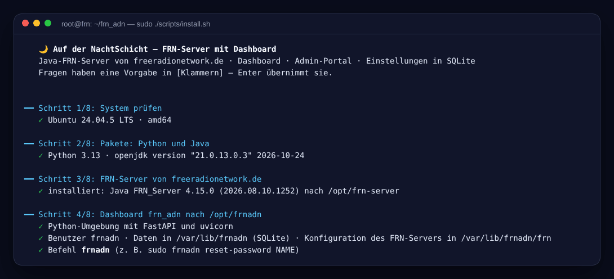
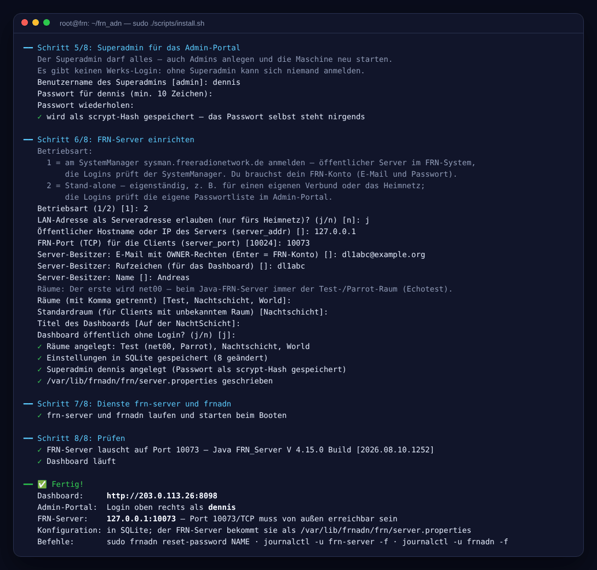
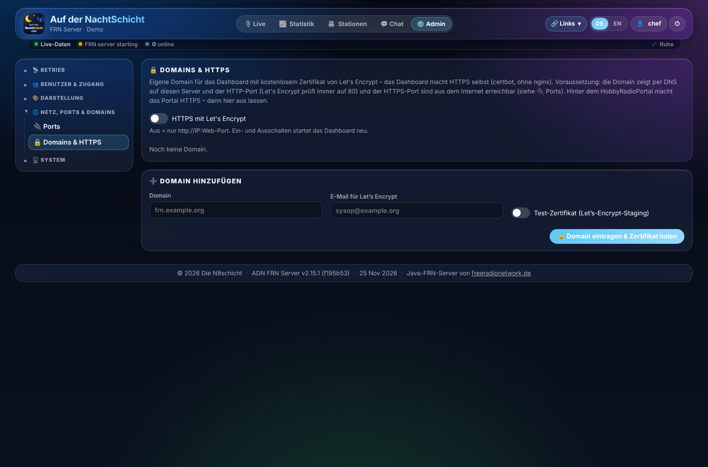

# 📦 Installation

[← Übersicht](../../readme.md) · **Installation** · [Dashboard](dashboard.md) · [Admin-Portal](adminbereich.md) · [Konfiguration](konfiguration.md) · [Betrieb & Fehlersuche](betrieb.md)

Installiert werden zwei Dienste:

| Dienst | Was | Wo |
|---|---|---|
| `frn-server` | der **Java-FRN-Server von freeradionetwork.de** (FRN_Server.jar) | Programm `/opt/frn-server`, Konfiguration `/var/lib/frnadn/frn` |
| `frnadn` | Dashboard und Admin-Portal | Programm `/opt/adn-frn-server`, Datenbank `/var/lib/frnadn/frnadn.db` |

Alle Einstellungen liegen in der SQLite-Datenbank. Daraus schreibt frn_adn nur die Dateien, die der Java-Server braucht.

## Voraussetzungen

| | |
|---|---|
| System | Debian 11/12/13, Ubuntu 22.04 oder neuer, Raspberry Pi OS (64 oder 32 Bit) |
| Java | wird installiert (`default-jre-headless`, Java 17 oder 21) |
| Python | 3.9 oder neuer (wird installiert) |
| Speicher | ca. 300 MB RAM für Java und Dashboard |
| FRN-Konto | für den Betrieb am SystemManager: dein FRN-Benutzerkonto (E-Mail und das Passwort, das der SystemManager per Mail geschickt hat) |
| Netz | **TCP 10024** (FRN, änderbar); für Let's Encrypt zusätzlich **TCP 80 und 443** eingehend |

## Schritt für Schritt

```bash
git clone https://github.com/dhartmann1979/adn-frn-server
cd adn-frn-server
chmod +x scripts/install.sh scripts/update.sh   # falls beim Kopieren Rechte verloren gingen
sudo ./scripts/install.sh
```

Jede Frage hat eine Vorgabe in `[Klammern]`, Enter übernimmt sie.

<p align="center"></p>

| Schritt | Was passiert |
|---|---|
| **1 System prüfen** | Betriebssystem, Architektur, systemd, apt |
| **2 Pakete** | Python, venv, curl, unzip, **Certbot** (für Let's Encrypt) und **Java**. Fehlt später eines, installiert jedes Update es nach |
| **3 FRN-Server** | lädt `FRN_Server.zip` von **freeradionetwork.de**, entpackt `FRN_Server.jar` nach `/opt/frn-server`. Der Installer lädt das Java-FRN-Paket für die neue Installation herunter. Eine bereits vorhandene JAR wird nicht übernommen; bei erkannter Altinstallation bricht der Installer vorher ab |
| **4 Dashboard** | kopiert das Dashboard nach `/opt/adn-frn-server`, legt die Python-Umgebung, den Dienstbenutzer `frnadn` und den Befehl `frnadn` an |
| **5 Superadmin** | Benutzername und Passwort (mind. 10 Zeichen, zweimal) – gespeichert als scrypt-Hash |
| **6 FRN-Server einrichten** | Betriebsart, Serveradresse, Port, Besitzer, Räume, Titel |
| **7 Dienste** | fragt den **Web-Port des Dashboards (HTTP, Vorgabe 8080)**, richtet `frn-server.service` und `frnadn.service` ein, startet beide, öffnet die Ports in `ufw` (Dashboard, FRN, 80/443 für HTTPS) |
| **8 Prüfen** | wartet, bis der FRN-Server lauscht, und zeigt Fehlermeldungen des SystemManagers verständlich an |

<p align="center"></p>

### Schritt 6: Betriebsart

**1 – am SystemManager (Vorgabe).** Der Server meldet sich bei `sysman.freeradionetwork.de` an, erscheint im FRN-System (FRN-Client, [FRN Browser](https://tools.freeradionetwork.de:43448/FRN_Browser/)) und lässt die Logins der Clients vom SystemManager prüfen. Gefragt werden:

| Frage | Parameter | Bedeutung |
|---|---|---|
| E-Mail deines FRN-Kontos | `sysman_auth_emailaddr` | das Konto, mit dem sich der Server anmeldet |
| Passwort dieses FRN-Kontos | `sysman_auth_password` | das Passwort aus der Mail des SystemManagers (verdeckte Eingabe) |
| Öffentlicher Hostname oder IP | `server_addr` | so erreichen Clients **und der SystemManager** den Server, z. B. `frn.die-n8schicht.de`. Keine LAN-Adresse! |
| FRN-Port | `server_port` | Vorgabe 10024 |

**2 – Stand-alone.** Ohne SystemManager, z. B. für einen eigenen Verbund oder das Heimnetz. Die Logins prüft die eigene Passwortliste (Admin-Portal → FRN accounts); auf Wunsch ist auch eine LAN-Adresse als Serveradresse erlaubt (`allowLANAddr`).

Danach:

| Frage | Bedeutung |
|---|---|
| Server-Besitzer: E-Mail | bekommt **OWNER**-Rechte in jedem Raum (`server_owner`); Enter = das FRN-Konto |
| Rufzeichen, Name | für die Kopfzeile des Dashboards |
| Räume | mit Komma getrennt. **Der erste wird `net00`** – beim Java-FRN-Server immer der Test-/Parrot-Raum (Echotest) |
| Standardraum | `default_net`: wohin Clients mit unbekanntem Raum kommen |
| Titel, öffentlich | Kopfzeile, Ansicht ohne Login |

> **Vor dem ersten Start:** Der SystemManager prüft, ob `server_addr:server_port` von außen erreichbar ist (Fehler −5). Portweiterleitung TCP 10024 im Router auf den Server einrichten.

### Ohne Fragen

```bash
sudo FRNADN_YES=1 ./scripts/install.sh       # alle Vorgaben
sudo frnadn set-superadmin admin              # Superadmin anlegen
```

Danach im Admin-Portal unter **Settings** Serveradresse und SystemManager-Konto eintragen und den FRN-Server neu starten.
Hinter einem Reverse-Proxy zusätzlich `FRNADN_PORT=8090 FRNADN_BEHIND_PROXY=1` (eigenes HTTPS aus). Aus einem Backup ohne Fragen:
`FRNADN_RESTORE=/pfad/x.frnbak FRNADN_RESTORE_PASSWORD_FILE=/pfad/pw`.

Weitere Variablen: `FRNADN_DIR` (Vorgabe `/opt/adn-frn-server`), `FRNADN_DATA` (Vorgabe `/var/lib/frnadn`), `FRNADN_FRN_HOME` (Vorgabe `$FRNADN_DATA/frn`), `FRNADN_PORT` (Web-Port, Vorgabe **8080**; eine vorhandene Installation behält ihren Port), `FRN_DIR` (`/opt/frn-server`), `FRN_ZIP=/pfad/FRN_Server.zip` (vorhandenes Paket statt Download).

### Web-Port 8080

Das Dashboard lauscht seit 2.17.1 standardmäßig auf **HTTP-Port 8080**: `http://<IP-des-Servers>:8080`. So bleiben die Ports
80 und 443 frei, für das eigene HTTPS mit Let's Encrypt (Prüfung auf Port 80, Dashboard dann unter `https://<domain>`) oder für
einen Reverse-Proxy. Ist der Port belegt, warnt der Installer. Ändern: neu installieren mit `FRNADN_PORT=…` oder in
`/etc/systemd/system/frnadn.service` die Zeile `Environment=FRNADN_PORT=…` anpassen und `systemctl daemon-reload &&
systemctl restart frnadn`. Updates ändern den Port nie.

Am Ende richtet der Installer mit `scripts/n8-admin.sh fix-perms` Besitzer und Rechte, die sudo-Freigaben und „Update jetzt“ ein.

## Neuinstallation auf einem Rechner mit einer alten FRN-Installation

Wenn die alte Installation auf demselben Rechner liegt, zuerst nur die alte Konfigurationsdatei sichern und beide alten Dienste stoppen. Die alten Verzeichnisse und Datenbanken bleiben unangetastet:

```bash
sudo cp -a /var/lib/frnadn/frn/server.properties /root/server.properties.alt
sudo systemctl stop frnadn frn-server
```

Danach die neue Installation mit eigenen, leeren Daten- und Java-Verzeichnissen starten. So werden alte Daten und JAR-Dateien nicht wiederverwendet:

```bash
cd /opt/adn-frn-server
sudo FRNADN_DATA=/var/lib/adn-frn-server \
     FRN_DIR=/opt/adn-frn-server/java \
     ./scripts/install.sh
```

Nach erfolgreicher Installation im Admin-Portal **Admin → System → Import server.properties** öffnen und `/root/server.properties.alt` auswählen. Nur unterstützte Einstellungen und Raumdefinitionen werden importiert. Die alte Datenbank, ACL-Dateien, FRN-Passwortlisten und Java-JAR werden nicht übernommen. Alte Verzeichnisse erst löschen, wenn die neue Installation geprüft und ein Backup vorhanden ist.

## Alte Konfiguration optional übernehmen

Die Installation bleibt eine frische Installation mit neuer SQLite-Datenbank und neuem Java-FRN-Server. Es wird keine alte Installation automatisch ersetzt oder migriert. Wenn du die bisherigen Servereinstellungen behalten möchtest, melde dich nach Abschluss im Admin-Portal an und wähle **Admin → System → Import server.properties**. Lade ausschließlich die Datei `server.properties` aus der alten Installation hoch. Der Import übernimmt nur unterstützte Einstellungen und Raumdefinitionen. Alte Datenbanken, JAR-Dateien, ACL-Listen und FRN-Passwortdateien werden nicht kopiert.

Vor dem Import empfiehlt sich ein Backup des neuen Datenverzeichnisses. Nach dem Import den Java-FRN-Server über das Admin-Portal neu starten.

## Router und Firewall

| Port | Richtung | Wofür |
|---|---|---|
| TCP 10024 (bzw. `server_port`) | eingehend, Portweiterleitung | FRN-Clients **und** Prüfung durch den SystemManager |
| TCP 10025 | ausgehend | Verbindung zum SystemManager (normalerweise offen) |
| TCP 80 | eingehend | Let's Encrypt HTTP-01 und HTTP→HTTPS-Weiterleitung |
| TCP 443 | eingehend, bei HTTPS | Dashboard über HTTPS |

`ufw` wird vom Installer automatisch freigegeben, falls aktiv.

## FRN-Client verbinden

Am SystemManager erscheint der Server im FRN-Client in der Serverliste. Stand-alone: im Client Server und Port direkt eintragen.

## HTTPS mit Let's Encrypt (optional)

frn_adn enthält das automatische HTTPS-System aus **HBlink4-FreeRadioID**. Ein zusätzlicher Reverse-Proxy wie Caddy oder Nginx ist dafür nicht nötig.

**Voraussetzungen vor dem Einschalten:**
- Ein öffentlicher DNS-A- bzw. AAAA-Record für den Dashboard-Hostnamen zeigt auf diesen Server.
- Eingehend TCP **80** und **443** sind in Router und Firewall freigegeben. Port 80 muss für die HTTP-01-Prüfung direkt erreichbar sein; ein vorgeschalteter Proxy darf die Challenge-URL nicht abfangen.
- Certbot wird vom Installer als Systempaket installiert.

**Einrichtung im Admin-Portal:**

1. Anmelden und **⚙️ Admin → 🌐 Netz, Ports & Domains → 🔒 Domains & HTTPS** öffnen.
2. Domain (nur Hostname, ohne `https://`) und E-Mail-Adresse eintragen.
3. Optional zunächst **Test-Zertifikat** einschalten, um DNS und Portfreigaben zu prüfen.
4. **Domain eintragen & Zertifikat holen** – HTTPS wird eingeschaltet und das Dashboard startet von selbst neu. Ports unter **🔌 Ports**.
   Bei Problemen: `sudo journalctl -u frnadn -n 80 --no-pager`

<p align="center"></p>

**Technik und Betrieb:**
- Der HTTP-Listener auf Port 80 bedient `/.well-known/acme-challenge/` direkt aus dem Webroot und leitet alle anderen Anfragen mit HTTP 301 auf HTTPS um.
- Certbot läuft als Dienstbenutzer `frnadn`; Konfiguration, Arbeitsdateien, Logs und Webroot liegen getrennt unter `$FRNADN_DATA/letsencrypt/`.
- Mit vorhandenem Zertifikat läuft das Dashboard auf HTTPS-Port 443. Während der ersten Ausstellung bleibt es übergangsweise auf Port 8080 erreichbar, falls der konfigurierte Dashboard-Port 80 vom Challenge-Listener belegt wird.
- Alle 12 Stunden wird `certbot renew` ausgeführt. Bei erfolgreicher Erneuerung wird das Zertifikat direkt im laufenden TLS-Kontext neu geladen; ein Dienstneustart ist dafür nicht nötig.
- Bei Problemen bleibt der HTTP-Fallback erreichbar. Details stehen in `journalctl -u frnadn`.

**Deaktivieren:** unter **🔒 Domains & HTTPS** den Schalter *HTTPS mit Let's Encrypt* ausschalten (das Dashboard startet neu) oder die Domain entfernen. Das Zertifikatsverzeichnis wird dabei nicht automatisch gelöscht.

## Aktualisieren

| Was | Wie |
|---|---|
| Java-FRN-Server | Admin-Portal → **System → Upgrade Java now** (lädt von freeradionetwork.de und startet den Dienst neu) |
| Dashboard | **⬆️ Update jetzt installieren** im Adminbereich oder `sudo /opt/adn-frn-server/scripts/update.sh` – Dashboard und FRN-Server starten danach neu; Stationen verbinden sich automatisch wieder |

`install.sh` ist ausschließlich für eine frische Installation vorgesehen. Es bricht ab, wenn bereits eine FRN-Datenbank, eine vorhandene `server.properties` oder ein laufender FRN-Dienst erkannt wird. Für Updates ist `scripts/update.sh` vorgesehen; `install.sh` nicht erneut auf einem installierten System ausführen.

## Deinstallieren

```bash
sudo systemctl disable --now frnadn frn-server
sudo rm -rf /opt/frnadn /opt/frn-server /etc/systemd/system/frnadn.service /etc/systemd/system/frn-server.service \
            /etc/sudoers.d/frnadn /usr/local/bin/frnadn
sudo rm -rf /var/lib/frnadn       # löscht auch Statistik, Benutzer und Einstellungen!
sudo userdel frnadn
```
