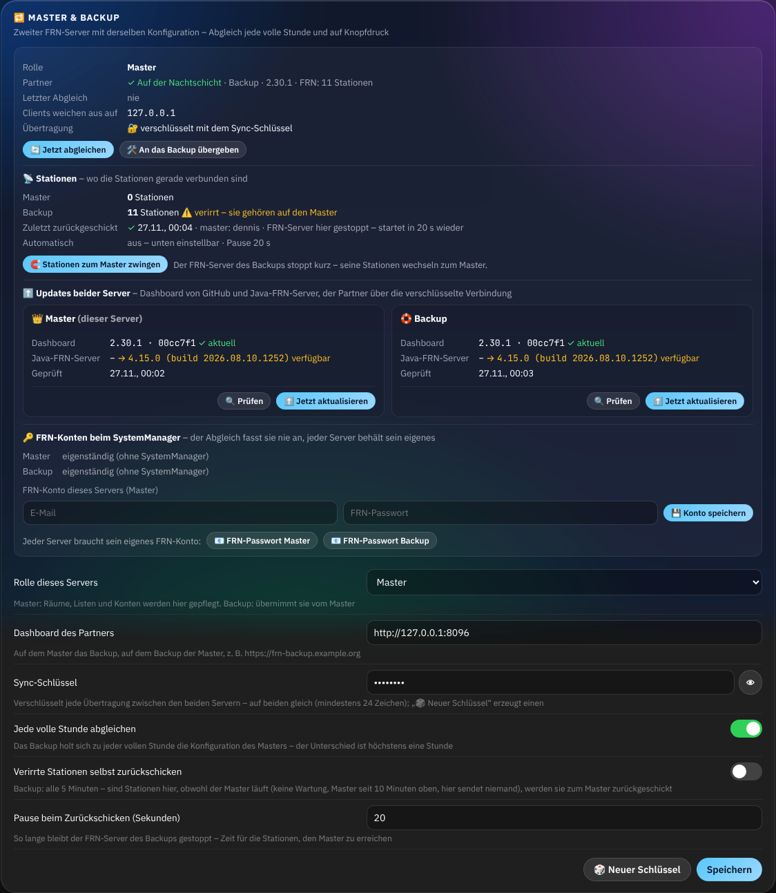
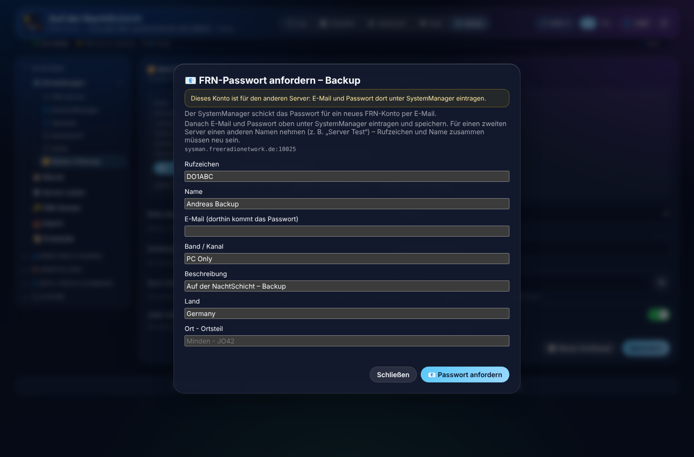

# 🔁 Master & Backup

Zwei FRN-Server mit derselben Konfiguration: **frn.auf-der-nachtschicht.de** ist der **Master**, hier pflegst du Räume,
Zugangslisten, Server-Listen und FRN-Konten. **frn-backup.auf-der-nachtschicht.de** ist das **Backup**. Es holt sich die
Konfiguration des Masters **zu jeder vollen Stunde** und auf Knopfdruck. Die beiden unterscheiden sich also höchstens um eine Stunde.

**Admin → Betrieb → ⚙️ Einstellungen → 🔁 Master & Backup**

## Wer macht was?

| | |
|---|---|
| **Ausfall** | Erledigt **FRN selbst**: Jeder Server nennt seinen Clients eine Ausweichadresse (`backup_server_addr`). Ist der Server weg, verbinden sich die Clients von selbst dorthin. Mit gesetzter Rolle ist das automatisch der Partner (Host aus „Dashboard des Partners“, Port = eigener FRN-Port), solange unter *FRN-Server → Ausweichserver* nichts anderes steht. |
| **Abgleich** | Das Backup holt sich zu jeder vollen Stunde (ein paar Sekunden danach) die Konfiguration vom Master. **🔄 Jetzt abgleichen** geht auf beiden Servern: auf dem Backup holt es sofort, auf dem Master bittet es das Backup darum. |
| **Wartung** | Von Hand auf dem Master: **🛠️ An das Backup übergeben** und danach **↩️ Vom Backup zurückholen** (siehe unten). |

## Einrichten

1. **Auf dem Master:** Rolle **Master**, *Dashboard des Partners* = `https://frn-backup.auf-der-nachtschicht.de`,
   **🎲 Neuer Schlüssel** → Schlüssel kopieren → **Speichern**.
2. **Auf dem Backup:** Rolle **Backup**, *Dashboard des Partners* = `https://frn.auf-der-nachtschicht.de`, denselben
   **Sync-Schlüssel** einfügen, *Jede volle Stunde abgleichen* an → **Speichern** → **🔄 Jetzt abgleichen**.
3. In beiden Kästen steht jetzt beim *Partner* ein grüner Haken mit Name, Rolle, Version und Stationen. Im Kopfbereich steht
   hinter dem Titel **[Master]** bzw. **[Backup]** (ohne Rolle: **[Standalone]**).

Beide Server müssen dieselbe Version haben (mindestens 2.17.0). Die Uhren müssen stimmen (± 5 Minuten), sonst lehnt der
Partner die Anfrage ab.

## 🔐 Verschlüsselte Übertragung

Alles zwischen Master und Backup ist **mit dem Sync-Schlüssel verschlüsselt**, zusätzlich zu HTTPS. Der Schlüssel selbst
wird **nie** übertragen:

- Jede Anfrage und jede Antwort ist mit einem aus dem Schlüssel abgeleiteten Schlüssel verschlüsselt und signiert
  (scrypt, SHAKE-256, HMAC-SHA-256; dieselben Bausteine wie die verschlüsselte Datensicherung `*.frnbak`).
- Eine Anfrage gilt nur für die Adresse, an die sie geht, höchstens 5 Minuten lang und nur einmal. Eine mitgeschnittene
  Anfrage lässt sich also nicht noch einmal abspielen. Die Antwort muss zur Anfrage gehören.
- Wer den Schlüssel nicht kennt, kann weder die Konfiguration lesen (sie enthält die FRN-Konten mit Passwörtern) noch
  einen Abgleich, eine Übergabe oder einen Neustart auslösen. Falsche Versuche werden gebremst.
- Neuen Schlüssel erzeugen: **🎲 Neuer Schlüssel**. Er gilt sofort hier; trag ihn danach auf dem anderen Server ein.

## Was wird abgeglichen?

| wird übernommen | bleibt auf jedem Server eigen |
|---|---|
| Räume (mit ihrer festen `netNN`-Nummer) und alle Raum-Einstellungen | Serveradresse und FRN-Port |
| Zugangslisten, Admin-, Stumm- und Sperrlisten, die ACL-Dateien des Java-Servers | Ausweichserver |
| FRN-Konten (eigene Passwortliste) | **FRN-Konto des Servers beim SystemManager** (E-Mail, Passwort) |
| Einstellungen: FRN-Server (Timeouts …), SystemManager-Adresse und Stand-alone, Betreiber, Dashboard, Daten | HTTPS und Domains |
| | Dashboard-Benutzer, Sitzungen, Statistik, Chat, Logo, Links, Theme |
| | Master & Backup selbst (Rolle, Partner, Schlüssel) |

- **Nur bei Unterschieden** wird etwas geschrieben. Ein Abgleich ohne Änderung meldet „unverändert“. Dass sich jemand
  angemeldet hat, zählt nicht als Änderung.
- Der Java-FRN-Server liest Räume, Listen und Konten nur beim Start. Haben sie sich geändert, startet das Backup ihn
  **nur neu, wenn keine Station verbunden ist**. Sind Stationen da (zum Beispiel weil der Master gerade ausgefallen ist),
  bleibt er laufen und oben erscheint der Hinweis „Jetzt neu starten“.
- Schutz: Schickt der Master keine Räume (leer oder kaputt), übernimmt das Backup nichts. Alte ACL-Dateien des Backups
  landen vorher in `acl/backups/…sync.bak`.
- Änderungen direkt auf dem Backup (auch Stummschalten aus dem FRN-Client heraus) überschreibt der nächste Abgleich. Gepflegt
  wird auf dem Master.

## 🛠️ Wartung: an das Backup übergeben

**🛠️ An das Backup übergeben** (nur auf dem Master):

1. Die Konfiguration wird zum Backup abgeglichen. Klappt das nicht, wird **nichts** umgeschaltet.
2. Läuft der FRN-Server auf dem Backup? Wenn nicht, wird **nichts** umgeschaltet.
3. Der FRN-Server auf dem Master stoppt. Die Stationen wechseln von selbst zum Backup (FRN-Ausweichadresse). Der Keep-Alive
   startet ihn nicht wieder; das Dashboard des Masters läuft weiter.

Oben steht dann „🛠️ Wartung – die Stationen sind auf dem Backup“. Jetzt kannst du den Master warten, aktualisieren oder neu
starten.

**↩️ Vom Backup zurückholen:** Der FRN-Server auf dem Master startet. Sobald er läuft, startet das Backup seinen FRN-Server
neu, damit seine Stationen zum Master zurückkommen (für sie ist der Master die Ausweichadresse).

## 📧 FRN-Passwort für Master und Backup

Jeder Server braucht **sein eigenes FRN-Konto** beim SystemManager. Mit denselben Zugangsdaten auf zwei Servern lehnt er den
zweiten ab („falsches FRN-Passwort“ bzw. „bereits online“). Deshalb gibt es zwei Knöpfe:

- **📧 FRN-Passwort Master** und **📧 FRN-Passwort Backup** öffnen das Formular, schon mit Rufzeichen, Name (+ „Master“
  oder „Backup“) und Beschreibung ausgefüllt. Rufzeichen und Name zusammen müssen beim SystemManager neu sein.
- Das Passwort kommt per E-Mail. Trag es mit genau dieser E-Mail **auf dem Server ein, für den es ist**: unter
  *Einstellungen → SystemManager*. Dieser Teil wird nie abgeglichen.

## Fehlersuche

| Meldung | Ursache und Lösung |
|---|---|
| *Partner … nicht erreichbar* | Adresse falsch, Partner aus, Firewall. Die Adresse ist die des **Dashboards** (https://…), nicht der FRN-Port. |
| *Der Partner hat abgelehnt: wrong sync key* | Der Schlüssel ist auf beiden Servern nicht gleich. Neu erzeugen und auf dem anderen Server eintragen. |
| *request expired …* | Die Uhrzeit eines Servers geht falsch: `timedatectl` prüfen, NTP einschalten. |
| *Der Partner kennt Master & Backup noch nicht* | Den Partner auf dieselbe Version aktualisieren. |
| *this server is master, not backup* | Die Rollen sind vertauscht oder beide gleich. |
| *Neustart steht aus – Stationen verbunden* | Das Backup hat Stationen, deshalb kein automatischer Neustart. Später **Jetzt neu starten** oder beim nächsten ruhigen Abgleich. |

Jeder Abgleich steht unter **📜 Protokoll** (`cluster_sync`, `cluster_maintenance`, `cluster_key`).
