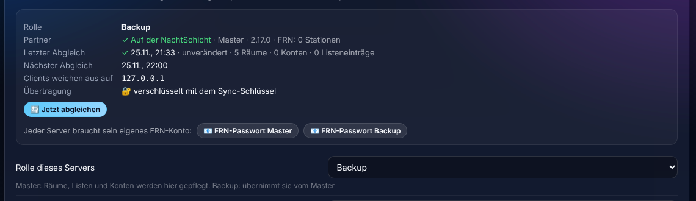
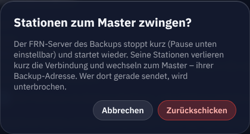
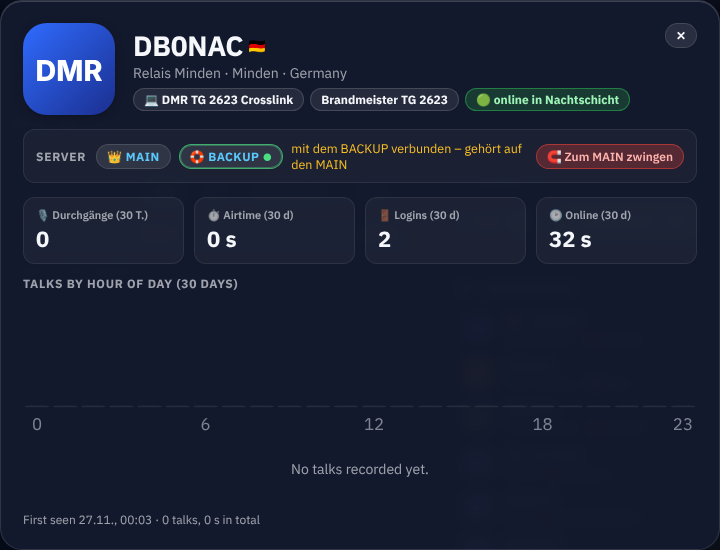
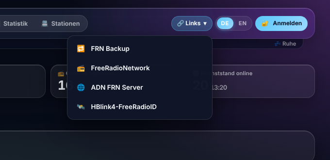
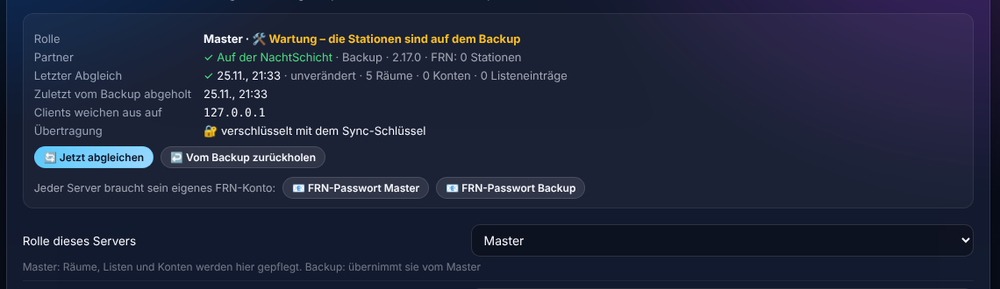

# 🔁 Master & Backup

Zwei FRN-Server mit derselben Konfiguration: **frn.auf-der-nachtschicht.de** ist der **Master**, hier pflegst du Räume,
Zugangslisten, Server-Listen und FRN-Konten. **frn-backup.auf-der-nachtschicht.de** ist das **Backup**. Es holt sich die
Konfiguration des Masters **zu jeder vollen Stunde** und auf Knopfdruck. Die beiden unterscheiden sich also höchstens um eine Stunde.

**Admin → Betrieb → ⚙️ Einstellungen → 🔁 Master & Backup**

## Wer macht was?

| | |
|---|---|
| **Ausfall** | Erledigt **FRN selbst**: Jeder Server nennt seinen Clients eine Ausweichadresse (`backup_server_addr`). Ist der Server weg, verbinden sich die Clients von selbst dorthin. Mit gesetzter Rolle ist das automatisch der Partner (Host aus „Dashboard des Partners“, Port = eigener FRN-Port), solange unter *FRN-Server → Ausweichserver* nichts anderes steht. |
| **Abgleich** | Das Backup holt sich zu jeder vollen Stunde (ein paar Sekunden danach) die Konfiguration vom Master. **🔄 Jetzt abgleichen** geht auf beiden Servern: auf dem Backup holt es sofort, auf dem Master bittet es das Backup darum. |
| **Wartung** | Von Hand auf dem Master: **🛠️ An das Backup übergeben** und danach **↩️ Vom Backup zurückholen** (siehe unten). |
| **Verirrte Stationen** | **🧲 Stationen zum Master zwingen** – auf Master und Backup, jederzeit (siehe unten). Auf Wunsch auch automatisch. |
| **Updates** | **⬆️ Updates beider Server**: für Master und Backup je **🔍 Prüfen** und **⬆️ Jetzt aktualisieren** (siehe unten). |

## Einrichten

1. **Auf dem Master:** Rolle **Master**, *Dashboard des Partners* = `https://frn-backup.auf-der-nachtschicht.de`,
   **🎲 Neuer Schlüssel** → Schlüssel kopieren → **Speichern**.
2. **Auf dem Backup:** Rolle **Backup**, *Dashboard des Partners* = `https://frn.auf-der-nachtschicht.de`, denselben
   **Sync-Schlüssel** einfügen, *Jede volle Stunde abgleichen* an → **Speichern** → **🔄 Jetzt abgleichen**.
3. Auf beiden Servern unter **🔑 FRN-Konten** das jeweils **eigene** FRN-Konto eintragen (für das Backup vorher mit
   **📧 FRN-Passwort Backup** und einer anderen E-Mail anfordern).
4. In beiden Kästen steht jetzt beim *Partner* ein grüner Haken mit Name, Rolle, Version und Stationen. Im Kopfbereich steht
   hinter dem Titel **[Master]** bzw. **[Backup]** (ohne Rolle: **[Standalone]**).

Beide Server müssen dieselbe Version haben (mindestens 2.17.0). Die Uhren müssen stimmen (± 5 Minuten), sonst lehnt der
Partner die Anfrage ab.

## 🔑 FRN-Konten von Master und Backup

Im Kasten *Master & Backup* steht unter **🔑 FRN-Konten beim SystemManager**, mit welchem Konto jeder der beiden Server beim
SystemManager angemeldet ist: E-Mail, ob ein Passwort gesetzt ist, und die Serveradresse. Den Partner zeigt er, sobald einmal
abgeglichen oder der Status abgerufen wurde. Steht dort zweimal dieselbe E-Mail, wird sie rot.

Darunter trägst du direkt das **FRN-Konto dieses Servers** ein (E-Mail und Passwort, **💾 Konto speichern**). Das ist dasselbe Feld
wie unter *Einstellungen → SystemManager*. Am besten richtest du das Konto ein, **bevor** du die Rolle setzt und das erste Mal
abgleichst. Der Abgleich fasst die FRN-Konten **nie** an: Jeder Server behält sein eigenes, auch beim stündlichen Abgleich und
nach einer Übergabe. Die E-Mail des Partners nimmt das Feld nicht an.

## 🔒 Schutz: nie zwei Server mit demselben FRN-Konto

Der SystemManager lässt ein FRN-Konto nur auf **einem** Server online. Melden sich Master und Backup mit derselben E-Mail an,
werfen sie sich gegenseitig raus („wrong FRN password“ / „wrong credentials“), und am Ende sind oft **beide** offline. Deshalb:

- **Jede Verbindung zwischen den beiden** (Abgleich, Statusabruf, Übergabe) trägt die Kennung des FRN-Kontos mit (nur ein Hash der
  E-Mail, verschlüsselt). Beide Server merken sich die Kennung des Partners.
- **Das Backup sperrt sich selbst:** Hat es dasselbe Konto wie der Master, **stoppt es seinen FRN-Server und hält ihn gesperrt**.
  Der Keep-Alive startet ihn nicht, „▶ Start“ wird abgelehnt, nach einem Abgleich oder Neustart bleibt er aus, und beim Hochfahren
  wird er gleich wieder gestoppt. Der Master bleibt immer online.
- **Speichern wird verweigert:** Wer auf einem der beiden unter *SystemManager* die E-Mail des anderen einträgt, bekommt
  „Dieses FRN-Konto verwendet schon der Master/das Backup“.
- **Freigabe von selbst:** Sobald auf dem Backup ein **eigenes** FRN-Konto gespeichert ist, wird die Sperre aufgehoben und sein
  FRN-Server startet.
- Im Kasten *Master & Backup* steht dann rot „⛔ Master und Backup verwenden dasselbe FRN-Konto“ und auf dem Backup
  „🔒 FRN-Server hier gestoppt und gesperrt“. Jede Sperre und Freigabe steht im Protokoll (`cluster_guard`).

Stand-alone-Server (ohne SystemManager) sind ausgenommen – dort gibt es kein Konto beim SystemManager.

## 🔁 FRN-Clients kehren zum Master zurück

Das öffentliche `/api/info` nennt unter `cluster` Master und Backup (Host, FRN-Port, Wartung). **N8 Crosslink** (ab 1.21.0) liest
das, behandelt den Master immer als Priorität 1 und wechselt nach einem Ausfall vom Backup **von selbst zurück**, sobald der Master
wieder sauber läuft (3 Prüfungen im Minutentakt, zwischen zwei Durchgängen). Während einer Wartung bleibt er auf dem Backup.
Normale FRN-Clients bleiben nach einem Ausfall auf dem Backup – bis du sie mit **🧲 Stationen zum Master zwingen** zurückschickst
(oder das automatisch erledigen lässt, siehe nächster Abschnitt).

## 🧲 Verirrte Stationen zum Master zwingen

Fällt der Master kurz aus (Neustart, Java-Update, Netzwerk-Hänger), wechseln die Stationen zum Backup – und **bleiben dort**, auch
wenn der Master längst wieder läuft. Im Kasten steht dann unter **📡 Stationen**, wie viele Stationen auf Master und Backup verbunden
sind, und beim Backup „⚠️ verirrt – sie gehören auf den Master“.

**🧲 Stationen zum Master zwingen** geht **auf beiden Servern** (auf dem Master bittet er das Backup darum, verschlüsselt):

1. Geprüft wird vorher: Der Master ist erreichbar, sein FRN-Server **läuft** und er ist **nicht in Wartung**. Sonst passiert nichts –
   die Stationen hätten kein Ziel.
2. Der FRN-Server des Backups **stoppt**. Die Stationen verlieren kurz die Verbindung und gehen zu ihrer Ausweichadresse – das ist
   beim Backup der Master.
3. Nach der **Pause** (Einstellung *Pause beim Zurückschicken*, Standard 20 Sekunden, 5–120) startet der FRN-Server des Backups
   wieder – bereit für den nächsten Ausfall. Während der Pause steht „⏳ wird zurückgeschickt“ im Kasten. Startet das Dashboard in
   dieser Zeit neu, holt es den Start nach.

Wer gerade auf dem Backup sendet, wird dabei unterbrochen – die Rückfrage sagt das. Jeder Vorgang steht unter **Zuletzt
zurückgeschickt** und im Protokoll (`cluster_return`).

### 👑 MAIN / 🛟 BACKUP im Stationsfenster

Klickst du irgendwo im Dashboard auf eine Station, steht im Fenster direkt unter dem Kopf die Leiste **SERVER** mit zwei Knöpfen:

- **👑 MAIN** und **🛟 BACKUP** öffnen das Dashboard des jeweiligen Servers (der eigene im selben Tab, der Partner in einem neuen).
- Der Server, mit dem die Station **gerade verbunden** ist, ist grün umrandet und hat einen Punkt ●. Daneben steht
  „mit dem MAIN verbunden“ oder gelb „mit dem BACKUP verbunden – gehört auf den MAIN“. Admins sehen das auf **beiden** Servern
  (der Partner wird verschlüsselt gefragt, welche Rufzeichen dort verbunden sind); Gäste sehen nur, ob sie auf diesem Server ist.
- Ist die Station auf dem BACKUP (und keine Wartung), gibt es für Admins **🧲 Zum MAIN zwingen**. FRN kann keine **einzelne**
  Station umziehen – der Knopf macht dasselbe wie *Stationen zum Master zwingen*: Der FRN-Server des BACKUP stoppt kurz, **alle**
  dort verbundenen Stationen wechseln zum MAIN. Die Rückfrage sagt das.

**Automatisch:** Mit *Verirrte Stationen selbst zurückschicken* (Einstellung auf dem **Backup**) prüft das Backup alle 5 Minuten:
Sind Stationen hier, obwohl der Master läuft? Zurückgeschickt wird nur, wenn der Master **seit mindestens 10 Minuten** läuft, **nicht
in Wartung** ist und auf dem Backup **gerade niemand sendet**. Standard: aus.

Auch **↩️ Vom Backup zurückholen** (Ende der Wartung) arbeitet jetzt so: stoppen, Pause, starten – statt eines schnellen Neustarts,
nach dem manche Stationen gleich wieder auf dem Backup landeten.

## ⬆️ Updates beider Server

Unter **⬆️ Updates beider Server** stehen Master und Backup als zwei gleich hohe Blöcke nebeneinander – egal, auf welchem der beiden
du gerade angemeldet bist. Jeder Block zeigt die Version des Dashboards (mit Commit) und des Java-FRN-Servers, ob es etwas Neues gibt
(mit den neuen Commits) und das Ergebnis des letzten Updates.

- **🔍 Prüfen** fragt GitHub und freeradionetwork.de sofort (sonst gilt das Ergebnis der letzten 10 Minuten).
- **⬆️ Jetzt aktualisieren** installiert, was neu ist:
  - den **Java-FRN-Server** – er startet neu, seine Stationen wechseln kurz zum Partner. **Beim Master schickt das Backup sie danach
    von selbst zurück** (sobald der Master wieder läuft).
  - das **Dashboard** – wie unter *System → Update* als root über `scripts/n8-admin.sh update --auto`: vorspulen, Python-Pakete,
    **Berechtigungen prüfen und korrigieren**, Neustart, Prüfung, sonst Rückkehr zur vorigen Version. Ein Passwort ist dafür nicht nötig.
- Der Block zeigt „⏳ Update läuft“, fragt alle 8 Sekunden nach und meldet die neue Version. Wird **dieser** Server aktualisiert, lädt
  die Seite danach neu.
- Der Partner wird über die **verschlüsselte Verbindung** angesprochen (Sync-Schlüssel), genau wie beim Abgleich.

Damit das beim Partner geht, muss er selbst schon **2.31.0** oder neuer haben. Ältere Versionen meldet der Block: dann einmal dort
unter *System → Update* (oder auf seiner Konsole `sudo ./scripts/update.sh`) aktualisieren – danach geht alles von hier aus.

## 🔗 Partner im Link-Menü

Master und Backup stehen sich **über Kreuz automatisch als erster Eintrag** im Link-Menü der Kopfzeile: auf dem Master
**🔁 FRN Backup**, auf dem Backup **🔁 FRN Master** (Adresse = *Dashboard des Partners*, mit dessen Site-Icon, öffnet in einem
neuen Tab). Der Eintrag wird nicht unter *Darstellung → 🔗 Links* gespeichert, ändert sich mit der Rolle von selbst und erscheint
auch dann, wenn das Link-Menü sonst ausgeschaltet ist. Steht dieselbe Adresse schon in deinen Links, erscheint sie nur einmal.

## 🔐 Verschlüsselte Übertragung

Alles zwischen Master und Backup ist **mit dem Sync-Schlüssel verschlüsselt**, zusätzlich zu HTTPS. Der Schlüssel selbst
wird **nie** übertragen:

- Jede Anfrage und jede Antwort ist mit einem aus dem Schlüssel abgeleiteten Schlüssel verschlüsselt und signiert
  (scrypt, SHAKE-256, HMAC-SHA-256; dieselben Bausteine wie die verschlüsselte Datensicherung `*.frnbak`).
- Eine Anfrage gilt nur für die Adresse, an die sie geht, höchstens 5 Minuten lang und nur einmal. Eine mitgeschnittene
  Anfrage lässt sich also nicht noch einmal abspielen. Die Antwort muss zur Anfrage gehören.
- Wer den Schlüssel nicht kennt, kann weder die Konfiguration lesen (sie enthält die FRN-Konten mit Passwörtern) noch
  einen Abgleich, eine Übergabe oder einen Neustart auslösen. Falsche Versuche werden gebremst.
- Neuen Schlüssel erzeugen: **🎲 Neuer Schlüssel**. Er gilt sofort hier; trag ihn danach auf dem anderen Server ein.

## Was wird abgeglichen?

| wird übernommen | bleibt auf jedem Server eigen |
|---|---|
| Räume (mit ihrer festen `netNN`-Nummer) und alle Raum-Einstellungen | Serveradresse und FRN-Port |
| Zugangslisten, Admin-, Stumm- und Sperrlisten, die ACL-Dateien des Java-Servers | Ausweichserver |
| FRN-Konten (eigene Passwortliste) | **FRN-Konto des Servers beim SystemManager** (E-Mail, Passwort) |
| Einstellungen: FRN-Server (Timeouts …), SystemManager-Adresse und Stand-alone, Betreiber, Dashboard, Daten | HTTPS und Domains |
| | Dashboard-Benutzer, Sitzungen, Statistik, Chat, Logo, Links, Theme |
| | Master & Backup selbst (Rolle, Partner, Schlüssel) |

- **Nur bei Unterschieden** wird etwas geschrieben. Ein Abgleich ohne Änderung meldet „unverändert“. Dass sich jemand
  angemeldet hat, zählt nicht als Änderung.
- Der Java-FRN-Server liest Räume, Listen und Konten nur beim Start. Haben sie sich geändert, startet das Backup ihn
  **nur neu, wenn keine Station verbunden ist**. Sind Stationen da (zum Beispiel weil der Master gerade ausgefallen ist),
  bleibt er laufen und oben erscheint der Hinweis „Jetzt neu starten“.
- Schutz: Schickt der Master keine Räume (leer oder kaputt), übernimmt das Backup nichts. Alte ACL-Dateien des Backups
  landen vorher in `acl/backups/…sync.bak`.
- Änderungen direkt auf dem Backup (auch Stummschalten aus dem FRN-Client heraus) überschreibt der nächste Abgleich. Gepflegt
  wird auf dem Master.

## 🛠️ Wartung: an das Backup übergeben

**🛠️ An das Backup übergeben** (nur auf dem Master):

1. Die Konfiguration wird zum Backup abgeglichen. Klappt das nicht, wird **nichts** umgeschaltet.
2. Läuft der FRN-Server auf dem Backup? Wenn nicht, wird **nichts** umgeschaltet.
3. Der FRN-Server auf dem Master stoppt. Die Stationen wechseln von selbst zum Backup (FRN-Ausweichadresse). Der Keep-Alive
   startet ihn nicht wieder; das Dashboard des Masters läuft weiter.

Oben steht dann „🛠️ Wartung – die Stationen sind auf dem Backup“. Jetzt kannst du den Master warten, aktualisieren oder neu
starten.

**↩️ Vom Backup zurückholen:** Der FRN-Server auf dem Master startet. Sobald er läuft, stoppt das Backup seinen FRN-Server für
die eingestellte Pause und startet ihn dann wieder, damit seine Stationen zum Master zurückkommen (für sie ist der Master die
Ausweichadresse).

## 📧 FRN-Passwort für Master und Backup

Jeder Server braucht **sein eigenes FRN-Konto** beim SystemManager. Mit denselben Zugangsdaten auf zwei Servern lehnt er den
zweiten ab („falsches FRN-Passwort“ bzw. „bereits online“). Deshalb gibt es zwei Knöpfe:

- **📧 FRN-Passwort Master** und **📧 FRN-Passwort Backup** öffnen das Formular, schon mit Rufzeichen, Name (+ „Master“
  oder „Backup“) und Beschreibung ausgefüllt. Rufzeichen und Name zusammen müssen beim SystemManager neu sein.
- Das Passwort kommt per E-Mail. Trag es mit genau dieser E-Mail **auf dem Server ein, für den es ist**: unter
  *Einstellungen → SystemManager*. Dieser Teil wird nie abgeglichen.

## Fehlersuche

| Meldung | Ursache und Lösung |
|---|---|
| **⛔ Master und Backup verwenden dasselbe FRN-Konto** (roter Kasten) / FRN-Server stoppt mit *SystemManager: wrong credentials* | Beide Server melden sich mit derselben E-Mail beim SystemManager an. Er lässt nur einen online: Wer zuerst kommt (z. B. das Backup, während der Master für ein Update neu startet), bleibt – der andere bekommt „wrong credentials“, sein FRN-Server beendet sich, und die Stationen landen auf dem anderen. Lösung: FRN-Server auf dem Backup stoppen (Master kommt wieder), mit **📧 FRN-Passwort Backup** ein eigenes Konto anfordern und auf dem Backup unter *SystemManager* eintragen. |
| *Partner … nicht erreichbar* | Adresse falsch, Partner aus, Firewall. Die Adresse ist die des **Dashboards** (https://…), nicht der FRN-Port. |
| *Der Partner hat abgelehnt: wrong sync key* | Der Schlüssel ist auf beiden Servern nicht gleich. Neu erzeugen und auf dem anderen Server eintragen. |
| *request expired …* | Die Uhrzeit eines Servers geht falsch: `timedatectl` prüfen, NTP einschalten. |
| *Der Partner kennt Master & Backup noch nicht* | Den Partner auf dieselbe Version aktualisieren. |
| *this server is master, not backup* | Die Rollen sind vertauscht oder beide gleich. |
| *Der Master ist in Wartung …* / *Der FRN-Server auf dem Master läuft nicht …* (beim Zurückschicken) | Zurückschicken geht nur zu einem laufenden Master ohne Wartung. Wartung mit **↩️ Vom Backup zurückholen** beenden bzw. den FRN-Server des Masters starten. |
| *Der Partner kennt Fern-Updates noch nicht (ältere Version)* | Den Partner einmal selbst aktualisieren (*System → Update* oder `sudo ./scripts/update.sh`), ab 2.31.0 geht es von hier. |
| *Neustart steht aus – Stationen verbunden* | Das Backup hat Stationen, deshalb kein automatischer Neustart. Später **Jetzt neu starten** oder beim nächsten ruhigen Abgleich. |

Jeder Abgleich steht unter **📜 Protokoll** (`cluster_sync`, `cluster_maintenance`, `cluster_key`, `cluster_return`, `cluster_update`).
