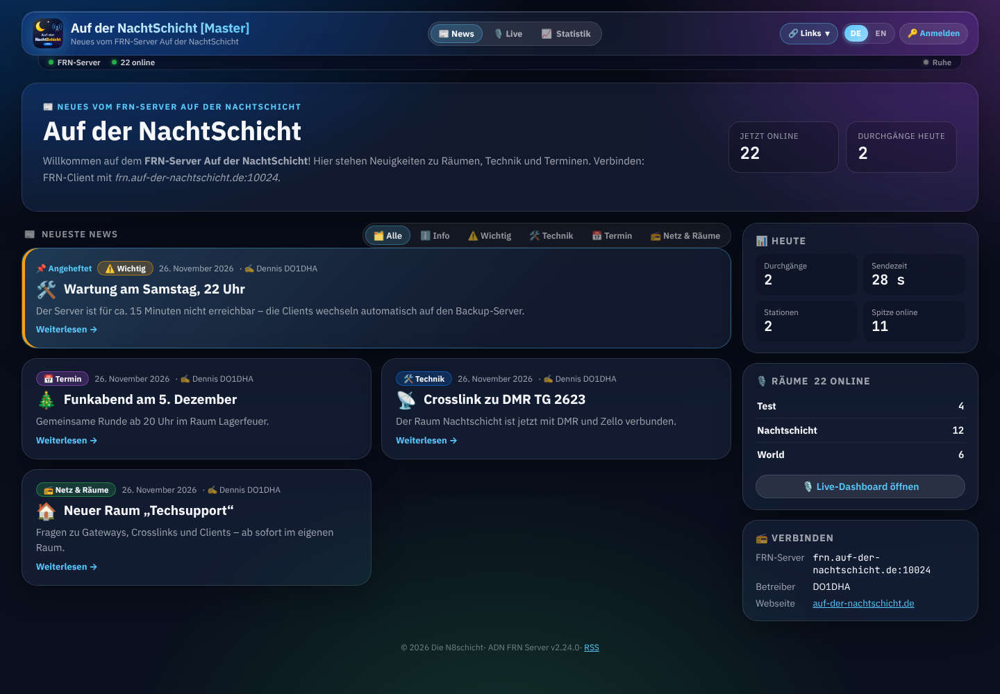
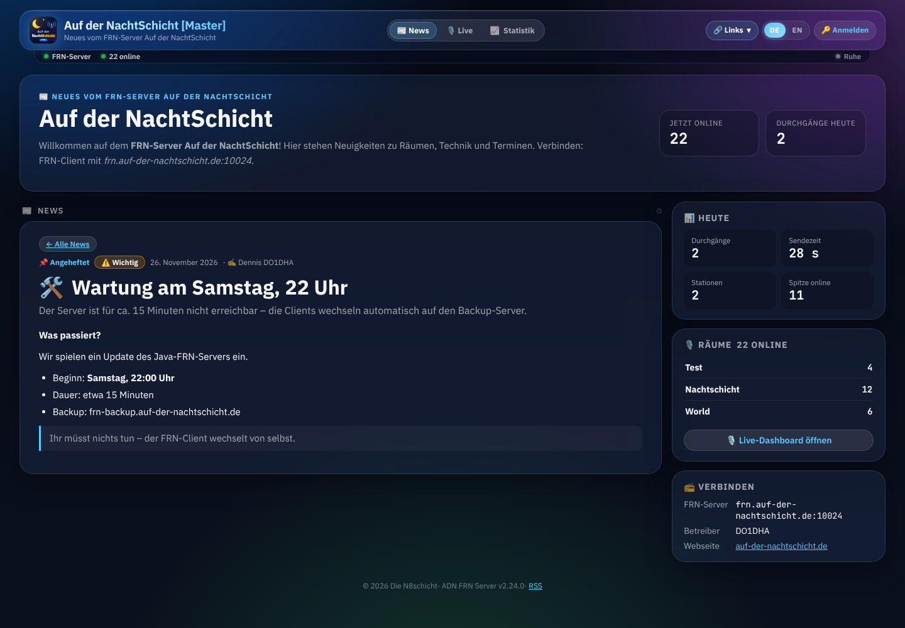
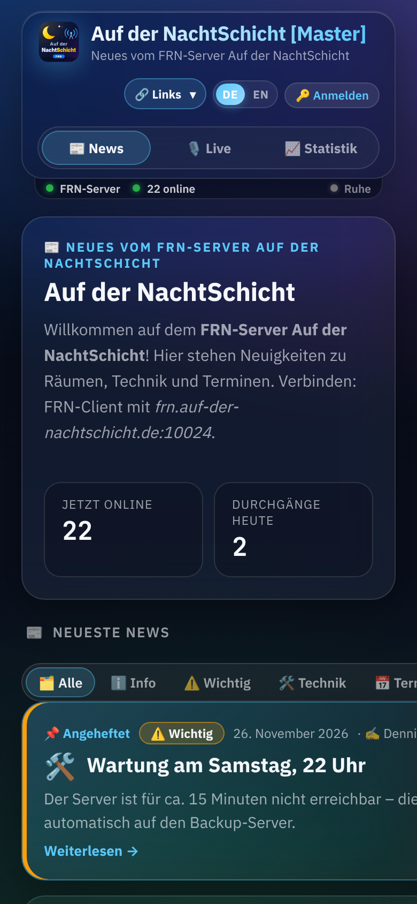
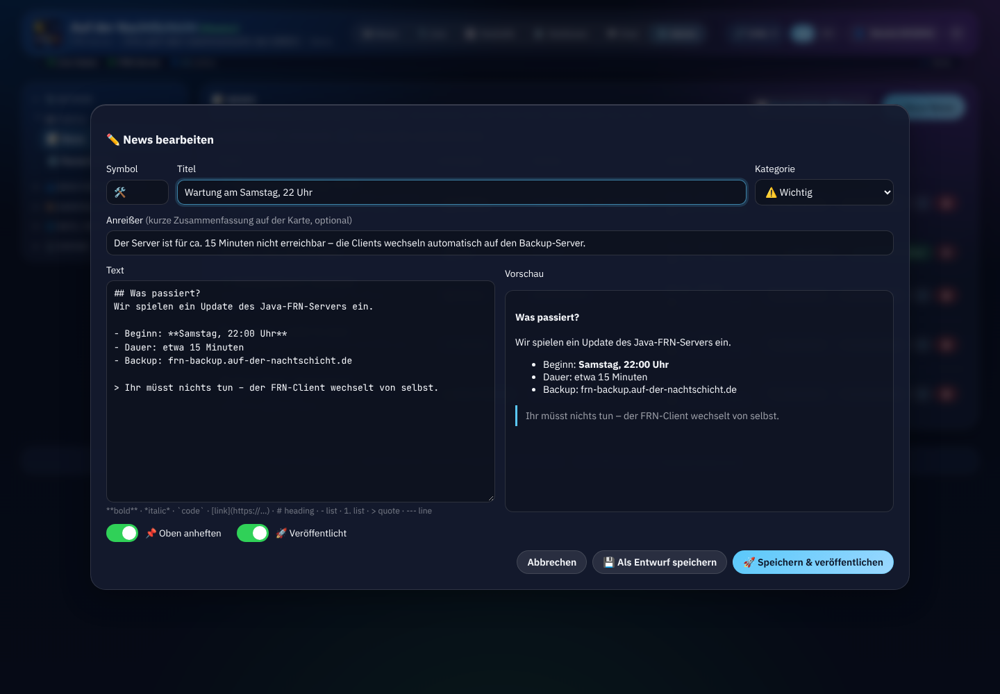
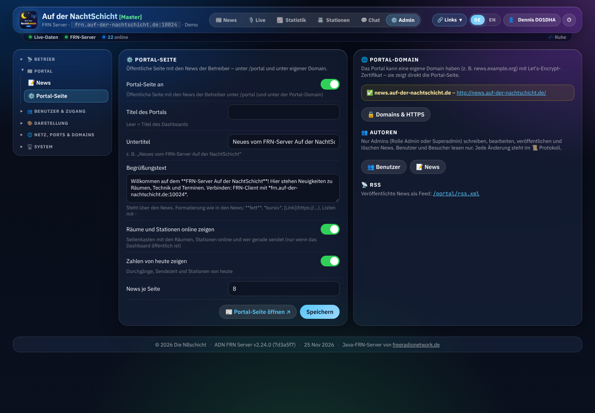
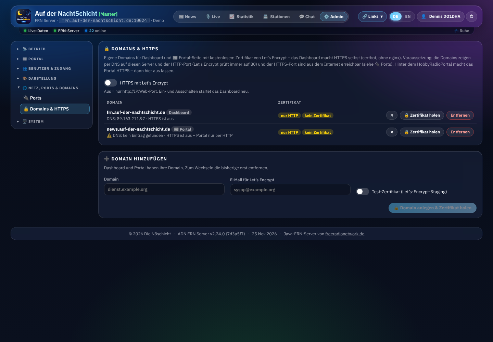

# 📰 Portal-Seite (News)

[← Übersicht](../../readme.md) · [Installation](installation.md) · [Dashboard](dashboard.md) · [Admin-Portal](adminbereich.md) · **Portal-Seite** · [Konfiguration](konfiguration.md) · [Betrieb & Fehlersuche](betrieb.md)

Seit **2.24.0** hat der ADN-FRN-Server eine öffentliche **Portal-Seite mit News** der Betreiber – unter `/portal` und auf Wunsch
unter einer **eigenen Domain mit Let's-Encrypt-Zertifikat** (z. B. `news.auf-der-nachtschicht.de`).

## Was Besucher sehen

- **Kopfzeile wie im Dashboard** (Logo, Titel mit [Master]/[Backup]/[Standalone], 📰 News · 🎙️ Live · 📈 Statistik, Links-Menü, DE | EN, Anmelden)
  und die schmale Statuszeile (FRN-Server, online, wer sendet).
- **Begrüßung** mit Titel, Untertitel, Begrüßungstext und zwei Kennzahlen (jetzt online, Durchgänge heute).
- **News als Karten** über die ganze Breite: angeheftete News oben über die volle Breite, die übrigen gleich breit nebeneinander.
  Jede Karte mit Kategorie (ℹ️ Info · ⚠️ Wichtig · 🛠️ Technik · 📅 Termin · 📻 Netz & Räume), Datum, Autor, Symbol, Titel und Anreißer.
  Oben lässt sich nach Kategorie filtern, unten lädt **Ältere News** nach.
- **Artikel-Seite** `/news/<Nummer>` mit dem ganzen Text.
- **Seitenkästen:** Zahlen von heute, Räume mit Stationen online (wer gerade sendet, blinkt magenta) und *Verbinden* (FRN-Server,
  Betreiber, Webseite). Räume und Zahlen nur, wenn das Dashboard öffentlich ist (oder man angemeldet ist); versteckte Räume nie.
- **RSS-Feed** `/portal/rss.xml` mit den letzten 30 veröffentlichten News.
- Auf dem Handy eine Spalte. Die Seite lädt alle 30 s neu.

 

Im Dashboard steht der Menüpunkt **📰 News** vorne in der Kopfzeile, sobald die Portal-Seite an ist.

## Nur Admins sind Autoren

Neue Gruppe im Admin-Menü: **📰 Portal** mit **📝 News** und **⚙️ Portal-Seite**.

- **Nur Admins** (Rolle *Admin* oder *Superadmin*) schreiben, bearbeiten, veröffentlichen, zurückziehen und löschen News.
  Benutzer mit Rolle *User* und Besucher lesen nur – der Server lehnt alles andere ab (403).
- Jede Änderung steht im **📜 Protokoll** (*news_saved*, *news_published*, *news_unpublished*, *news_deleted*).
- **Entwürfe** sieht man nur im Admin-Portal. Veröffentlichen setzt das Datum; Zurückziehen nimmt die News von der Seite.

### Schreiben

**＋ Neue News** bzw. **✏️ Bearbeiten** öffnet den Editor: Symbol (Emoji), Titel, Kategorie, Anreißer (kurz, steht auf der Karte), Text
und links daneben die **Vorschau**. *📌 Oben anheften* und *🚀 Veröffentlicht*; **💾 Als Entwurf speichern** oder
**🚀 Speichern & veröffentlichen**.

Formatierung im Text (auch im Begrüßungstext):

| Schreiben | ergibt |
|---|---|
| `**fett**` · `*kursiv*` · `` `Code` `` | **fett** · *kursiv* · `Code` |
| `[Text](https://…)` oder einfach `https://…` | Link (öffnet in neuem Tab) |
| `# Überschrift` · `## …` · `### …` | Zwischenüberschriften |
| `- Punkt` · `1. Punkt` | Listen |
| `> Zitat` · `---` | Hinweis-Kasten · Trennlinie |
| Leerzeile | neuer Absatz |

Alles andere wird **als Text** angezeigt: HTML oder Skripte eines Autors erreichen nie einen Besucher (der Text wird erst vollständig
maskiert, dann formatiert). Grenzen: Titel 140, Anreißer 400, Text 20 000 Zeichen.

## ⚙️ Portal-Seite

| Einstellung | Standard | Wirkung |
|---|---|---|
| Portal-Seite an | an | aus = `/portal` leitet auf das Dashboard, die Portal-Domain zeigt das Dashboard |
| Titel des Portals | leer | leer = Titel des Dashboards |
| Untertitel | leer | steht über dem Titel und in der Kopfzeile |
| Begrüßungstext | leer | steht über den News, Formatierung wie oben |
| Räume und Stationen online zeigen | an | Seitenkasten *Räume* (nur bei öffentlichem Dashboard) |
| Zahlen von heute zeigen | an | Seitenkasten *Heute* und Kennzahlen oben |
| News je Seite | 8 | 3–30 |

Mit **Master & Backup** gehen News und diese Einstellungen beim stündlichen Abgleich mit zum Backup – nur die Portal-Domain bleibt je
Server eigen.

## 🌐 Eigene Domain mit Let's Encrypt

Wie immer unter **🌐 Netz, Ports & Domains → 🔒 Domains & HTTPS**:

1. DNS: einen A-/AAAA-Eintrag (oder CNAME) der neuen Domain auf diesen Server setzen.
2. Hat das Dashboard schon seine Domain, bietet **➕ Domain hinzufügen** jetzt **Portal-Domain eintragen & Zertifikat holen** an.
3. Das Dashboard startet neu und **erweitert das Let's-Encrypt-Zertifikat** um die Portal-Domain (ein Zertifikat für beide Namen,
   certbot `--expand`). Bis dahin steht in der Tabelle *Zertifikat wird um diese Domain erweitert …*.
4. `https://news.example.org/` zeigt direkt die Portal-Seite; `/dashboard` darunter das Dashboard. Der HTTP-Port leitet je Domain auf
   die richtige HTTPS-Adresse um.

**Entfernen** nimmt nur die Portal-Domain weg – die Seite bleibt unter `/portal` erreichbar. Ohne HTTPS funktioniert die Portal-Domain
über HTTP. Erneuert wird automatisch zusammen mit dem Zertifikat des Dashboards (alle 12 Stunden geprüft).

## Schnittstellen

| Pfad | Wer | Inhalt |
|---|---|---|
| `GET /portal`, `GET /news/<id>` | alle | Portal-Seite bzw. Artikel |
| `GET /api/portal?offset=&category=` | alle | Titel, Begrüßung, veröffentlichte News, ggf. Räume und Zahlen von heute |
| `GET /api/portal/news/<id>` | alle | eine veröffentlichte News |
| `GET /portal/rss.xml` | alle | RSS 2.0 |
| `GET /api/admin/portal` | Admins | Einstellungen und alle News (auch Entwürfe) |
| `POST /api/admin/news` · `POST /api/admin/news/<id>/publish` · `DELETE /api/admin/news/<id>` | Admins | schreiben, (de)veröffentlichen, löschen |
| `POST /api/admin/portal/settings` | Admins | Einstellungen `portal.*` (ohne Domain) |
