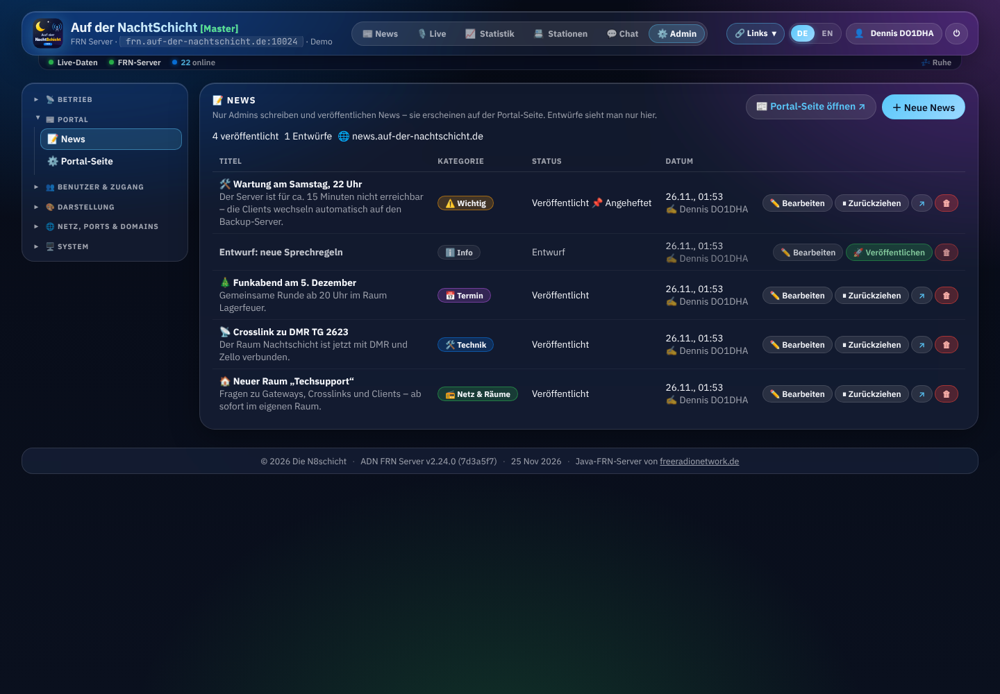
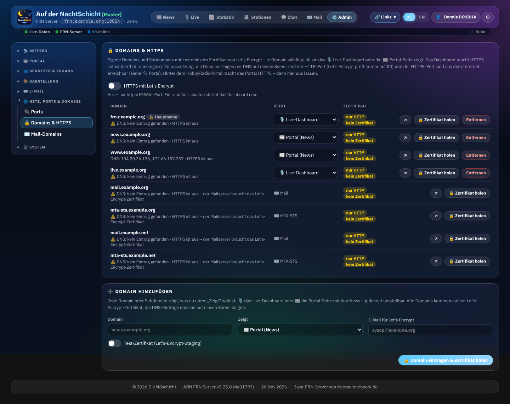
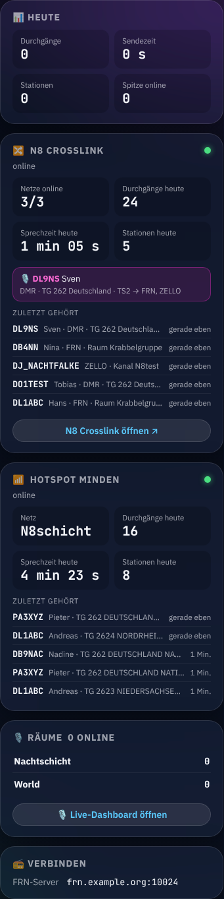
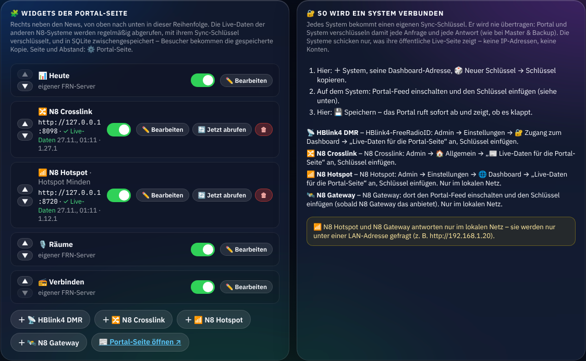
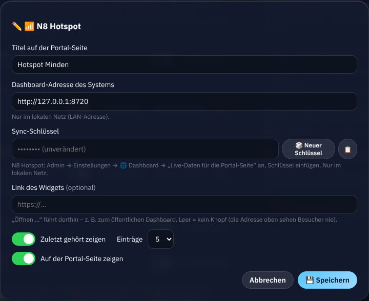

# 📰 Portal-Seite (News)

[← Übersicht](../../readme.md) · [Installation](installation.md) · [Dashboard](dashboard.md) · [Admin-Portal](adminbereich.md) · **Portal-Seite** · [Konfiguration](konfiguration.md) · [Betrieb & Fehlersuche](betrieb.md)

Seit **2.24.0** hat der ADN-FRN-Server eine öffentliche **Portal-Seite mit News** der Betreiber – unter `/portal` und auf Wunsch
unter einer **eigenen Domain mit Let's-Encrypt-Zertifikat** (z. B. `news.auf-der-nachtschicht.de`).

<p align="center"></p>

## Was Besucher sehen

- **Kopfzeile wie im Dashboard** (Logo, Titel mit [Master]/[Backup]/[Standalone], 📰 News · 🎙️ Live · 📈 Statistik, Links-Menü, Sprachmenü 🌐 mit neun Sprachen, Anmelden)
  und die schmale Statuszeile (FRN-Server, online, wer sendet).
- **Begrüßung** mit Titel, Untertitel, Begrüßungstext und zwei Kennzahlen (jetzt online, Durchgänge heute).
- **News als Karten** über die ganze Breite: angeheftete News oben über die volle Breite, die übrigen gleich breit nebeneinander.
  Jede Karte mit Kategorie (ℹ️ Info · ⚠️ Wichtig · 🛠️ Technik · 📅 Termin · 📻 Netz & Räume), Datum, Autor, Symbol, Titel und Anreißer.
  Oben lässt sich nach Kategorie filtern, unten lädt **Ältere News** nach.
- **Artikel-Seite** `/news/<Nummer>` mit dem ganzen Text.
- **Widgets am Rand** (ab 2.33.0, siehe [🧩 Widgets](#-widgets-am-rand-live-daten-der-anderen-n8-systeme)): Zahlen von heute, Räume mit
  Stationen online (wer gerade sendet, blinkt magenta), *Verbinden* (FRN-Server, Betreiber, Webseite) **und die Live-Daten von
  HBlink4-FreeRadioID, N8 Crosslink, N8 Hotspot und N8 Gateway** – in der Reihenfolge, die die Admins wählen, links oder rechts.
  Räume und Zahlen nur, wenn das Dashboard öffentlich ist (oder man angemeldet ist); versteckte Räume nie.
- **RSS-Feed** `/portal/rss.xml` mit den letzten 30 veröffentlichten News.
- Auf dem Handy eine Spalte. Die Seite lädt alle 30 s neu.

<p align="center"> </p>

Im Dashboard steht der Menüpunkt **📰 News** vorne in der Kopfzeile, sobald die Portal-Seite an ist.

## Nur Admins sind Autoren

Neue Gruppe im Admin-Menü: **📰 Portal** mit **📝 News** und **⚙️ Portal-Seite**.

- **Nur Admins** (Rolle *Admin* oder *Superadmin*) schreiben, bearbeiten, veröffentlichen, zurückziehen und löschen News.
  Benutzer mit Rolle *User* und Besucher lesen nur – der Server lehnt alles andere ab (403).
- Jede Änderung steht im **📜 Protokoll** (*news_saved*, *news_published*, *news_unpublished*, *news_deleted*).
- **Entwürfe** sieht man nur im Admin-Portal. Veröffentlichen setzt das Datum; Zurückziehen nimmt die News von der Seite.

<p align="center"></p>

### Schreiben

**＋ Neue News** bzw. **✏️ Bearbeiten** öffnet den Editor: Symbol (Emoji), Titel, Kategorie, **🖼️ Themenbild** (seit 2.28: JPEG, PNG oder WebP, wird im Browser auf höchstens 1600 px verkleinert, mit Bildbeschreibung für Screenreader – oben auf der Karte, bei angehefteten News links daneben, im Artikel als breites Titelbild), Anreißer (kurz, steht auf der Karte), Text
und links daneben die **Vorschau**. *📌 Oben anheften* und *🚀 Veröffentlicht*; **💾 Als Entwurf speichern** oder
**🚀 Speichern & veröffentlichen**.

<p align="center"></p>

Formatierung im Text (auch im Begrüßungstext):

| Schreiben | ergibt |
|---|---|
| `**fett**` · `*kursiv*` · `` `Code` `` | **fett** · *kursiv* · `Code` |
| `[Text](https://…)` oder einfach `https://…` | Link (öffnet in neuem Tab) |
| `# Überschrift` · `## …` · `### …` | Zwischenüberschriften |
| `- Punkt` · `1. Punkt` | Listen |
| `> Zitat` · `---` | Hinweis-Kasten · Trennlinie |
| Leerzeile | neuer Absatz |

Alles andere wird **als Text** angezeigt: HTML oder Skripte eines Autors erreichen nie einen Besucher (der Text wird erst vollständig
maskiert, dann formatiert). Grenzen: Titel 140, Anreißer 400, Text 20 000 Zeichen.

## ⚙️ Portal-Seite

<p align="center"></p>

| Einstellung | Standard | Wirkung |
|---|---|---|
| Portal-Seite an | an | aus = `/portal` leitet auf das Dashboard, die Portal-Domain zeigt das Dashboard |
| Titel des Portals | leer | leer = Titel des Dashboards |
| Untertitel | leer | steht über dem Titel und in der Kopfzeile |
| Begrüßungstext | leer | steht über den News, Formatierung wie oben |
| Räume und Stationen online zeigen | an | Seitenkasten *Räume* (nur bei öffentlichem Dashboard) |
| Zahlen von heute zeigen | an | Seitenkasten *Heute* und Kennzahlen oben |
| News je Seite | 8 | 3–30 |

Mit **Master & Backup** gehen News und diese Einstellungen beim stündlichen Abgleich mit zum Backup – nur die Portal-Domain bleibt je
Server eigen.

## 🌐 Domains: Live oder Portal

Seit **2.26.0** wählst du unter **🌐 Netz, Ports & Domains → 🔒 Domains & HTTPS** für **jede Domain und Subdomain**, was sie zeigt:

<p align="center"></p>

- Spalte **„Zeigt“**: **🎙️ Live-Dashboard** oder **📰 Portal (News)** – umstellen wirkt **sofort, ohne Neustart**.
- **➕ Domain hinzufügen** fragt das Ziel gleich mit ab. Beliebig viele Domains, z. B. `frn.example.org` → Live,
  `news.example.org` und `www.example.org` → Portal.
- Alle Domains kommen auf **ein Let's-Encrypt-Zertifikat**; die erste ist der **🔒 Hauptname**. Beim Hinzufügen startet das Dashboard
  neu und erweitert das Zertifikat (DNS der neuen Domain muss auf diesen Server zeigen, Port 80 erreichbar). Der HTTP-Port leitet je
  Domain auf die richtige HTTPS-Adresse um.
- **Entfernen** einer Domain: das Portal bleibt unter `/portal` erreichbar, das Dashboard unter `/dashboard`. Wird der Hauptname
  entfernt, rückt die nächste Domain nach.
- Auf einer Portal-Domain führt **🎙️ Live** zur ersten Live-Domain; im Dashboard führt **📰 News** zur ersten Portal-Domain.
- Ist die Portal-Seite unter *📰 Portal → ⚙️ Portal-Seite* ausgeschaltet, zeigen auch Portal-Domains das Dashboard.

## Schnittstellen

| Pfad | Wer | Inhalt |
|---|---|---|
| `GET /portal`, `GET /news/<id>` | alle | Portal-Seite bzw. Artikel |
| `GET /api/portal?offset=&category=` | alle | Titel, Begrüßung, veröffentlichte News, ggf. Räume und Zahlen von heute |
| `GET /api/portal/news/<id>` | alle | eine veröffentlichte News |
| `GET /portal/rss.xml` | alle | RSS 2.0 |
| `GET /api/admin/portal` | Admins | Einstellungen und alle News (auch Entwürfe) |
| `POST /api/admin/news` · `POST /api/admin/news/<id>/publish` · `DELETE /api/admin/news/<id>` | Admins | schreiben, (de)veröffentlichen, löschen |
| `POST /api/admin/portal/settings` | Admins | Einstellungen `portal.*` (ohne Domain) |

## 🧩 Widgets am Rand: Live-Daten der anderen N8-Systeme

<p align="center"> </p>

Seit **2.33.0** zeigt die Portal-Seite am Rand **Widgets** – die drei Kästen des eigenen FRN-Servers und die **Live-Daten der anderen
N8-Systeme**:

| Widget | woher | Inhalt |
|---|---|---|
| 📊 Heute · 🎙️ Räume · 📻 Verbinden | dieser FRN-Server | wie bisher |
| 📡 **HBlink4 DMR** | HBlink4-FreeRadioID (ab 1.19.0) | Repeater & Hotspots, wer gerade spricht, Durchgänge und Sprechzeit heute, zuletzt gehört |
| 🔀 **N8 Crosslink** | N8 Crosslink (ab 1.28.0) | Netze online (FRN/DMR/Zello), wer gerade spricht und wohin, Durchgänge/Sprechzeit/Stationen heute, zuletzt gehört |
| 📶 **N8 Hotspot** | N8 Hotspot (ab 1.13.0) – **nur im lokalen Netz** | Netz, wer gerade spricht (RF oder Netz), Durchgänge/Sprechzeit/Stationen heute, zuletzt gehört |
| 🛰️ **N8 Gateway** | N8 Gateway – **nur im lokalen Netz** | sobald N8 Gateway den Portal-Feed anbietet (Schnittstelle unten) |

Jedes Widget hat oben einen Punkt: 🟢 läuft · 🟡 teilweise (z. B. ein Netz offline) · 🔴 aus · ⚪ keine aktuellen Daten (dann steht
dort „Stand …“ mit der Zeit der letzten Daten).

### Einrichten (Admin → 📰 Portal → 🧩 Widgets)

1. **＋ HBlink4 DMR** (bzw. Crosslink, Hotspot, Gateway) → Dashboard-Adresse des Systems eintragen
   (z. B. `https://dmr.die-n8schicht.de`, beim Hotspot die LAN-Adresse wie `http://192.168.1.20`) → **🎲 Neuer Schlüssel** → **📋** kopieren.
2. Auf dem System den Portal-Feed einschalten und den Schlüssel einfügen:
   - **HBlink4-FreeRadioID:** Admin → Einstellungen → 🔐 Zugang zum Dashboard → *Live-Daten für die Portal-Seite* an, *Sync-Schlüssel* einfügen.
   - **N8 Crosslink:** Admin → 🏠 Allgemein → *📰 Live-Daten für die Portal-Seite* an, *Sync-Schlüssel für das Portal* einfügen.
   - **N8 Hotspot:** Admin → Einstellungen → 🌐 Dashboard → *Live-Daten für die Portal-Seite* an, *Sync-Schlüssel* einfügen.
3. Hier **💾 Speichern** – das Portal ruft sofort ab und meldet „✅ Live-Daten empfangen“ oder den Grund (falscher Schlüssel,
   nicht erreichbar, System zu alt …).

<p align="center"></p>

- **Reihenfolge:** mit **▲ ▼** – von oben nach unten so, wie es auf der Portal-Seite erscheint. Die eigenen Kästen (Heute, Räume,
  Verbinden) lassen sich genauso verschieben und ausschalten, aber nicht löschen.
- **An/Aus:** der Schalter je Widget. **Titel** frei wählbar (leer = Titel des Systems), **Link** für den Knopf „… öffnen“
  (leer = kein Knopf; die Abrufadresse sehen Besucher nie), **Zuletzt gehört** an/aus und Anzahl (3–8).
- **Seite und Abruf-Abstand** unter ⚙️ Portal-Seite: *Widgets* rechts oder links der News, *Live-Daten abrufen alle* 15–600 s (Standard 30 s).
- **🔄 Jetzt abrufen** fragt sofort; Fehler stehen in der Liste mit Zeit der letzten guten Daten.

### Wie die Daten fließen

- Das Portal fragt jedes eingeschaltete System im eingestellten Abstand (Standard **30 s**) und **speichert die Antwort in SQLite**
  (Tabelle `portal_widgets`). Besucher bekommen immer die **gespeicherte Kopie** – ein langsames oder ausgeschaltetes System bremst die
  Portal-Seite nie. Bleibt ein System stumm, bleiben die letzten Daten mit „keine aktuellen Daten · Stand …“ stehen.
- **Verschlüsselt mit dem Sync-Schlüssel** des Systems – wie bei Master & Backup, zusätzlich zu HTTPS. Der Schlüssel wird nie
  übertragen; jede Anfrage gilt nur einmal und höchstens 5 Minuten. Ohne Schlüssel bekommt niemand die Daten.
- Die Systeme schicken **nur, was ihre öffentliche Live-Seite zeigt**: Status, Kennzahlen, Rufzeichen/Namen, TG bzw. Raum, Zeiten –
  **keine IP-Adressen, keine Ports, keine Konten**.
- **N8 Hotspot und N8 Gateway nur im lokalen Netz:** Das Portal nimmt für sie nur LAN-Adressen an (privat, Loopback, Link-Local; der
  Name muss dorthin auflösen), und Hotspot/Gateway beantworten den Feed nur aus dem lokalen Netz. Hat man keinen Hotspot/Gateway,
  legt man einfach keins an.
- Mit **Master & Backup** gehen die Widgets (mit Schlüsseln, verschlüsselt) beim Abgleich auch auf das Backup.
- Jede Änderung steht im 📜 Protokoll (`widget_saved`, `widget_order`, `widget_deleted`).

### Schnittstelle (für N8 Gateway und weitere Systeme)

Ein System, das ein Widget liefern will, braucht nur die Datei `n8feed.py` (in allen N8-Systemen gleich, nur Python-Standardbibliothek)
und einen Endpunkt:

```python
from . import n8feed
replay = n8feed.Replay()

@app.post(n8feed.PATH)                       # POST /api/n8/feed – ohne Anmeldung, eigene Verschlüsselung
async def portal_feed(request):
    key = einstellung("portal_key") if einstellung("portal_feed") else ""
    if lokal_only and not n8feed.is_local(client_ip(request)):     # Hotspot/Gateway
        return 403
    try:
        blob = n8feed.answer_request(await request.body(), key, replay, lambda: n8feed.summary(
            "gateway", titel, version, "ok", "", [("Kennzahl", 1), ...], on_air=[...], last_heard=[...]))
    except n8feed.FeedError as e:
        return 403 (404, wenn aus)
    return Response(blob, media_type=n8feed.CTYPE)
```

Format der Zusammenfassung und der Verschlüsselung: siehe Kopf von [`frnadn/n8feed.py`](../../frnadn/n8feed.py).

