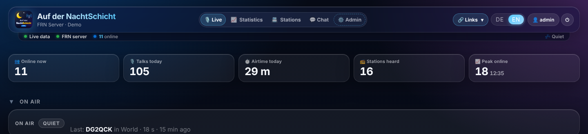
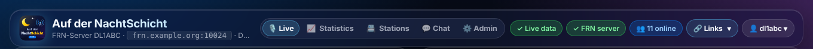

# 🔐 Sicherheit & N8 Kit

[← Übersicht](../../readme.md)

Diese Seite beschreibt, wie das Dashboard sich schützt, was du als Betreiber noch tun kannst (Reverse-Proxy), und das **N8 Kit** – die gemeinsamen Bausteine, die adn-frn-server, HBlink4-FreeRadioID, N8-HotSpot und N8 Crosslink gleich aussehen und sich gleich verhalten lassen.

## Was das Dashboard selbst tut

### Keine offene API-Beschreibung

FastAPI legt normalerweise unter `/docs`, `/redoc` und `/openapi.json` eine vollständige Beschreibung aller Routen an – mit allen Admin-Endpunkten und ihren Datenformaten. Das ist **abgeschaltet**; die drei Adressen antworten mit 404.

Zum Entwickeln lässt sie sich einschalten, nur mit einer Umgebungsvariablen beim Start:

```bash
N8_API_DOCS=1 ./venv/bin/python -m frnadn
```

### Sicherheits-Header bei jeder Antwort

| Header | Wert | Wofür |
|---|---|---|
| `Content-Security-Policy` | `default-src 'self'`; Skripte, Styles, Schriften nur vom eigenen Server; Bilder auch `https:` (Kartenkacheln, Avatare); Verbindungen nur zum eigenen Server (`ws:`/`wss:` für Live-Daten); `object-src 'none'`, `base-uri 'self'`, `form-action 'self'`, `frame-ancestors 'self'` | fremde Skripte, Plugins, `<base>`-Tricks, fremde Formularziele und Einbetten in fremde Seiten werden vom Browser blockiert |
| `Strict-Transport-Security` | `max-age=31536000` | nur wenn die Seite über **HTTPS** kommt (direkt oder über einen Proxy mit `X-Forwarded-Proto: https`); verhindert SSL-Stripping |
| `Permissions-Policy` | Kamera, Mikrofon, Zahlung, USB, Seriell, Sensoren aus; Standort nur für die eigene Seite | Seiten können diese Geräte nicht ansprechen |
| `X-Content-Type-Options` | `nosniff` | Dateien werden nur als das ausgeführt, was sie sind |
| `X-Frame-Options` | `SAMEORIGIN` | kein Einbetten in fremde Seiten (Clickjacking) |
| `Referrer-Policy` | `same-origin` | Adressen des Dashboards gehen nicht an fremde Seiten |
| `Cross-Origin-Opener-Policy` / `-Resource-Policy` | `same-origin` / `same-site` | Fenster und Dateien sind von fremden Seiten getrennt |

Der Header `server: uvicorn` wird **nicht** mehr gesendet.

`'unsafe-inline'` ist für Skripte noch erlaubt, weil die Seiten Klick-Handler direkt im HTML haben. Deshalb ist das Escapen (nächster Abschnitt) die eigentliche Schutzschicht gegen XSS; die CSP sorgt dafür, dass ein Angreifer keine **fremden** Skripte nachladen und keine Daten an fremde Server schicken kann.

### Daten aus dem FRN-Netz

Rufzeichen, Namen, Orte, Band und Beschreibung schicken die FRN-Clients selbst; Chat-Nachrichten schreiben die Benutzer. Jedes dieser Felder geht beim Anzeigen durch `esc()` bzw. wird als `textContent` gesetzt – in Live, Last heard, Räumen, Statistik, Stationen, Chat und im Admin-Portal. Hochgeladene Bilder (Logo, Client-Logos) werden am Inhalt geprüft.

### Anmeldung

Sitzungs-Cookie `HttpOnly`, `SameSite`, über HTTPS `Secure`; jede schreibende Anfrage braucht den Header `X-N8` (CSRF-Schutz); Fehlversuche werden gebremst. IP-Adressen sehen nur Admins.

### Portal-Zugang (API-Token)

Für das HobbyRadioPortal gibt es eigene **API-Tokens** (Admin → Users). Gespeichert wird nur der SHA-256-Hash; der Token selbst erscheint
beim Anlegen einmal. Er gilt nur als `Authorization: Bearer`-Header und nur für eine feste Liste von Adressen:

| erlaubt | gesperrt |
|---|---|
| `/api/admin/settings` (ohne `https.*`), `/api/admin/rooms…`, `/api/admin/acl`, `/api/admin/audit`, `/api/admin/server/start\|stop\|restart`, öffentliche Lese-APIs | Benutzer, Sitzungen, Tokens, FRN-Konten, Updates, System, Theme, Links, Import, Logs, `/api/auth/*` |

Tokens verwalten nur angemeldete Menschen (Admin/Superadmin) – ein Token kann keine weiteren Tokens anlegen. Jede Änderung steht im
Protokoll mit dem Token-Namen und dem Portal-Benutzer, der sie ausgelöst hat. Ein verlorener Token: **Widerrufen**, neuen anlegen.

## Reverse-Proxy davor (empfohlen)

Das Dashboard kann HTTPS mit Let's Encrypt selbst. Läuft auf dem Server ohnehin ein Webserver, ist ein **Reverse-Proxy** davor die sauberste Lösung: Zertifikate, Header und Protokolle an einer Stelle. Das Dashboard lauscht dann nur lokal (Admin → Settings → HTTPS & web: HTTPS **aus**; in `frnadn.service` z. B. `Environment=FRNADN_PORT=8090`). Die Weiterleitungs-Header nimmt frn_adn von `127.0.0.1` an (`proxy_headers`).

**Caddy** (holt das Zertifikat selbst):

```caddy
frn.example.org {
    encode zstd gzip
    header {
        Strict-Transport-Security "max-age=31536000"
        -Server
    }
    reverse_proxy 127.0.0.1:8090
}
```

**nginx**:

```nginx
server {
    listen 443 ssl http2;
    server_name frn.example.org;
    ssl_certificate     /etc/letsencrypt/live/frn.example.org/fullchain.pem;
    ssl_certificate_key /etc/letsencrypt/live/frn.example.org/privkey.pem;
    server_tokens off;
    add_header Strict-Transport-Security "max-age=31536000" always;

    location / {
        proxy_pass http://127.0.0.1:8090;
        proxy_http_version 1.1;
        proxy_set_header Upgrade $http_upgrade;          # Live-Daten (WebSocket)
        proxy_set_header Connection "upgrade";
        proxy_set_header Host $host;
        proxy_set_header X-Forwarded-For $proxy_add_x_forwarded_for;
        proxy_set_header X-Forwarded-Proto $scheme;      # damit das Dashboard HSTS setzt
        proxy_read_timeout 1h;
    }
}
server { listen 80; server_name frn.example.org; return 301 https://$host$request_uri; }
```

Die übrigen Sicherheits-Header setzt das Dashboard selbst; der Proxy muss sie nur durchreichen (beide Beispiele tun das). Der FRN-Port (TCP 10024) läuft **nicht** über den Proxy.

## N8 Kit

Gemeinsame Bausteine für **HBlink4-FreeRadioID, adn-frn-server, N8-HotSpot und N8 Crosslink**. Die Dateien sind in allen vier Repositories **identisch**; wer eine ändert, kopiert sie in die anderen.

| Datei | Inhalt |
|---|---|
| `static/n8-kit.js` | Sprache DE/EN, Übersetzung, Sprachumschalter, Update-Hinweis, Updates-Kachel, Update-Fortschritt |
| `static/n8-kit.css` | Aussehen dieser Bausteine, auf Basis der N8-Theme-2-Farben |
| `frnadn/n8_security.py` | Sicherheits-Header, API-Doku aus, kein `server`-Header |
| `frnadn/n8_update_guard.py` + `scripts/n8-update-guard.sh` | Prüfung nach dem Update und automatisches Zurücksetzen |
| `static/i18n-app.js` | die deutschen Texte dieses Dashboards (eigene Datei je Projekt) |

### Sprache DE | EN

<p align="center"></p>
<p align="center"></p>

- Der Umschalter steht in der Kopfzeile neben 🔗 Links und dem Login, auch ohne Anmeldung.
- **Standard ist Deutsch.** Die Wahl gilt **sofort**, ohne Neuladen, und wird im Cookie `n8_lang` gespeichert. Cookies gelten für alle Ports eines Servers – wer also auf `frn.example.org` Englisch wählt, sieht auch die APRS-Karte und die anderen N8schicht-Oberflächen auf diesem Server auf Englisch.
- Für einen Link in einer bestimmten Sprache: `?lang=en` oder `?lang=de` an die Adresse hängen.
- Übersetzt wird die fertige Seite: Texte und die Attribute `title`, `placeholder`, `aria-label`, `alt`. Neue Inhalte (Live-Daten, Fenster) werden übersetzt, sobald sie erscheinen; auch Rückfragen (`confirm`) folgen der Sprache. Rufzeichen, Raumnamen, Chat-Texte und Code bleiben, wie sie sind.
- Fehlt ein Wort, erscheint das Original. Ergänzen: in `static/i18n-app.js` eine Zeile `'English text': 'Deutscher Text',` – ohne führende Emojis und ohne Satzzeichen am Ende, Zahlen über die `rules` am Ende der Datei.

### Updates – überall gleich

| | |
|---|---|
| Prüfen | jede volle Stunde, auch ohne Anmeldung; installiert wird nur auf Knopfdruck |
| Hinweis | unter der Statusleiste, nur für Admins: *Update verfügbar: alt → neu* · Was ist neu? · Jetzt aktualisieren · Details · Später (ein Tag) |
| Installieren | Fenster mit Neuerungen, dann drei Schritte mit Fortschritt; die Seite lädt danach neu |
| Prüfung danach | die neue Version ruft ihre eigene Weboberfläche auf |
| Rollback | antwortet sie nicht, startet der Dienst neu; nach drei Starts ohne Antwort setzt `n8-update-guard.sh` auf den alten Stand zurück (`update.sh` trägt die Zeile in bestehende Units ein) |
| Ergebnis | *Letztes Update* in Admin → System: erfolgreich oder zurückgenommen, mit Zeit |
| Java-FRN-Server | bleibt eigener Knopf **Upgrade Java now** unter der Kachel |

---

Weiter: [⬆️ Updates](updates.md) · [🩺 Betrieb & Fehlersuche](betrieb.md)
