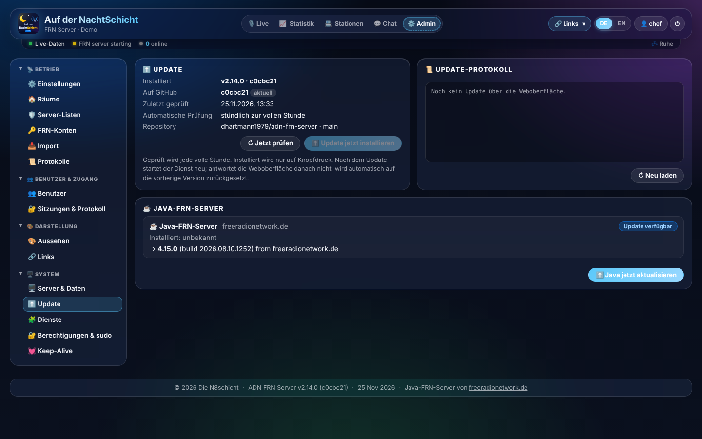
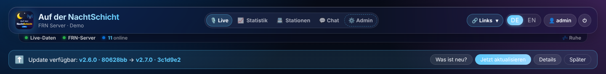
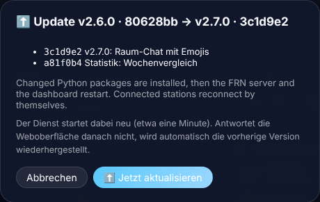
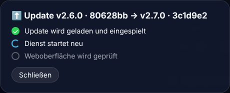

# ⬆️ Updates

[← Übersicht](../../readme.md) · [Installation](installation.md) · [Dashboard](dashboard.md) · [Admin-Portal](adminbereich.md) · [Konfiguration](konfiguration.md) · [Betrieb & Fehlersuche](betrieb.md) · **Updates**

Zwei Programme werden aktualisiert, jedes mit eigenem Knopf. **Nichts wird automatisch installiert** – das Dashboard prüft nur und zeigt an.

| | Quelle | Knopf |
|---|---|---|
| 🖥️ **Dashboard** (frn_adn) | GitHub: `dhartmann1979/adn-frn-server`, Branch `main` | **⬆️ Update jetzt installieren** (Kachel) bzw. **Jetzt aktualisieren** (Hinweis) |
| ☕ **Java-FRN-Server** | `freeradionetwork.de` (FRN_Server.zip) | **Upgrade Java now** |

<p align="center"></p>

Zu finden unter **⚙️ Admin → 🖥️ System → ⬆️ Update** (seit 2.14.0 ein eigener Eintrag im Baum-Menü; „Update jetzt“ braucht kein Passwort). Hinweis, Kachel und Fortschritt kommen aus dem **N8 Kit** und sehen in adn-frn-server, HBlink4-FreeRadioID, N8-HotSpot und N8 Crosslink gleich aus.

<p align="center"></p>

Gibt es ein neues Dashboard, sehen **angemeldete Admins** direkt unter der Statusleiste den Hinweis *Update verfügbar: v2.6.0 · … → v2.7.0 · …* mit **Was ist neu?** (Commit-Liste), **Jetzt aktualisieren**, **Details** (öffnet Admin → System → Update) und **Später** (blendet den Hinweis für diese Version einen Tag aus). Besucher ohne Anmeldung sehen ihn nie.

## Wie das Update läuft (N8 Admin)

Seit 2.13.0 läuft das Update wie in N8 Crosslink und den anderen N8schicht-Projekten über den Root-Helfer
**`scripts/n8-admin.sh`**. Das Programmverzeichnis gehört **root** und ist für den Dienst `frnadn` schreibgeschützt; nur die Daten
(`/var/lib/frnadn`) und der Ordner des Java-Servers gehören `frnadn`.

1. **⬆️ Update jetzt installieren** legt nur die Datei `/var/lib/frnadn/update.request` an.
2. Die systemd-Path-Unit `frnadn-update.path` sieht sie und startet `frnadn-update.service` als root:
   `n8-admin.sh update --auto`.
3. Der Helfer spult nur vor (nie über von Hand geänderte Dateien oder eigene Commits), installiert die Python-Pakete, schreibt die
   Konfiguration des FRN-Servers, **prüft und korrigiert Berechtigungen und sudo**, startet FRN-Server und Dashboard neu und ruft die
   Weboberfläche auf.
4. Antwortet sie nicht innerhalb von 90 Sekunden, setzt er auf den alten Stand zurück und startet erneut. Das Ergebnis steht unter
   *Letztes Update*, das Protokoll unter **📜 Update-Protokoll** (`/var/lib/frnadn/update.log`).

Einmalig nach dem Update von 2.12 oder älter (dort gehörte das Programm noch dem Dienst):

```bash
sudo /opt/adn-frn-server/scripts/n8-admin.sh fix-perms
```

Das richtet Besitzer und Rechte, die sudo-Freigaben und den Update-Auslöser ein. Danach geht alles im Adminbereich.

## Wann wird geprüft?

- 30 Sekunden nach dem Start des Dashboards,
- danach zu **jeder vollen Stunde**,
- und jederzeit mit **↻ Jetzt prüfen**.

Die Abfrage an GitHub braucht keinen Zugang (zwei Anfragen pro Prüfung). Das Ergebnis zeigt je Programm: installierte Version, neue Version, bei GitHub zusätzlich die Zahl der neuen Commits samt Liste und einen Vergleichslink.

<p align="center"></p>

Beim Öffnen von **Admin → System → Update** zeigt die Karte das letzte Ergebnis (höchstens 10 Minuten alt), damit GitHub nicht bei jedem
Klick gefragt wird – ohne Anmeldung erlaubt GitHub 60 Abfragen pro Stunde. **↻ Jetzt prüfen** fragt immer sofort neu, nach einem Upgrade
wird automatisch neu geprüft. Die Uhrzeit der letzten Prüfung steht unten in der Karte.

## Dashboard aktualisieren

### Im Admin-Portal

<p align="center">
  
  
</p>

1. **↻ Jetzt prüfen** – steht dort **Update verfügbar**, zeigt die Kachel unter *Was ist neu* die neuen Commits.
2. **⬆️ Update jetzt installieren** (oder **Jetzt aktualisieren** im Hinweis). Das Fenster zeigt die Neuerungen; **⬆️ Jetzt aktualisieren** startet.
3. Drei Schritte mit Fortschritt: **Update wird geladen und eingespielt** (genau der Stand, den du gesehen hast, per Fast-Forward, dazu geänderte Python-Pakete) → **Dienst startet neu** (erst der FRN-Server für einen frischen Live-Status, dann das Dashboard) → **Weboberfläche wird geprüft**. Danach lädt die Seite von selbst neu. Einstellungen, Benutzer und Datenbank bleiben unberührt.

**Automatisch zurück:** Antwortet die Weboberfläche nach dem Neustart nicht, setzt `n8-admin.sh` auf den alten Stand zurück (siehe oben).

Der Knopf ist grau, wenn das Upgrade so nicht möglich ist; die Kachel nennt den Grund (siehe unten).

### Auf der Konsole

```bash
cd /opt/adn-frn-server
sudo ./scripts/update.sh
```

`update.sh` ruft `scripts/n8-admin.sh update` auf – genau dasselbe wie der Knopf, mit Ausgabe auf der Konsole. Verbundene Stationen verbinden sich automatisch wieder.

## Java-FRN-Server aktualisieren

**Upgrade Java now** lädt `FRN_Server.zip` von freeradionetwork.de, ersetzt `FRN_Server.jar` (und `releasenotes.txt`) und startet den Java-Server neu. Alle Stationen verbinden sich danach selbst wieder. Dieselbe Prüfung gibt es auch unter **Settings → ⬆️ Check for update**.

## Wenn etwas nicht klappt

| Anzeige | Ursache | Lösung |
|---|---|---|
| **Update jetzt installieren** ist grau, Hinweis „Run once as root …“ | Update-Auslöser oder sudo noch nicht eingerichtet | `sudo /opt/adn-frn-server/scripts/n8-admin.sh fix-perms` |
| **unknown state** · „No git checkout …“ | Das Dashboard wurde ohne `.git`-Ordner kopiert | neu von GitHub klonen oder den Stand von Hand einspielen und `update.sh` ausführen |
| **update available**, aber „own commits“ | Im Programmverzeichnis gibt es eigene Commits | von Hand aktualisieren: `git pull --rebase` oder neu klonen |
| Protokoll: „von Hand geänderte Dateien“ | Dateien im Programmverzeichnis wurden verändert | Änderungen sichern, `git -C /opt/adn-frn-server stash`, dann erneut |
| **check failed** · „rate limit“ | GitHub begrenzt anonyme Abfragen | später noch einmal prüfen |
| **check failed** · „not reachable“ | Der Server erreicht github.com nicht | Netz, DNS und Proxy prüfen |
| „The code is updated, but the Python packages are not …“ | `pip install` ist gescheitert (z. B. kein Netz) | `sudo ./scripts/update.sh` |
| Fortschritt endet mit „Der Dienst antwortet noch nicht“ | Dashboard startet nicht | 📜 Update-Protokoll ansehen, `sudo journalctl -u frnadn -n 80 --no-pager`; der Helfer setzt nach 90 s automatisch zurück |
| **Letztes Update: zurückgenommen** | Die neue Version kam nicht hoch, der alte Stand läuft wieder | Log ansehen (`journalctl -u frnadn`), Fehler melden; der Hinweis bietet das Update weiter an |


## Eigenes Repository oder anderer Branch

Wer eine eigene öffentliche Kopie pflegt, stellt Repository und Branch in der Unit `frnadn.service` per Umgebungsvariable ein:

```ini
Environment=FRNADN_GITHUB_REPO=meinname/adn-frn-server
Environment=FRNADN_GITHUB_BRANCH=main
```

Danach `sudo systemctl daemon-reload && sudo systemctl restart frnadn`. Das Upgrade holt immer vom konfigurierten `origin` des Verzeichnisses, nie von einer Adresse aus dem Browser.

## Versionen und Releases

Die Versionsnummer steht in `frnadn/__init__.py` (`__version__`), alle Änderungen stehen in [CHANGELOG.md](../../CHANGELOG.md),
die neueste Version oben (`## 2.3.0 – 2026-11-22`). Die Zählung folgt [Semantic Versioning](https://semver.org/lang/de/):
MAJOR für Änderungen, nach denen man etwas von Hand anpassen muss, MINOR für neue Funktionen, PATCH für Fehlerbehebungen.

Für eine neue Version: Abschnitt oben in `CHANGELOG.md` ausführlich schreiben, `__version__` erhöhen, committen und pushen.
Der Workflow `.github/workflows/release.yml` legt daraufhin auf GitHub den Tag `vX.Y.Z` und das Release mit genau dem Text aus
dem Changelog an. Wird der Text später verbessert, passt der Workflow das Release automatisch an.
