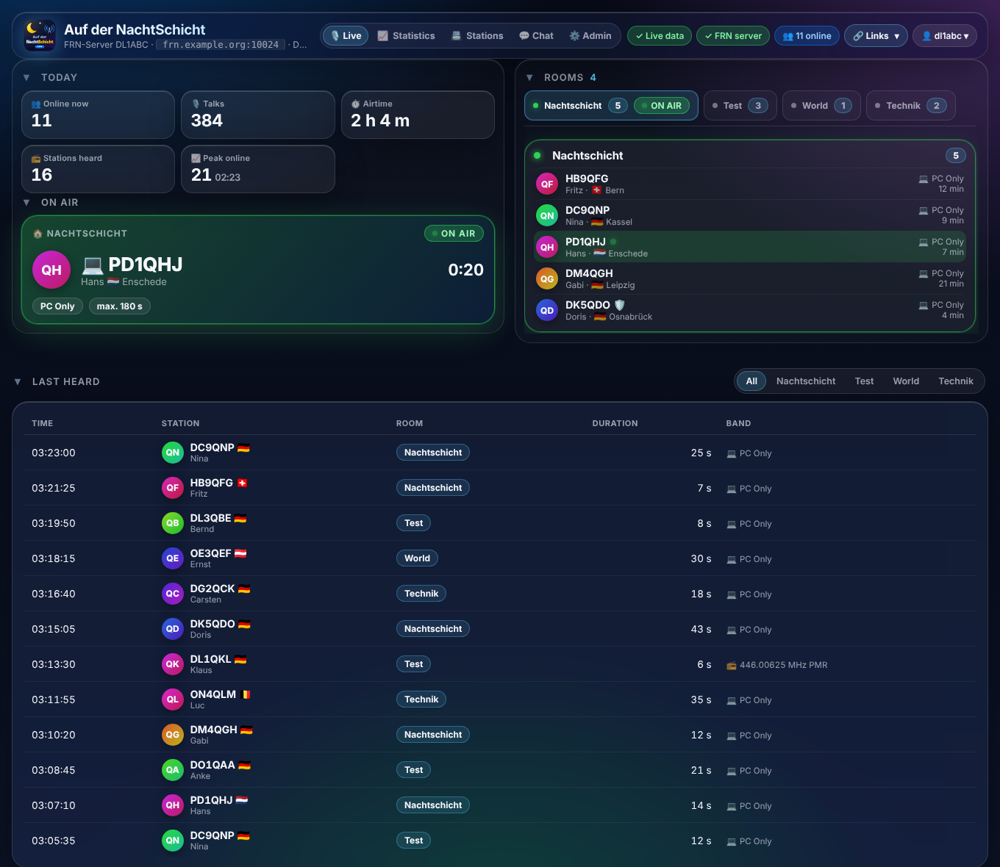
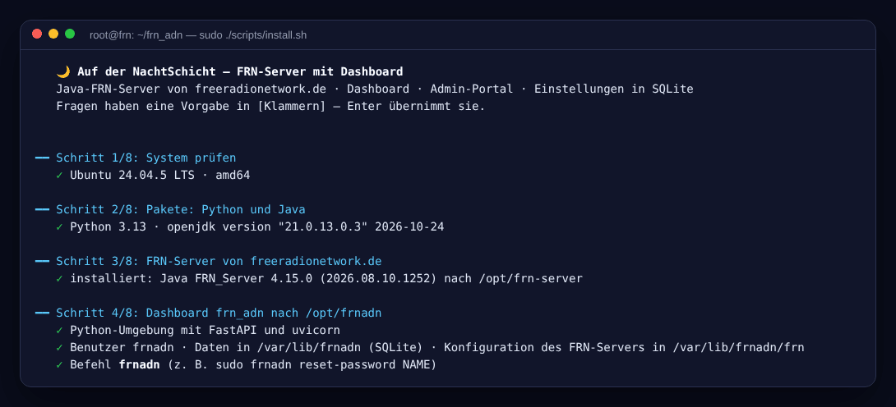
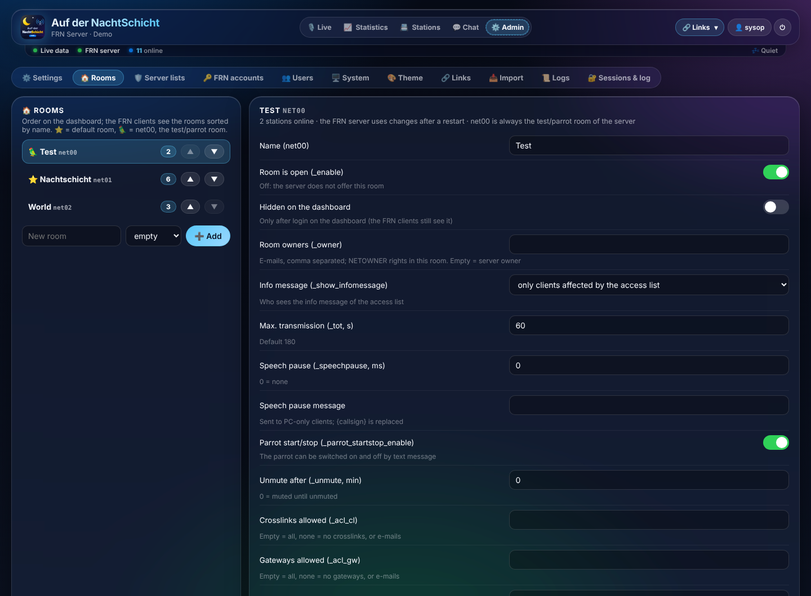
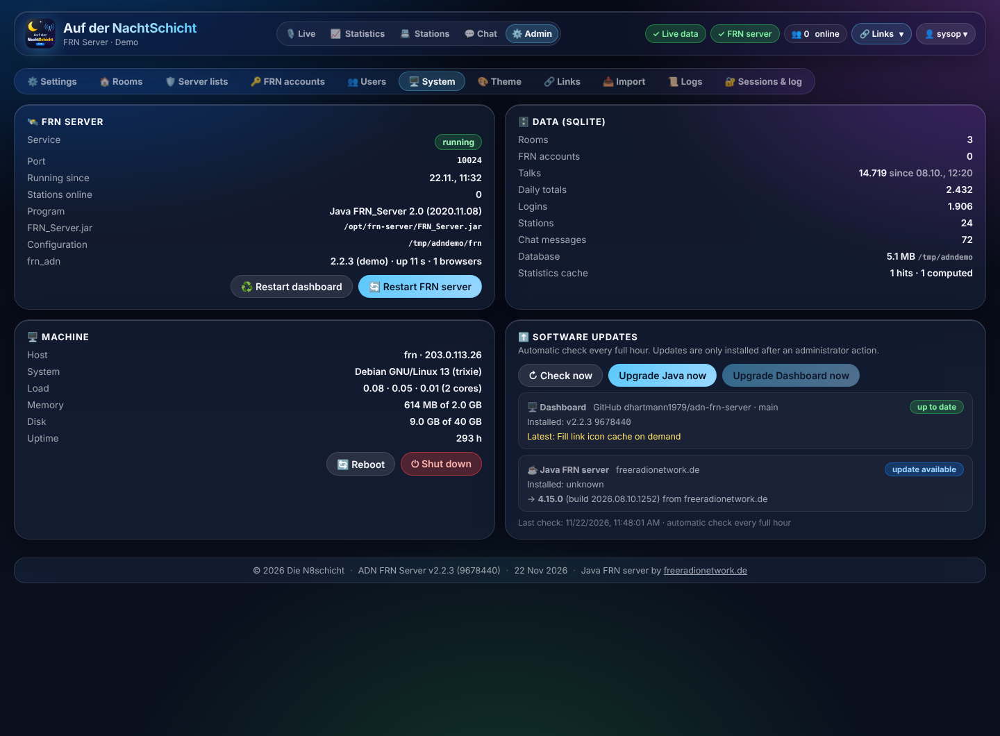
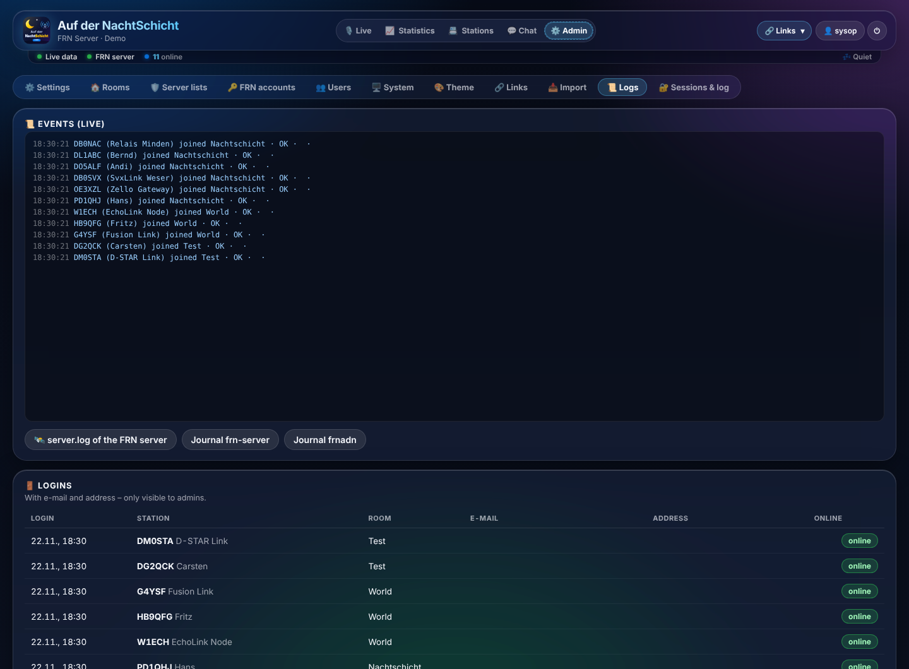
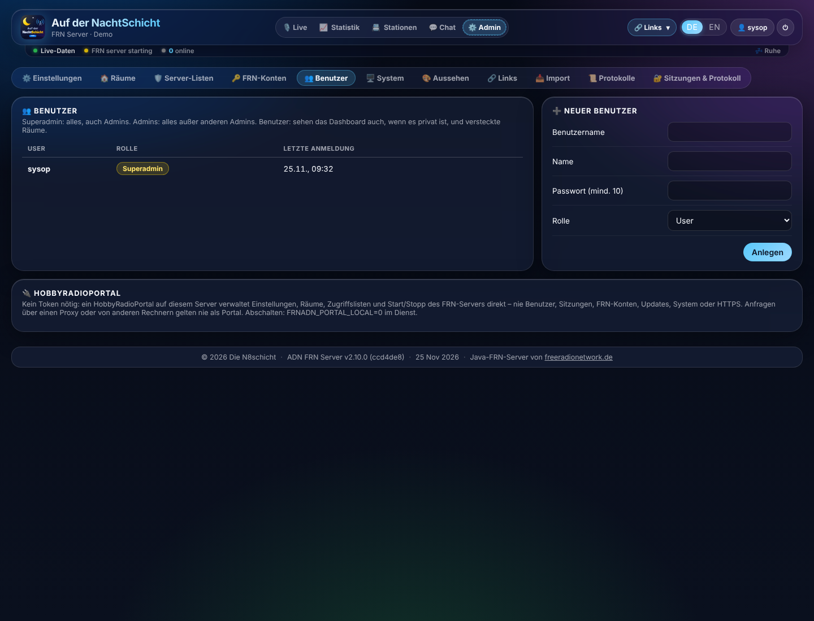
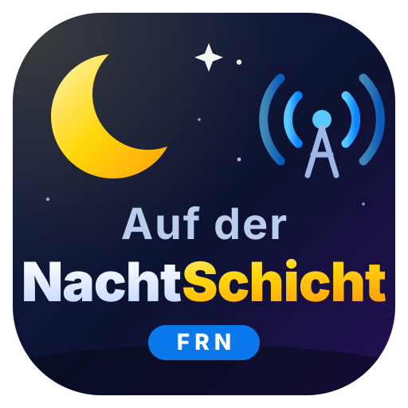

<p align="center">
  
</p>

<p align="center">
  <b>Java-FRN-Server von freeradionetwork.de · Live-Dashboard · Admin-Portal · Einstellungen in SQLite</b><br>
  Ein eigener FreeRadioNetwork-Server zum Nachbauen – geführt installiert, im Browser verwaltet,<br>
  im gleichen Glas-Design wie <b>DMR Die N8schicht</b>.
</p>

<p align="center">
  <a href="#schnellstart">Schnellstart</a> ·
  <a href="docs/de/installation.md">Installation</a> ·
  <a href="docs/de/dashboard.md">Dashboard</a> ·
  <a href="docs/de/adminbereich.md">Admin-Portal</a> ·
  <a href="docs/de/konfiguration.md">Konfiguration</a> ·
  <a href="docs/de/betrieb.md">Betrieb &amp; Fehlersuche</a>
</p>

---

## Was ist das?

frn_adn macht aus dem **Java-FRN-Server von [freeradionetwork.de](https://freeradionetwork.de/frn_server.html)** (FRN_Server.jar von Dirk Rasmussen) einen kompletten Server mit Dashboard und Admin-Portal. Der FRN-Server meldet sich wie gewohnt am **SystemManager sysman.freeradionetwork.de** an – oder läuft stand-alone. frn_adn installiert ihn, hält seine Einstellungen in SQLite, schreibt daraus `server.properties` und liest seine Logs mit, um live zu zeigen, wer in welchem Raum ist und wer spricht.

| | |
|---|---|
| 🛰️ **Original-Server, nichts selbst gebaut** | Der FRN-Server ist der von freeradionetwork.de – mit SystemManager-Anmeldung, Parrot, Admin-/Stumm-/Sperr-/Zugangslisten und allen Raum-Optionen. Updates kommen per Knopfdruck von freeradionetwork.de |
| 🎙️ **Live-Dashboard** | Wer gerade spricht, steht oben (**ON AIR**). Räume mit allen Stationen, Funk/PC/Crosslink, Parrot, seit wann online, Last Heard, Kommen &amp; Gehen – live per WebSocket |
| ⚙️ **Admin-Portal statt Config-Datei** | Server, SystemManager, Betreiber, Räume (net00–net63) und die eigene Passwortliste liegen in **SQLite** und werden im Browser geändert. Die Dateien für den Server schreibt frn_adn – **nur das Nötigste**: `server.properties`, `log4j.xml`, `acl/FRNPasswd.xml` |
| 🔄 **Start, Stopp, Neustart, Update** | FRN-Server steuern, neue Version von freeradionetwork.de prüfen und installieren, `server.properties` ansehen, `server.log` und Journal lesen |
| 👥 **Benutzer &amp; Rollen** | Superadmin, Admins und Benutzer. E-Mail- und IP-Adressen der Stationen sehen nur Admins. Sitzungen und Protokoll aller Änderungen |
| 📈 **Statistiken** | Heute, 24 h, 7/30/90 Tage, 1 Jahr: Durchgänge, Sprechzeit, Stationen, Spitzenwert online, Aktivität pro Raum, Wochentag × Uhrzeit |
| 🗄️ **SQLite mit Cache** | Eine Datenbank, Tagessummen für lange Zeiträume, Statistik-Cache, Live-Daten im Speicher – schnell und schlank, auch auf dem Raspberry Pi |
| 🧭 **Geführte Installation** | `scripts/install.sh` installiert Java, lädt den FRN-Server von freeradionetwork.de, fragt Superadmin, SystemManager-Konto, Adresse, Port und Räume ab und prüft am Ende, ob der Server läuft. **Kein Werks-Login** |

<p align="center">
  
  &nbsp;
  
</p>

## Schnellstart

Auf einem Debian-, Ubuntu- oder Raspberry-Pi-OS-System, als root bzw. mit `sudo`:

```bash
git clone https://github.com/dhartmann1979/frn_adn
cd frn_adn
sudo ./scripts/install.sh
```

Das Skript führt in acht Schritten durch alles: Java, FRN-Server von freeradionetwork.de, Dashboard, **Superadmin** (Passwort als scrypt-Hash), dann Betriebsart (**SystemManager** mit deinem FRN-Konto oder **Stand-alone**), Serveradresse, Port, Besitzer und Räume. Jede Frage hat eine Vorgabe, die du mit Enter übernimmst. Am Ende prüft es, ob der FRN-Server lauscht und was der SystemManager meldet.

> **Wichtig:** Der SystemManager prüft beim Start, ob dein Server von außen erreichbar ist. Richte die **Portweiterleitung TCP 10024** (bzw. deinen Port) im Router vor dem ersten Start ein.

<p align="center">
  
  
</p>

➡️ Ausführlich: **[Installation](docs/de/installation.md)**

## So sieht es aus

<table>
<tr>
<td width="50%"><br><b>Settings</b>: Zustand des FRN-Servers mit Start/Stopp/Neustart und Update, darunter alle Werte für <code>server.properties</code>.</td>
<td width="50%"><br><b>Räume</b> net00–net63: TOT, Sprechpause, Parrot, Owner, Crosslinks/Gateways, Sperrmuster, Telegram-Bot.</td>
</tr>
<tr>
<td><br><b>Tab 📈 Statistics</b>: Top-Stationen, Aktivität pro Raum, Online-Verlauf, Wochentag × Uhrzeit.</td>
<td><br><b>System</b>: FRN-Server, Datenbank, Maschine, Updates.</td>
</tr>
<tr>
<td><br><b>Logs</b>: Ereignisse live, <code>server.log</code> des FRN-Servers, Journal, alle Logins mit E-Mail und IP.</td>
<td><br><b>Benutzer &amp; Rollen</b>: Superadmin, Admin, Benutzer.</td>
</tr>
</table>

## Dokumentation

| Anleitung | Inhalt |
|---|---|
| 📦 [Installation](docs/de/installation.md) | Voraussetzungen, Schritt für Schritt, SystemManager oder Stand-alone, Router/Firewall, HTTPS, Aktualisieren |
| 🎙️ [Dashboard](docs/de/dashboard.md) | Live, ON AIR, Räume, Last Heard, Statistiken, Stationen, Chat |
| ⚙️ [Admin-Portal](docs/de/adminbereich.md) | Anmelden, Rollen, Settings, Räume, Server-Listen, FRN-Konten, Benutzer, System, Logs |
| 🧾 [Konfiguration](docs/de/konfiguration.md) | Was in SQLite liegt und was in Dateien, alle Parameter von `server.properties`, Rechte im FRN-Client |
| 🩺 [Betrieb &amp; Fehlersuche](docs/de/betrieb.md) | Dienste, Befehle, SystemManager-Fehler −4 bis −9, Sicherung |

## Aktualisieren

```bash
cd /opt/frnadn && sudo ./scripts/update.sh     # Dashboard; der FRN-Server läuft weiter
```

Den FRN-Server selbst aktualisiert das Admin-Portal (**Settings → Check for update**) direkt von freeradionetwork.de.

## Danksagung &amp; Lizenz

- **Java FRN_Server** © Dirk Rasmussen, [freeradionetwork.de](https://freeradionetwork.de) – frn_adn lädt ihn bei der Installation von dort und enthält ihn nicht selbst. Für den Betrieb eines öffentlichen Servers gelten die [Hinweise von freeradionetwork.de](https://freeradionetwork.de/please_read.html).
- Design und Logo: **Auf der NachtSchicht** / **DMR Die N8schicht**.

frn_adn: siehe [LICENSE](LICENSE).

<p align="center"></p>
