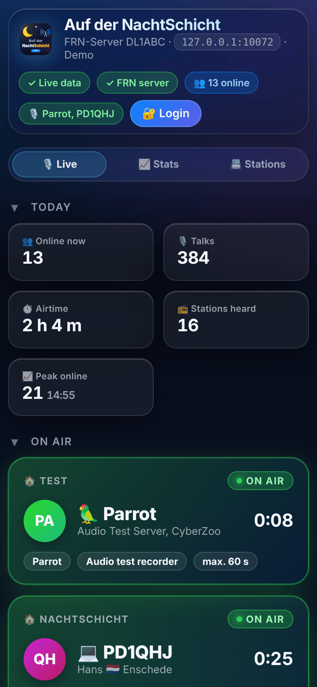
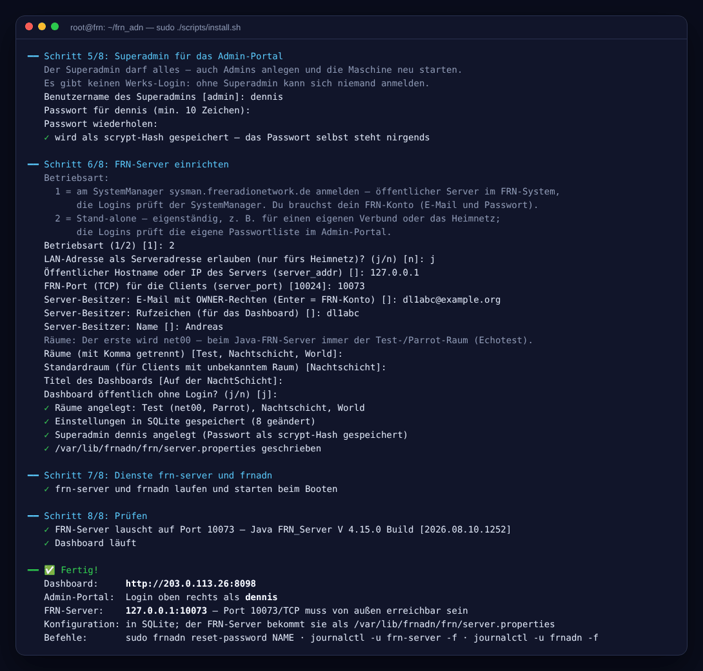
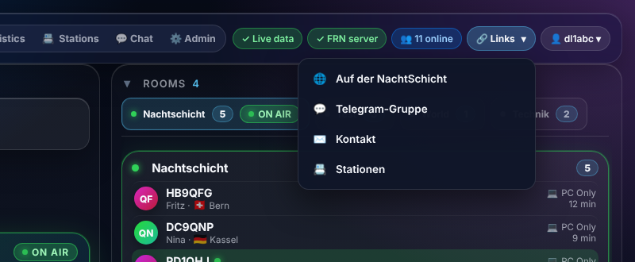
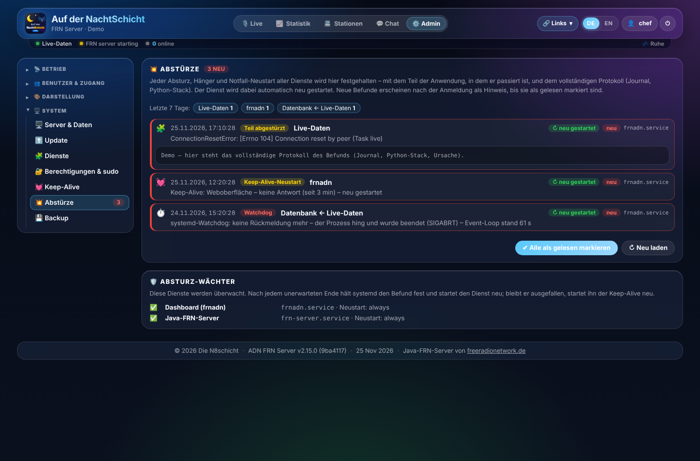
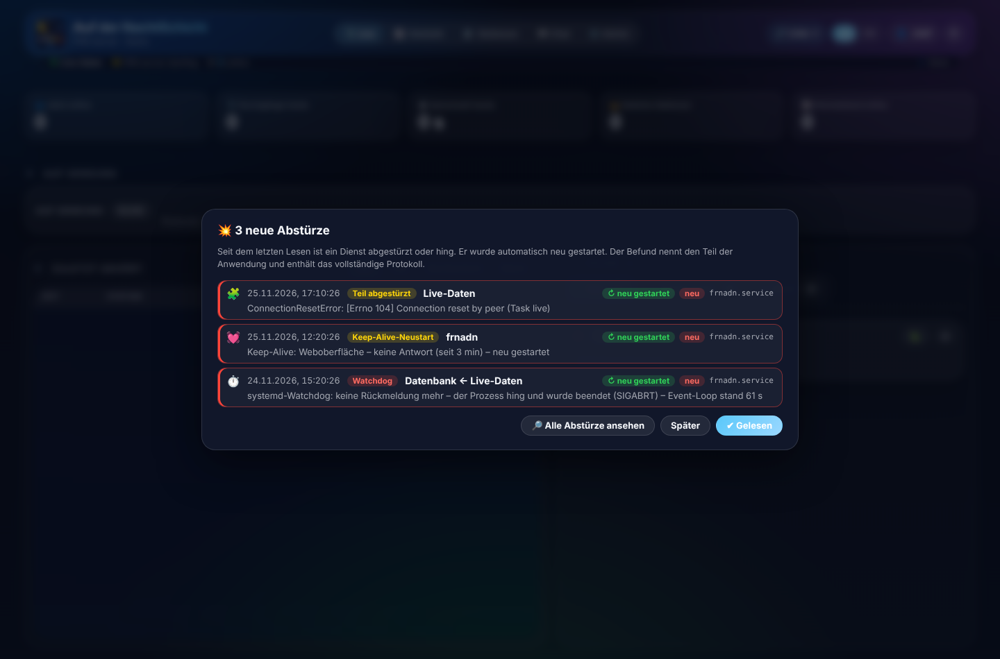
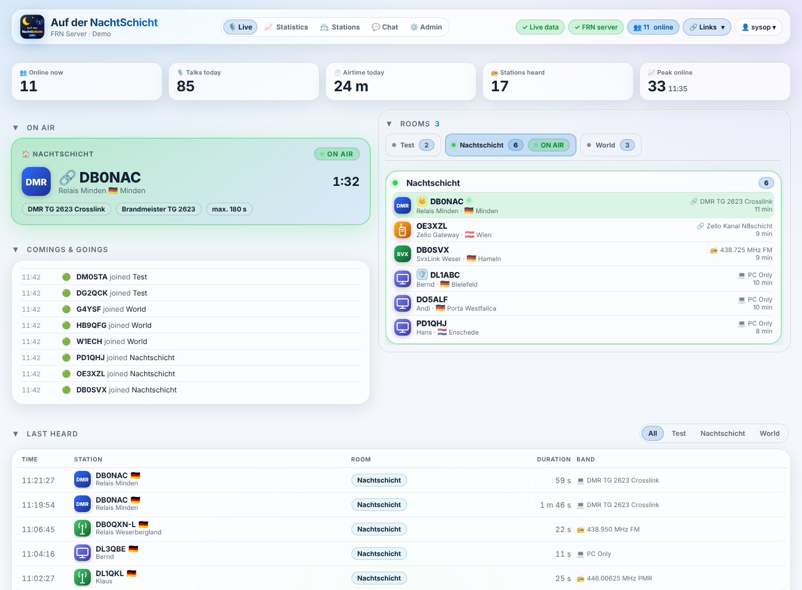
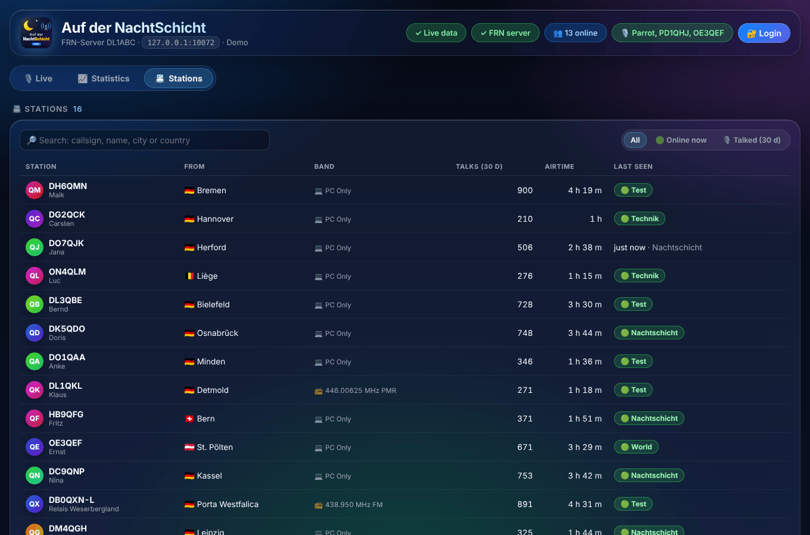

<p align="center">
  
</p>

<p align="center">
  <b>Dashboard · Admin-Portal · Updates</b> für den Java-Server des <a href="https://freeradionetwork.de/">FreeRadioNetwork</a><br>
  Gestaltet wie <a href="https://github.com/dhartmann1979/HBlink4-FreeRadioID">HBlink4-FreeRadioID</a> – zum Nachbauen für den eigenen FRN-Server.
</p>

<p align="center">
  <a href="CHANGELOG.md"></a>
  <a href="CHANGELOG.md"></a>
  <a href="LICENSE"></a>
</p>

<p align="center">
  <a href="#schnellstart">Schnellstart</a> ·
  <a href="docs/de/installation.md">Installation</a> ·
  <a href="docs/de/dashboard.md">Dashboard</a> ·
  <a href="docs/de/adminbereich.md">Admin-Portal</a> ·
  <a href="docs/de/portal.md">Portal-Seite</a> ·
  <a href="docs/de/email.md">E-Mail</a> ·
  <a href="docs/de/master-backup.md">Master &amp; Backup</a> ·
  <a href="docs/de/updates.md">Updates</a> ·
  <a href="docs/de/anleitungen.md">Anleitungen</a> ·
  <a href="docs/de/konfiguration.md">Konfiguration</a> ·
  <a href="docs/de/betrieb.md">Betrieb &amp; Fehlersuche</a> ·
  <a href="docs/de/sicherheit.md">Sicherheit</a> ·
  <a href="CHANGELOG.md">Änderungen</a>
</p>

---

## Was ist das?

ADN FRN Server ist eine **frische Oberfläche für den Java-FRN-Server** von freeradionetwork.de (FRN_Server.jar). Der Java-Server bleibt, wie er ist; frn_adn liest seine Logdateien, zeigt live, wer gerade spricht, und ersetzt das Bearbeiten von `server.properties` durch ein Admin-Portal im Browser.

| | |
|---|---|
| 🎙️ **Live-Dashboard** | Aufgebaut wie die Startseite von DMR Die N8schicht: Tageskacheln, **ON AIR**, darunter Last heard und Räume nebeneinander in gleicher Höhe – am Desktop ohne Scrollen. Stationslisten sortiert (Crosslinks, Admins, QRV, QRL; PC Only zuletzt). Comings & goings im Statistik-Tab. Für Smartphone und Desktop gebaut, Änderungen kommen per WebSocket sofort. |
| 📡 **Avatar = Client-Software** | Jede Station zeigt, woher sie kommt: DMR, Zello, SvxLink, EchoLink, AllStar, YSF, D-STAR, M17, TeamSpeak, Crosslink, Funk-Gateway, PC. 👑 Owner und 🛡️ Admin stehen direkt vor dem Rufzeichen. Eigene Bilder je Art hochladbar. |
| 📈 **Statistik** | Sprechzeit und Durchgänge je Raum und Station, heute bis ein Jahr, Aktivität nach Wochentag und Uhrzeit, Spitzenwert der Stationen online. |
| 📇 **Stationen** | Alle gehörten Stationen mit Suche, Avatar, Land und Ort; Detailansicht je Station. |
| ⚙️ **Admin-Portal statt Config-Dateien** | Alle Einstellungen, Räume und FRN-Konten liegen in SQLite; frn_adn schreibt daraus `server.properties`. Server starten, stoppen und neu starten per Knopf. |
| 👥 **Benutzer & Rechte** | Superadmin, Admins und Benutzer. **E-Mail- und IP-Adressen der Stationen sehen nur Admins.** Dazu **🔑 Sitzungen** (abmelden) und ein **📜 Protokoll** aller Änderungen – gleiche Ansicht wie in HBlink4 und allen N8-Systemen. |
| 🧩 **Dienste & Berechtigungen** | Dienste schlank aktivieren, deaktivieren, starten, stoppen, neu starten; Berechtigungsprüfer mit Korrektur und sudo-Einrichtung (`scripts/n8-admin.sh`) – wie in N8 Crosslink |
| 🧭 **Ein Menü + Statusleiste** | Kopfzeile mit Logo, Reitern, Links und Login ganz rechts (ohne Aufklappmenü, **⚙️ Admin** nach dem Login als Menüpunkt); darunter eine schmale Statusleiste für Live-Daten, FRN-Server, Stationen online und On air |
| 🔗 **Link-Menü** | Eigene Links (Webseite, Chat, Kontakt …) als Aufklapp-Menü oder Knopfreihe in der Kopfzeile, mit den **Favicons der verlinkten Seiten** (in SQLite zwischengespeichert), „neuer Tab“, Reihenfolge und Schnellstart-Knöpfen – wie bei HBlink4-FreeRadioID. |
| ⬆️ **Updates mit Vorschau** | Zu jeder vollen Stunde und auf Knopfdruck: neue Commits für das Dashboard (GitHub) und neue Versionen des Java-Servers. Zwei getrennte Knöpfe, nie automatisch. |
| 🎨 **Eigenes Aussehen** | N8 Theme wie bei HBlink4-FreeRadioID und N8-Hotspot: 7 Profile inkl. hellem *Daylight*, jede Farbe frei wählbar, dazu Dashboard-Logo, Site-Icon und Client-Logos. |
| 💾 **Backup & Wiederherstellen** | Alles in einer passwortverschlüsselten `.frnbak` – Datenbank, Branding, Konfiguration und Zugriffslisten des FRN-Servers. Einspielen per Knopf (mit Vorschau und automatischem Rückweg), per `frnadn restore` oder beim Installieren. Nur Superadmin. |
| 📥 **Import** | Eine alte `server.properties` nach der Neuinstallation übernehmen; nichts anderes wird kopiert. |
| 🔒 **HTTPS & Ports** | Let's-Encrypt-Zertifikat, automatisch geholt und erneuert – alles unter **🌐 Netz, Ports & Domains** (Ports, Domains & HTTPS), wie in allen N8-Systemen. |
| 🧭 **Geführte Installation** | `scripts/install.sh` fragt alles ab, richtet beide Dienste ein und prüft am Ende das Ergebnis. |

<p align="center">
  
</p>

<p align="center">
  
  &nbsp;
  
</p>

> Die Screenshots zeigen erfundene Demo-Daten.

## Schnellstart

Auf einem Debian-, Ubuntu- oder Raspberry-Pi-OS-Rechner, als root bzw. mit `sudo`:

```bash
git clone https://github.com/dhartmann1979/adn-frn-server.git
cd adn-frn-server
chmod +x scripts/install.sh scripts/update.sh
sudo ./scripts/install.sh
```

Jede Frage hat eine Vorgabe, die du mit Enter übernimmst. Danach öffnest du das Dashboard, meldest dich oben rechts an und stellst alles Weitere im **Admin-Portal** ein.

<p align="center">
  
  
</p>

Der Installer ist für eine **saubere Neuinstallation** gedacht und bricht ab, wenn er schon eine FRN-Datenbank, eine `server.properties` oder einen laufenden FRN-Dienst findet.


➡️ Ausführlich: **[Installation](docs/de/installation.md)**

## So sieht es aus

<table>
<tr>
<td width="50%"><br><b>✉️ Webmail</b>: jeder Benutzer hat ein Postfach, HTML-Mails abgeschottet, SPF/DKIM/DMARC sichtbar.</td>
<td width="50%"><br><b>🧾 DNS-Vorlagen</b> für MX, SPF, DKIM, DMARC, BIMI, MTA-STS mit Live-Prüfung.</td>
</tr>
<tr>
<td width="50%"><br><b>📰 Portal-Seite</b>: News der Betreiber, eigene Domain mit Let's Encrypt, RSS – nur Admins sind Autoren.</td>
<td width="50%"><br><b>📝 News-Editor</b> mit Vorschau, Kategorien, Anheften, Entwurf/Veröffentlichen.</td>
</tr>
<tr>
<td width="50%"><br><b>🔗 Link-Menü</b>: eigene Links in der Kopfzeile, mit Symbol und Aufklapp-Liste.</td>
<td width="50%"><br><b>Link-Editor</b> mit Site-Icon-Vorschau, Fallback-Emoji, Sortierung und SQLite-Cache.</td>
</tr>
<tr>
<td><br><b>⬆️ Update</b>: Baum-Menü wie in allen N8-Systemen, Dashboard und Java-FRN-Server, Update-Protokoll.</td>
<td><br><b>💓 Keep-Alive</b>: prüft jede Minute Dashboard und FRN-Server, startet neu, Internet-Ausfall, Heartbeat.</td>
</tr>
<tr>
<td><br><b>💥 Abstürze</b>: jeder Absturz mit Teil, Ursache und Protokoll, automatischer Neustart, Zähler je Teil.</td>
<td><br><b>Hinweis nach der Anmeldung</b>: neue Abstürze erscheinen sofort, bis sie als gelesen markiert sind.</td>
</tr>
<tr>
<td><br><b>📡 Räume</b>: Avatar = Client-Software, 👑/🛡️ vor dem Rufzeichen.</td>
<td><br><b>Client logos</b>: eingebaute Abzeichen, je Art durch ein eigenes Bild ersetzbar.</td>
</tr>
<tr>
<td><br><b>🎨 Theme</b>: N8 Theme mit 7 Profilen (auch hell), jede Farbe frei wählbar, Dashboard-Logo, Site-Icon und Client-Logos.</td>
<td><br><b>☀️ Daylight</b>: das helle Profil.</td>
</tr>
<tr>
<td><br><b>Knopfreihe</b>: dieselben Links als Leiste unter der Kopfzeile.</td>
<td><br><b>Am Smartphone</b>: Kopfzeile in einer Zeile, Menü klappt unter dem Knopf auf.</td>
</tr>
<tr>
<td><br><b>📈 Statistics</b>: Sprechzeit je Raum und Station, Verlauf, Spitzenwerte.</td>
<td><br><b>📇 Stations</b>: alle gehörten Stationen mit Suche und Filtern.</td>
</tr>
<tr>
<td><br><b>🏠 Rooms</b>: Räume net00 … net63 mit allen Parametern.</td>
<td><br><b>⚙️ Settings</b>: Server, SystemManager, Operator, Dashboard und Daten.</td>
</tr>
<tr>
<td colspan="2"><br><b>💾 Backup & ♻️ Wiederherstellen</b>: verschlüsselte <code>.frnbak</code> anlegen und herunterladen; ein Backup prüfen (Inhalt vorab sehen) und mit <code>RESTORE</code> einspielen.</td>
</tr>
</table>

## Dokumentation

| Anleitung | Inhalt |
|---|---|
| 📦 [Installation](docs/de/installation.md) | Voraussetzungen, geführte Installation, HTTPS, Router und Firewall, Aktualisieren, Deinstallieren |
| 🎙️ [Dashboard](docs/de/dashboard.md) | Kopfzeile und Menü, Link-Menü, Tabs Live / Statistics / Stations / Chat, Login |
| 🔐 [Sicherheit & N8 Kit](docs/de/sicherheit.md) | Sicherheits-Header, API-Doku aus, Reverse-Proxy (Caddy/nginx), Sprache DE/EN, Updates mit Prüfung und Rollback |
| ✉️ [E-Mail](docs/de/email.md) | Postfach für jeden Benutzer (gleiches Passwort), eigene Mail-Domains, nur TLS mit Let's Encrypt, Upstream-Relay, Empfang per MX, DKIM/DMARC/BIMI/MTA-STS mit DNS-Vorlagen, Webmail |
| 📰 [Portal-Seite](docs/de/portal.md) | Öffentliche News-Seite – nur Admins sind Autoren, Kategorien, Anheften, Entwürfe, RSS, eigene Domain mit Let's-Encrypt-Zertifikat |
| 🔁 [Master & Backup](docs/de/master-backup.md) | Zweiter FRN-Server mit derselben Konfiguration: Abgleich jede volle Stunde und auf Knopfdruck, **verschlüsselt mit dem Sync-Schlüssel**, Wartungs-Übergabe von Hand, FRN-Passwort für beide Server |
| ⚙️ [Admin-Portal](docs/de/adminbereich.md) | Baum-Menü, Rollen, Settings, HTTPS, Rooms, ACL-Listen, FRN-Konten, Benutzer, Portal-Token, System, Theme, Updates, Links, Import, Logs |
| ⬆️ [Updates](docs/de/updates.md) | Dashboard und Java-Server aktualisieren, Fehlermeldungen und Lösungen |
| 🧭 [Anleitungen](docs/de/anleitungen.md) | Schritt für Schritt: Link-Menü einrichten, Dashboard aktualisieren, Logo und Farbe, Umzug, weitere Admins |
| 🧾 [Konfiguration](docs/de/konfiguration.md) | Was in den Dateien steht und was in SQLite, alle Einstellungen im Überblick, Räume |
| 🩺 [Betrieb & Fehlersuche](docs/de/betrieb.md) | **💥 Abstürze** mit Teil, Ursache und Protokoll (Hinweis nach der Anmeldung). **Bei Problemen zuerst das [öffentliche FRN-Fehlerprotokoll](http://log.freeradionetwork.de:60080/error_log.php)** (im Adminbereich unter Logs eingebaut), Dienste, Keep-Alive, SystemManager-Fehler, typische Probleme, Backup & Wiederherstellen, Testen ohne Funk |
| 🏷️ [Änderungen](CHANGELOG.md) | Was sich in welcher Version geändert hat |

## Aktualisieren

Am einfachsten im Admin-Portal: der Hinweis **Update verfügbar → Jetzt aktualisieren** unter der Statusleiste, oder **⚙️ Admin → 🖥️ System → ⬆️ Update → ⬆️ Update jetzt installieren** (ohne Passwort). Antwortet das Dashboard danach nicht, wird automatisch auf den alten Stand zurückgesetzt. Oder auf der Konsole:

```bash
cd /opt/adn-frn-server
sudo ./scripts/update.sh
```

Dashboard und FRN-Server starten danach neu; verbundene Stationen verbinden sich automatisch wieder. Datenbank, Benutzer und Einstellungen bleiben erhalten. Mehr dazu: **[Updates](docs/de/updates.md)**.

## Entwicklung

```bash
python3 -m venv venv && . venv/bin/activate
pip install -r requirements.txt pytest httpx2
python3 -m pytest -q                       # Tests (Dashboard, FRN-Protokoll, Import, Updates, Links)
FRNADN_DATA=/tmp/test FRNADN_FRN_DIRECT=1 FRNADN_PORT=8080 python3 -m frnadn
```

Die Oberfläche kommt ohne Build-Schritt und ohne externe Bibliotheken aus: `static/index.html`, `app.css`, `app.js` sowie `extras.css` / `extras.js` (Kopfzeile, Link-Liste, Update-Anzeige).

## Danksagung & Lizenz

- **FreeRadioNetwork** und der Java-FRN-Server: [freeradionetwork.de](https://freeradionetwork.de/) (Dirk Rasmussen). Dieses Projekt ist eine unabhängige Oberfläche dafür.
- Gestaltung und Bedienung: [HBlink4-FreeRadioID](https://github.com/dhartmann1979/HBlink4-FreeRadioID) – *DMR Die N8schicht*.
- Design und Logo: **Auf der NachtSchicht**.

Lizenz: GNU GPLv3, siehe [LICENSE](LICENSE). Support über die Issues dieses Repositorys.
