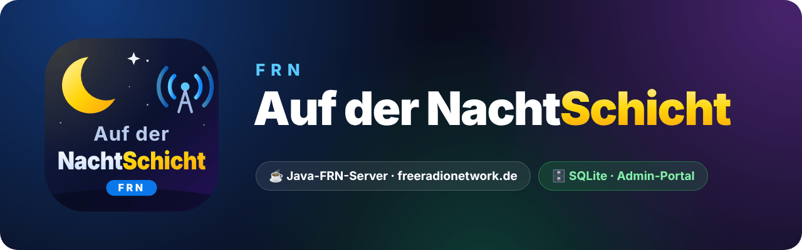
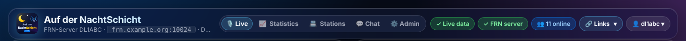
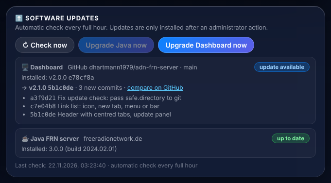
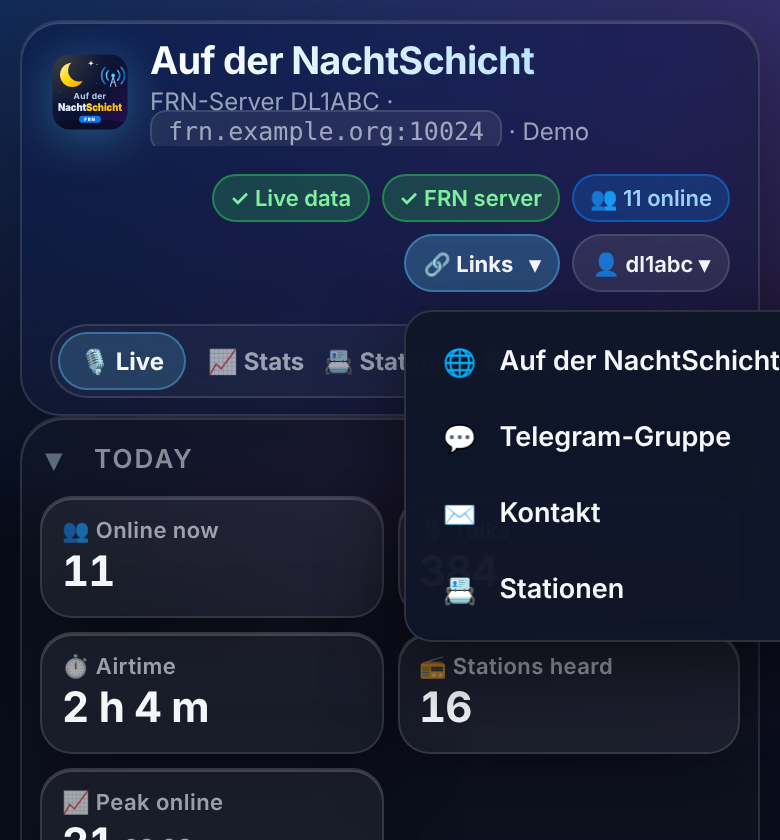
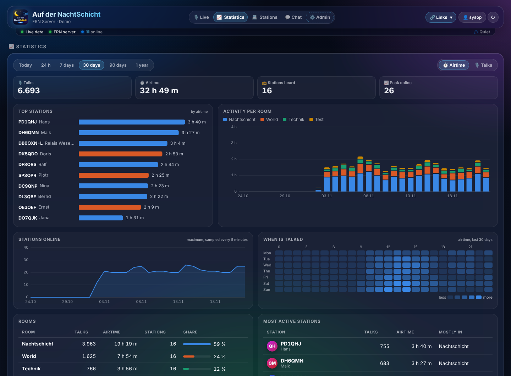
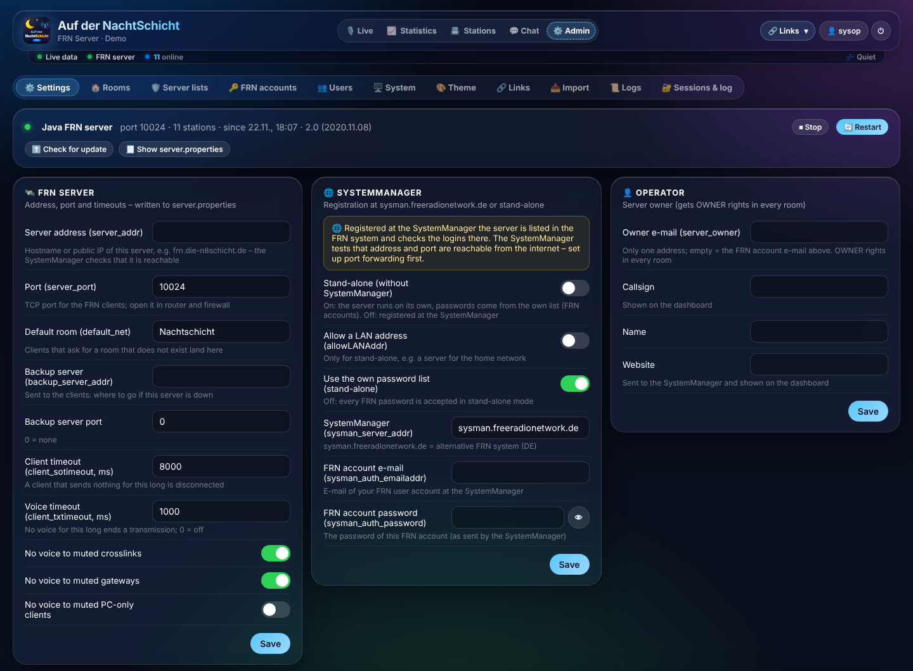

<p align="center">
  
</p>

<p align="center">
  <b>Dashboard · Admin-Portal · Updates</b> für den Java-Server des <a href="https://freeradionetwork.de/">FreeRadioNetwork</a><br>
  Gestaltet wie <a href="https://github.com/dhartmann1979/HBlink4-FreeRadioID">HBlink4-FreeRadioID</a> – zum Nachbauen für den eigenen FRN-Server.
</p>

<p align="center">
  <a href="CHANGELOG.md"></a>
  <a href="CHANGELOG.md"></a>
  <a href="LICENSE"></a>
</p>

<p align="center">
  <a href="#schnellstart">Schnellstart</a> ·
  <a href="docs/de/installation.md">Installation</a> ·
  <a href="docs/de/dashboard.md">Dashboard</a> ·
  <a href="docs/de/adminbereich.md">Admin-Portal</a> ·
  <a href="docs/de/updates.md">Updates</a> ·
  <a href="docs/de/anleitungen.md">Anleitungen</a> ·
  <a href="docs/de/konfiguration.md">Konfiguration</a> ·
  <a href="docs/de/betrieb.md">Betrieb &amp; Fehlersuche</a> ·
  <a href="CHANGELOG.md">Änderungen</a>
</p>

---

## Was ist das?

ADN FRN Server ist eine **frische Oberfläche für den Java-FRN-Server** von freeradionetwork.de (FRN_Server.jar). Der Java-Server bleibt, wie er ist; frn_adn liest seine Logdateien, zeigt live, wer gerade spricht, und ersetzt das Bearbeiten von `server.properties` durch ein Admin-Portal im Browser.

| | |
|---|---|
| 🎙️ **Live-Dashboard** | Wer gerade spricht, steht oben (**ON AIR**). Räume mit ihren Stationen, Last heard, Comings & goings. Für Smartphone und Desktop gebaut, Änderungen kommen per WebSocket sofort. |
| 📈 **Statistik** | Sprechzeit und Durchgänge je Raum und Station, heute bis ein Jahr, Aktivität nach Wochentag und Uhrzeit, Spitzenwert der Stationen online. |
| 📇 **Stationen** | Alle gehörten Stationen mit Suche, Avatar, Land und Ort; Detailansicht je Station. |
| ⚙️ **Admin-Portal statt Config-Dateien** | Alle Einstellungen, Räume und FRN-Konten liegen in SQLite; frn_adn schreibt daraus `server.properties`. Server starten, stoppen und neu starten per Knopf. |
| 👥 **Benutzer & Rechte** | Superadmin, Admins und Benutzer. **E-Mail- und IP-Adressen der Stationen sehen nur Admins.** Dazu Sitzungen und ein Protokoll aller Änderungen. |
| 🔗 **Link-Menü** | Eigene Links (Webseite, Chat, Kontakt …) als Aufklapp-Menü oder Knopfreihe in der Kopfzeile, mit Symbol, „neuer Tab“, Reihenfolge und Schnellstart-Knöpfen – wie bei HBlink4-FreeRadioID. |
| ⬆️ **Updates mit Vorschau** | Zu jeder vollen Stunde und auf Knopfdruck: neue Commits für das Dashboard (GitHub) und neue Versionen des Java-Servers. Zwei getrennte Knöpfe, nie automatisch. |
| 🎨 **Eigenes Aussehen** | Akzentfarbe und eigenes PNG-Logo im Admin-Portal. |
| 📥 **Import** | Eine alte `server.properties` nach der Neuinstallation übernehmen; nichts anderes wird kopiert. |
| 🔒 **HTTPS** | Let's-Encrypt-Zertifikat, automatisch geholt und erneuert. |
| 🧭 **Geführte Installation** | `scripts/install.sh` fragt alles ab, richtet beide Dienste ein und prüft am Ende das Ergebnis. |

<p align="center">
  
</p>

<p align="center">
  
  &nbsp;
  
</p>

> Die Screenshots zeigen erfundene Demo-Daten.

## Schnellstart

Auf einem Debian-, Ubuntu- oder Raspberry-Pi-OS-Rechner, als root bzw. mit `sudo`:

```bash
git clone https://github.com/dhartmann1979/adn-frn-server.git
cd adn-frn-server
chmod +x scripts/install.sh scripts/update.sh
sudo ./scripts/install.sh
```

Jede Frage hat eine Vorgabe, die du mit Enter übernimmst. Danach öffnest du das Dashboard, meldest dich oben rechts an und stellst alles Weitere im **Admin-Portal** ein.

<p align="center">
  
  
</p>

Der Installer ist für eine **saubere Neuinstallation** gedacht und bricht ab, wenn er schon eine FRN-Datenbank, eine `server.properties` oder einen laufenden FRN-Dienst findet.

> **Nach der Installation einmal** `cd /opt/adn-frn-server && sudo ./scripts/update.sh` ausführen. Das stellt die Dateirechte so ein, dass sich das Dashboard später selbst aus dem Admin-Portal aktualisieren kann. Siehe [Updates](docs/de/updates.md#einmalig-nach-einer-neuinstallation).

➡️ Ausführlich: **[Installation](docs/de/installation.md)**

## So sieht es aus

<table>
<tr>
<td width="50%"><br><b>🔗 Link-Menü</b>: eigene Links in der Kopfzeile, mit Symbol und Aufklapp-Liste.</td>
<td width="50%"><br><b>Link-Editor</b> im Admin-Portal: Symbol, Name, Adresse, neuer Tab, Reihenfolge, Schnellstart.</td>
</tr>
<tr>
<td><br><b>⬆️ Software updates</b>: installierte und neue Version, neue Commits, getrennte Upgrade-Knöpfe.</td>
<td><br><b>🖥️ System</b>: FRN-Server, Datenbank, Maschine, Updates und Erscheinungsbild auf einer Seite.</td>
</tr>
<tr>
<td><br><b>Knopfreihe</b>: dieselben Links als Leiste unter der Kopfzeile.</td>
<td><br><b>Am Smartphone</b>: Reiter in eigener Zeile, Menü klappt unter dem Knopf auf.</td>
</tr>
<tr>
<td><br><b>📈 Statistics</b>: Sprechzeit je Raum und Station, Verlauf, Spitzenwerte.</td>
<td><br><b>📇 Stations</b>: alle gehörten Stationen mit Suche und Filtern.</td>
</tr>
<tr>
<td><br><b>🏠 Rooms</b>: Räume net00 … net63 mit allen Parametern.</td>
<td><br><b>⚙️ Settings</b>: Server, SystemManager, Operator, Dashboard und Daten.</td>
</tr>
</table>

## Dokumentation

| Anleitung | Inhalt |
|---|---|
| 📦 [Installation](docs/de/installation.md) | Voraussetzungen, geführte Installation, HTTPS, Router und Firewall, Aktualisieren, Deinstallieren |
| 🎙️ [Dashboard](docs/de/dashboard.md) | Kopfzeile und Menü, Link-Menü, Tabs Live / Statistics / Stations / Chat, Login |
| ⚙️ [Admin-Portal](docs/de/adminbereich.md) | Rollen, Settings, HTTPS, Rooms, FRN-Konten, Benutzer, System, Updates, Links, Import, Logs |
| ⬆️ [Updates](docs/de/updates.md) | Dashboard und Java-Server aktualisieren, Fehlermeldungen und Lösungen |
| 🧭 [Anleitungen](docs/de/anleitungen.md) | Schritt für Schritt: Link-Menü einrichten, Dashboard aktualisieren, Logo und Farbe, Umzug, weitere Admins |
| 🧾 [Konfiguration](docs/de/konfiguration.md) | Was in den Dateien steht und was in SQLite, alle Einstellungen im Überblick, Räume |
| 🩺 [Betrieb & Fehlersuche](docs/de/betrieb.md) | Dienste, SystemManager-Fehler, typische Probleme, Sicherung, Testen ohne Funk |
| 🏷️ [Änderungen](CHANGELOG.md) | Was sich in welcher Version geändert hat |

## Aktualisieren

Am einfachsten im Admin-Portal: **⚙️ Admin → 🖥️ System → ⬆️ Software updates → ↻ Check now → Upgrade Dashboard now**. Oder auf der Konsole:

```bash
cd /opt/adn-frn-server
sudo ./scripts/update.sh
```

Der FRN-Server läuft dabei weiter; Datenbank, Benutzer und Einstellungen bleiben erhalten. Mehr dazu: **[Updates](docs/de/updates.md)**.

## Entwicklung

```bash
python3 -m venv venv && . venv/bin/activate
pip install -r requirements.txt pytest httpx2
python3 -m pytest -q                       # Tests (Dashboard, FRN-Protokoll, Import, Updates, Links)
FRNADN_DATA=/tmp/test FRNADN_FRN_DIRECT=1 FRNADN_PORT=8080 python3 -m frnadn
```

Die Oberfläche kommt ohne Build-Schritt und ohne externe Bibliotheken aus: `static/index.html`, `app.css`, `app.js` sowie `extras.css` / `extras.js` (Kopfzeile, Link-Liste, Update-Anzeige).

## Danksagung & Lizenz

- **FreeRadioNetwork** und der Java-FRN-Server: [freeradionetwork.de](https://freeradionetwork.de/) (Dirk Rasmussen). Dieses Projekt ist eine unabhängige Oberfläche dafür.
- Gestaltung und Bedienung: [HBlink4-FreeRadioID](https://github.com/dhartmann1979/HBlink4-FreeRadioID) – *DMR Die N8schicht*.
- Design und Logo: **Auf der NachtSchicht**.

Lizenz: GNU GPLv3, siehe [LICENSE](LICENSE). Support über die Issues dieses Repositorys.
